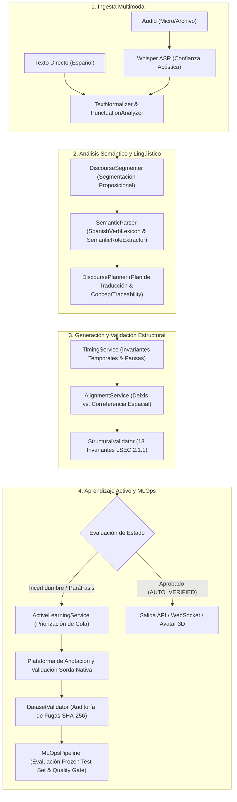

# LSEC Translator Architecture 2.2

> Sistema Híbrido de Transcripción Inteligente, Representación Semántica, Generación de Glosas LSEC, Plataforma de Anotación Lingüística y Pipeline MLOps para la Lengua de Señas Ecuatoriana (LSEC).

---

## ⚠️ Declaración Ético-Metodológica y Advertencia Lingüística

> [!IMPORTANT]
> 1. La Lengua de Señas Ecuatoriana (LSEC) es una lengua natural con gramática visoespacial propia; **no es una codificación palabra por palabra del español**.
> 2. Las oraciones en LSEC no siguen rígidamente un orden universal SOV; su estructura depende de factores discursivos, tópicos, contrastes, clasificadores y operaciones espaciales.
> 3. Las reglas y transformaciones computacionales implementadas **no constituyen una gramática oficial definitiva**.
> 4. Todas las salidas automáticas de este sistema son **propuestas computacionales asistidas** que requieren **validación obligatoria por personas sordas usuarias competentes o nativas de LSEC**.
> 5. Las mayúsculas en las glosas no demuestran la existencia de una seña equivalente en el lexicón natural.
> 6. **Protección contra contaminación:** Ninguna propuesta automática (`MACHINE_PROPOSED`) o dato sin consentimiento explícito (`NO_CONSENT`) puede ingresar a las particiones de entrenamiento (*Ground Truth*).

---

## 🏗️ Arquitectura Integral del Pipeline LSEC (Fases 0 a 12)



---

## 📁 Estructura del Proyecto

```
lsec_translator_prototype/
├── app/
│   ├── main.py                          # FastAPI + Lifespan + CORS + Routers
│   ├── config.py                        # Configuración y variables de entorno
│   ├── api/
│   │   ├── endpoints.py                 # REST (/translate, /transcribe, /pipeline)
│   │   ├── annotation_endpoints.py      # REST (/dataset/manifest, /annotations/submit, /mlops/benchmark)
│   │   └── websocket.py                 # Streaming bidireccional (/ws/pipeline)
│   ├── core/
│   │   ├── schemas.py                   # Modelos Pydantic v2 (GlossOutput, TranslationPlan, etc.)
│   │   └── dataset_schemas.py           # Esquemas del Corpus (LSECDatasetItem, SignBoundary, AuditLog)
│   ├── services/
│   │   ├── asr_service.py               # WhisperASRService
│   │   ├── text_normalizer.py           # PunctuationAnalyzer & TextNormalizer
│   │   ├── discourse_segmenter.py       # DiscourseSegmenter
│   │   ├── semantic_parser.py           # SpanishVerbLexicon & SemanticRoleExtractor
│   │   ├── discourse_planner.py         # DiscoursePlanner & ConceptTraceability
│   │   ├── alignment_service.py         # SourceAlignmentService (Deixis vs Correferencia)
│   │   ├── timing_service.py            # TimingService & TimeBudget
│   │   ├── validator.py                 # StructuralValidator (13 Invariantes LSEC)
│   │   ├── active_learning_service.py   # ActiveLearningService (Muestreo por Incertidumbre)
│   │   ├── dataset_validator.py         # DatasetValidator (Auditoría de Fugas)
│   │   ├── mlops_pipeline.py            # MLOpsPipeline (Evaluación Frozen Test)
│   │   ├── nlp_service.py               # LSECTranslatorService (Orquestador)
│   │   ├── vision_service.py            # SpatialGestureService (MediaPipe)
│   │   └── firebase_service.py          # FirebaseService
│   └── tests/
│       ├── test_lsec_211_core_fixes.py  # 48 pruebas de las 13 invariantes y 7 casos mínimos
│       ├── test_dataset_schemas_and_validation.py # Pruebas del esquema de datos y control de fugas
│       ├── test_active_learning_and_mlops.py      # Pruebas de aprendizaje activo y compuerta MLOps
│       ├── test_annotation_endpoints.py           # Pruebas de integración de la API REST de anotación
│       └── test_pipeline.py             # Pruebas de integración general del pipeline
├── data/
│   ├── lexicon_lsec.json                # Lexicón normalizado con lemas y paradigmas verbales
│   ├── guidelines/
│   │   └── annotation_guide_lsec_v1.md  # Guía Oficial de Anotación Lingüística LSEC v1.0 (30 Categorías)
│   └── corpus/
│       └── pilot_corpus_lsec.json       # Corpus piloto validado y particionado sin fugas
├── requirements.txt
└── README.md
```

---

## 📡 Endpoints de la API REST

### 1. Traducción Español → LSEC
- **Ruta:** `POST /api/v1/translate`
- **Body:** `{"text": "¿Tú comes manzana?"}`
- **Parámetros:** `mode=detailed|legacy|debug`, `budget=compact|medium|expanded`.

### 2. Manifiesto del Dataset y Auditoría de Fugas
- **Ruta:** `GET /api/v1/dataset/manifest`
- **Descripción:** Retorna la distribución de ejemplos por partición (*Train/Val/Test/Frozen*), variantes regionales y el reporte de control de fugas SHA-256.

### 3. Envío de Anotaciones y Revisiones Humanas
- **Ruta:** `POST /api/v1/annotations/submit`
- **Descripción:** Registra la validación o modificación de un ejemplo con auditoría append-only sin sobrescritura destructiva.

### 4. Cola Priorizada de Aprendizaje Activo
- **Ruta:** `GET /api/v1/annotations/queue?top_k=20`
- **Descripción:** Entrega los ejemplos con mayor incertidumbre o inconsistencias estructurales para revisión sorda prioritaria.

### 5. Evaluación MLOps contra Frozen Test Set
- **Ruta:** `POST /api/v1/mlops/benchmark`
- **Descripción:** Ejecuta la compuerta de evaluación automatizada (Exact Match, F1, Distancia de Edición, Concept Recall) y emite el dictamen `PASS` / `FAIL`.

---

## 🧪 Ejecución de Pruebas Automatizadas

```bash
# Activar entorno virtual
venv\Scripts\activate

# Ejecutar la suite completa de 180 pruebas automatizadas
pytest -v
```

**Resultado actual:** **180 / 180 pruebas aprobadas (100% de éxito, 0 fallos, 0 regresiones).**

---

## 📜 Guía de Anotación Lingüística LSEC v1.0

La especificación formal de anotación se encuentra en [`data/guidelines/annotation_guide_lsec_v1.md`](file:///c:/Users/brana/Desktop/TIC%20Software/lsec_translator_prototype/data/guidelines/annotation_guide_lsec_v1.md) y cubre 30 categorías lingüísticas:
1. Glosas canónicas en mayúsculas.
2. Tipografía y guiones de compuestos/deletreo (`U-P-E-C`, `SOLAMENTE-NO`).
3. Pronombres personales (`PRO1`, `PRO2`, `PRO3`).
4. Deixis vs. Correferencia anafórica con locus.
5. Sujetos implícitos (*pro-drop*).
6. Predicados y lemas verbales protegidos.
7. Roles semánticos nucleares (`AGENT`, `PATIENT`, `THEME`, `LOCATION`, etc.).
8. Negación manual y gestual (*headshake*).
9. Preguntas sí/no (`pregunta_sn` con cejas elevadas).
10. Preguntas abiertas (`pregunta_qu` con ceño fruncido).
11. Línea temporal y marcadores deícticos temporales.
12. Aspecto verbal (durativo, reiterativo, completivo).
13. Pluralidad, cuantificadores y numerales.
14. Relaciones de posesión.
15. Clasificadores (`CL:`).
16. Verbos direccionales y de concordancia.
17. Asignación de loci espaciales.
18. Operaciones de indexación espacial.
19. Componentes no manuales (CNM).
20. Expresiones faciales gramaticales.
21. Movimientos de cabeza.
22. Mirada (*eye gaze*).
23. Cambio de rol (*role shift*).
24. Segmentación temporal milimétrica.
25. Variantes regionales (Sierra vs. Costa).
26. Alternativas léxicas concurrentes.
27. Desambiguación contextual de homónimos.
28. Nombres propios y señas de identidad.
29. Préstamos lingüísticos y dactilología.
30. Protocolo de resolución de desacuerdos inter-anotadores.
