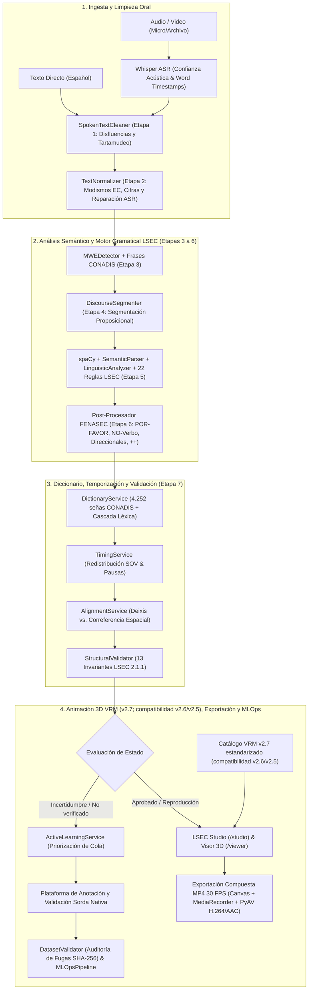

# LSEC Translator 2.7.0 — Arquitectura y Pipeline Cinemático VRM

> Sistema híbrido 100 % offline de transcripción inteligente (ASR), motor lingüístico de 7 etapas (Español → glosas LSEC), animación 3D 1:1 en avatar VRM, estación audiovisual bilingüe (*LSEC Studio*), plataforma de anotación nativa y pipeline MLOps para la Lengua de Señas Ecuatoriana (LSEC).

## Matriz oficial de versiones

| Componente | Versión vigente | Alcance |
| :--- | :--- | :--- |
| Sistema integrado | **2.7.0** | Versión pública de esta distribución |
| API HTTP/WebSocket | **2.0.0** | Contrato de servicio `/api/v1` y `/ws/pipeline` |
| Motor lingüístico | **2.1.1** | Normalización, análisis discursivo, planificación y validación LSEC |
| Esquema de salida | **2.1** | Contrato `GlossOutput` y metadatos de traducción |
| Motor de gramática | **0.1.0** | Identificador del componente formal de reglas |
| Animaciones predeterminadas | **2.7 estandarizada** | Catálogo VRM preferido |
| Animaciones compatibles | **2.6 corregida**, **2.5 directa 1:1** | Versiones históricas seleccionables explícitamente |
| LSEC Studio | **2.1.1** | Interfaz audiovisual web |

La versión del sistema identifica la integración completa. Las versiones de API,
motor lingüístico, esquema y animación son independientes para conservar
compatibilidad y trazabilidad.

---

## ⚠️ Declaración Ético-Metodológica y Advertencia Lingüística

> [!IMPORTANT]
> 1. La Lengua de Señas Ecuatoriana (LSEC) es una lengua natural con gramática visoespacial propia; **no es una codificación palabra por palabra del español**.
> 2. Las oraciones en LSEC no siguen rígidamente un orden universal SOV; su estructura depende de factores discursivos, tópicos, contrastes, clasificadores y operaciones espaciales.
> 3. Las reglas y transformaciones computacionales implementadas **no constituyen una gramática oficial definitiva**.
> 4. Todas las salidas automáticas de este sistema son **propuestas computacionales asistidas** que requieren **validación obligatoria por personas sordas usuarias competentes o nativas de LSEC**.
> 5. Las mayúsculas en las glosas no demuestran la existencia de una seña equivalente en el lexicón natural.
> 6. **Protección contra contaminación:** Ninguna propuesta automática (`MACHINE_PROPOSED`) o dato sin consentimiento explícito (`NO_CONSENT`) puede ingresar a las particiones de entrenamiento (*Ground Truth*).

---

## 🛠️ Los 5 Pilares Tecnológicos del Ecosistema

| Pilar | Tecnologías Principales | Rol en el Sistema |
| :--- | :--- | :--- |
| **1. Backend Web & Persistencia** | `Python 3.10+`, `FastAPI`, `Uvicorn`, `Pydantic v2`, `pydantic-settings`, `SQLite3`, `HTTPX` | Servidor ASGI asíncrono (REST + WebSockets), validación estricta de contratos de datos y base de datos local 100 % offline con fallback en memoria. |
| **2. Reconocimiento de Voz (ASR) & Video** | `Faster-Whisper`, `CTranslate2` (`FP16`/`INT8`), `CUDA 12.x`, `PyAV (av)` + `libx264` + `AAC` | Transcripción acústica neuronal con marcas de tiempo por palabra y codificación determinista de video MP4 a **30.0 FPS constantes** (`/finalize-export-mp4`). |
| **3. Motor PLN Híbrido & Gramática LSEC** | `spaCy` (`es_core_news_md` / `sm`), 7 Etapas Lingüísticas, 22 Reglas LSEC, 4 Reglas FENASEC, Catálogo CONADIS (**4.252 señas**), 13 Invariantes | Limpieza de disfluencias, normalización ecuatoriana/quichuismos, MWEs, segmentación proposicional, análisis morfosintáctico, reordenamiento `TIEMPO + TÓPICO + SOV` y validación estructural. |
| **4. Visión 3D & Cinemática (`Diccionario LSEC` v2.7)** | `PyTorch`, `HaMeR`, `MANO (smplx)`, `DWPose` / `RTMW3D` (`rtmlib` + `onnxruntime-gpu`), `MediaPipe Face` (52 ARKit Blendshapes), `OpenCV`, `NumPy`, `SciPy` | Catálogo VRM estandarizado v2.7 como versión predeterminada, con compatibilidad v2.6 corregida y v2.5 directa 1:1. Incluye mejora de video, extracción 3D, retargeting, Stage C e IK analítica anti-penetración. |
| **5. Frontend NLE, Motor 3D WebGL & QA** | `Vanilla HTML5/CSS3/ES6+`, `Three.js`, `@pixiv/three-vrm`, `VRM 1.0 Humanoid` (54 huesos), `HTML5 Canvas 2D`, `MediaRecorder`, `Pytest`, `Playwright` | Estación audiovisual *LSEC Studio* (`/studio`), reproductor 3D autónomo (`/viewer`), línea de tiempo multipista a 60 FPS, intérprete 3D PiP y suite con **358+ pruebas automatizadas**. |

---

## 🚀 Inicio Rápido

```bash
# 1. Entorno virtual e instalación (Python 3.10+; probado con 3.11-3.13)
python -m venv venv
venv\Scripts\activate
pip install -r requirements.txt        # incluye el modelo spaCy es_core_news_sm

# 2. Configuración (opcional): copiar .env.example a .env y ajustar
copy .env.example .env

# 3. Iniciar el servidor (o doble clic en run_studio.bat)
uvicorn app.main:app --host 127.0.0.1 --port 8000
```

- **LSEC Studio** (estación audiovisual NLE + intérprete 3D PiP): <http://127.0.0.1:8000/studio>
- **Reproductor 3D Interactivo 1:1 (4.143 señas VRM):** <http://127.0.0.1:8000/viewer> (o `/reproductor`)
- **Configuración y calibración del avatar 3D:** <http://127.0.0.1:8000/avatarconfig>
- **Documentación interactiva de la API (OpenAPI 3.1):** <http://127.0.0.1:8000/docs>

**Variables de entorno principales** (`.env`):

| Variable | Valor por defecto | Descripción |
|---|---|---|
| `WHISPER_MODEL_SIZE` | `small` / `base` | Tamaño del modelo de faster-whisper (`tiny`, `base`, `small`, ...) |
| `WHISPER_DEVICE` / `WHISPER_COMPUTE_TYPE` | `cuda` / `float16` (`cpu` / `int8`) | Aceleración por GPU NVIDIA o ejecución en CPU |
| `WHISPER_MODEL_PATH` | `data/models/whisper` | Pesos locales de Whisper (modo 100 % offline) |
| `LSEC_DATABASE_PATH` | `data/lsec_database.sqlite` | Base SQLite local (logs de traducción y revisiones) |
| `LSEC_DICTIONARY_*` | ver sección del Diccionario | Catálogo CONADIS, marcado de no verificadas y frases |
| `LSEC_ANIMATIONS_V27_DIR` | autodetección en `../Diccionario LSEC/` | Directorio preferido de animaciones VRM estandarizadas v2.7 |
| `LSEC_ANIMATIONS_V26_DIR` / `LSEC_ANIMATIONS_DIR` | autodetección en `../Diccionario LSEC/` | Directorios compatibles de animaciones v2.6/v2.5 |
| `APP_HOST` / `APP_PORT` / `APP_DEBUG` | `0.0.0.0` / `8000` / `false` | Servidor (con `APP_DEBUG=true` se sirve `/media` con los videos de prueba) |

---

## 🏗️ Arquitectura Integral del Pipeline LSEC



---

## 📁 Estructura del Proyecto

```
lsec_translator_prototype/
├── app/
│   ├── main.py                              # FastAPI + Lifespan + CORS + Routers + archivos estáticos
│   ├── config.py                            # Configuración y variables de entorno (pydantic-settings)
│   ├── api/
│   │   ├── endpoints.py                     # REST (/health, /transcribe, /translate, /pipeline, /review/*)
│   │   ├── animation_direct_endpoints.py    # REST (/animations/*, /animations-direct/*, /finalize-export-mp4)
│   │   ├── annotation_endpoints.py          # REST (/dataset/*, /annotations/*, /mlops/benchmark)
│   │   ├── dictionary_endpoints.py          # REST (/dictionary/search, /{slug}, /stats)
│   │   └── websocket.py                     # Streaming bidireccional (/ws/pipeline)
│   ├── core/
│   │   ├── schemas.py                       # Modelos Pydantic v2 (GlossOutput, GlossItem, DictionarySignMetadata...)
│   │   ├── dataset_schemas.py               # Esquemas del Corpus (LSECDatasetItem, SignBoundary, AuditLog)
│   │   └── audio_reference.py               # Referencias acústicas temporales
│   ├── lsec_grammar/                        # Motor formal de 22 reglas gramaticales LSEC (RuleEngine)
│   ├── services/
│   │   ├── asr_service.py                   # WhisperASRService (faster-whisper, pesos locales)
│   │   ├── spoken_text_cleaner.py           # Etapa 1: Limpieza de muletillas y titubeos
│   │   ├── text_normalizer.py               # Etapa 2: Modismos ecuatorianos, quichuismos y reparación ASR
│   │   ├── mwe_detector.py                  # Etapa 3: Expresiones multipalabra
│   │   ├── discourse_segmenter.py           # Etapa 4: Segmentación proposicional
│   │   ├── semantic_parser.py               # Etapa 5A: SpanishVerbLexicon & SemanticRoleExtractor
│   │   ├── linguistic_analyzer.py           # Etapa 5A: Pro-drop, negación, tiempo/aspecto y preposiciones
│   │   ├── discourse_planner.py             # Etapa 5B: DiscoursePlanner & ConceptTraceability
│   │   ├── fenasec_rules.py                 # Etapa 6: Reglas FENASEC (cortesía, negación, direccionales, ++)
│   │   ├── dictionary_service.py            # Etapa 7: Diccionario Oficial CONADIS (4.252 señas) + cascada
│   │   ├── duplicate_resolver.py            # Resolución de glosas duplicadas
│   │   ├── metadata_linker.py               # Enlace de IDs proposición / glosa / locus
│   │   ├── alignment_service.py             # SourceAlignmentService (Deixis vs Correferencia)
│   │   ├── timing_service.py                # TimingService & Redistribución temporal SOV
│   │   ├── review_service.py                # Propagación de marcas de revisión
│   │   ├── validator.py                     # StructuralValidator (13 Invariantes LSEC)
│   │   ├── active_learning_service.py       # ActiveLearningService (Muestreo por Incertidumbre)
│   │   ├── dataset_validator.py             # DatasetValidator (Auditoría de Fugas SHA-256)
│   │   ├── mlops_pipeline.py                # MLOpsPipeline (Evaluación Frozen Test)
│   │   ├── nlp_service.py                   # LSECTranslatorService (Orquestador de las 7 etapas)
│   │   └── storage_service.py               # LocalStorageService (SQLite, 100% offline)
│   ├── static/                              # LSEC Studio (index.html), Visor 3D (viewer.html), avatarconfig.html, js/
│   └── tests/                               # Suite pytest (358 pruebas unitarias/integración + E2E Playwright)
├── data/                                    # Lexicones, guía de anotación v1.0, corpus piloto y base SQLite
├── docs/                                    # Documentación técnica detallada del backend y frontend
├── run_studio.bat                           # Lanzador portable (Windows)
├── requirements.txt
└── README.md
```

---

## 📡 Endpoints de la API REST y WebSockets

Todos bajo el prefijo `/api/v1` (más el alias `/api/animations-direct` para el motor 3D).

1. **Estado del sistema:** `GET /api/v1/health` — estado de `asr`, `nlp` y `storage` (SQLite local).
2. **Transcripción y Pipeline completo:** `POST /api/v1/transcribe` y `POST /api/v1/pipeline` (mp4, mov, avi, mkv, webm, wav, mp3, ogg, flac).
3. **Traducción Español → LSEC:** `POST /api/v1/translate` (`mode=detailed|legacy|debug`, `budget=compact|medium|expanded`).
4. **Animaciones VRM estandarizadas v2.7 (compatibilidad v2.6/v2.5) y Exportación MP4:**
   - `GET /api/v1/animations/list?q=&limit=` y `GET /api/v1/animations/stats`: Catálogo de 4.143 señas VRM ordenadas según `catalogo_lsec.json`.
   - `GET /api/v1/animations/resolve/{gloss}` y `POST /api/v1/animations/resolve`: Resolución de glosas a animaciones 3D.
   - `GET /api/v1/animations/{sign_name}`, `/{sign_name}/qa`, `/{sign_name}/info`, `/{sign_name}/video`, `/{sign_name}/illustration`: Datos cinemáticos, video MP4 Ultra HD e ilustración oficial.
   - `POST /api/v1/animations/finalize-export-mp4`: Remuxeado/codificación determinista a **MP4 (`H.264 + AAC` a 30.0 FPS constantes)** con `PyAV`.
5. **Diccionario Oficial CONADIS:** `GET /api/v1/dictionary/search`, `GET /api/v1/dictionary/{slug}`, `GET /api/v1/dictionary/stats`.
6. **Revisión, Anotaciones y MLOps:** `POST /api/v1/review/validate`, `GET /api/v1/review/history`, `GET /api/v1/dataset/manifest`, `POST /api/v1/annotations/submit`, `GET /api/v1/annotations/queue`, `POST /api/v1/mlops/benchmark`.
7. **Tiempo real e interfaces web:** `WS /ws/pipeline`, `GET /studio`, `GET /viewer` (`/reproductor`), `GET /avatarconfig`.

---

## 📖 Documentación Técnica Adicional del Repositorio

- **[Documentación General del Sistema y Tecnologías (v2.6)](file:///c:/Users/brana/Desktop/TIC%20Software/DOCUMENTACION_GENERAL_SISTEMA_LSEC_V2.6.md):** Documento maestro consolidado con los 5 pilares tecnológicos.
- **[Informe de Reglas Lingüísticas LSEC (7 Etapas)](file:///c:/Users/brana/Desktop/TIC%20Software/Informe_Reglas_Linguisticas_LSEC.md):** Desglose completo de las reglas de conversión Español Hablado → Glosas LSEC.
- **[Detalle Técnico del Uso de `spaCy`](file:///c:/Users/brana/Desktop/TIC%20Software/Detalle_Uso_spaCy_LSEC.md):** Rol morfosintáctico y de dependencias de `spaCy` en el motor híbrido.
- **[Descripción de Tecnologías y Funciones del Sistema](file:///c:/Users/brana/Desktop/TIC%20Software/lsec_translator_prototype/docs/DESCRIPCION_TECNOLOGIAS_Y_FUNCIONES_DEL_SISTEMA.md)** y **[Documentación Backend, Pipeline 3D y Frontend](file:///c:/Users/brana/Desktop/TIC%20Software/lsec_translator_prototype/docs/DOCUMENTACION_SISTEMA_BACKEND_FRONTEND.md)**.

---

## 🧪 Ejecución de Pruebas Automatizadas

```bash
# Activar entorno virtual
venv\Scripts\activate

# Suite completa sin las pruebas E2E del navegador (no requieren servidor)
pytest -q --deselect app/tests/test_lsec_avatar_vrm_validation.py -k "not playwright"
```

**Resultado actual:** **358 pruebas aprobadas, 0 fallos**.
