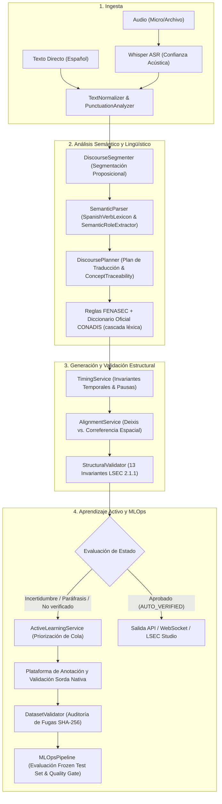

# LSEC Translator Architecture 2.2

> Sistema Híbrido de Transcripción Inteligente, Representación Semántica, Generación de Glosas LSEC, Plataforma de Anotación Lingüística y Pipeline MLOps para la Lengua de Señas Ecuatoriana (LSEC).

---

## ⚠️ Declaración Ético-Metodológica y Advertencia Lingüística

> [!IMPORTANT]
> 1. La Lengua de Señas Ecuatoriana (LSEC) es una lengua natural con gramática visoespacial propia; **no es una codificación palabra por palabra del español**.
> 2. Las oraciones en LSEC no siguen rígidamente un orden universal SOV; su estructura depende de factores discursivos, tópicos, contrastes, clasificadores y operaciones espaciales.
> 3. Las reglas y transformaciones computacionales implementadas **no constituyen una gramática oficial definitiva**.
> 4. Todas las salidas automáticas de este sistema son **propuestas computacionales asistidas** que requieren **validación obligatoria por personas sordas usuarias competentes o nativas de LSEC**.
> 5. Las mayúsculas en las glosas no demuestran la existencia de una seña equivalente en el lexicón natural.
> 6. **Protección contra contaminación:** Ninguna propuesta automática (`MACHINE_PROPOSED`) o dato sin consentimiento explícito (`NO_CONSENT`) puede ingresar a las particiones de entrenamiento (*Ground Truth*).

---

## 🚀 Inicio Rápido

```bash
# 1. Entorno virtual e instalación (Python 3.10+; probado con 3.13)
python -m venv venv
venv\Scripts\activate
pip install -r requirements.txt        # incluye el modelo spaCy es_core_news_sm

# 2. Configuración (opcional): copiar .env.example a .env y ajustar
copy .env.example .env

# 3. Iniciar el servidor (o doble clic en run_studio.bat)
uvicorn app.main:app --host 127.0.0.1 --port 8000
```

- **LSEC Studio** (editor audiovisual): <http://127.0.0.1:8000/studio>
- **Configuración del avatar 3D:** <http://127.0.0.1:8000/avatarconfig>
- **Documentación interactiva de la API:** <http://127.0.0.1:8000/docs>

**Variables de entorno principales** (`.env`):

| Variable | Valor por defecto | Descripción |
|---|---|---|
| `WHISPER_MODEL_SIZE` | `base` | Tamaño del modelo de faster-whisper (`tiny`, `base`, `small`, ...) |
| `WHISPER_DEVICE` / `WHISPER_COMPUTE_TYPE` | `cpu` / `int8` | Usar `cuda` / `float16` con GPU NVIDIA |
| `WHISPER_MODEL_PATH` | `data/models/whisper` | Pesos locales de Whisper (modo offline) |
| `LSEC_DATABASE_PATH` | `data/lsec_database.sqlite` | Base SQLite local (logs de traducción y revisiones) |
| `LSEC_DICTIONARY_*` | ver sección del Diccionario | Catálogo CONADIS, marcado de no verificadas y frases |
| `APP_HOST` / `APP_PORT` / `APP_DEBUG` | `0.0.0.0` / `8000` / `false` | Servidor (con `APP_DEBUG=true` se sirve `/media` con los videos de prueba) |

---

## 🏗️ Arquitectura Integral del Pipeline LSEC



> **Alcance:** este proyecto genera y valida glosas LSEC y ofrece la estación de trabajo audiovisual. La **generación de animaciones de señas para el avatar** se desarrolla en un proyecto aparte; aquí solo se conserva el visor 3D (Three.js + VRM) que reproduce los clips JSON ubicados en `app/static/assets/clips/`.

---

## 📁 Estructura del Proyecto

```
lsec_translator_prototype/
├── app/
│   ├── main.py                          # FastAPI + Lifespan + CORS + Routers + archivos estáticos
│   ├── config.py                        # Configuración y variables de entorno (pydantic-settings)
│   ├── api/
│   │   ├── endpoints.py                 # REST (/health, /transcribe, /translate, /pipeline, /review/*)
│   │   ├── annotation_endpoints.py      # REST (/dataset/*, /annotations/*, /mlops/benchmark)
│   │   ├── dictionary_endpoints.py      # REST (/dictionary/search, /{slug}, /stats)
│   │   └── websocket.py                 # Streaming bidireccional (/ws/pipeline)
│   ├── core/
│   │   ├── schemas.py                   # Modelos Pydantic v2 (GlossOutput, GlossItem, DictionarySignMetadata...)
│   │   ├── dataset_schemas.py           # Esquemas del Corpus (LSECDatasetItem, SignBoundary, AuditLog)
│   │   └── audio_reference.py           # Referencias acústicas temporales
│   ├── lsec_grammar/                    # Motor de reglas: registro, RuleEngine, ConflictResolver, confianza
│   ├── services/
│   │   ├── asr_service.py               # WhisperASRService (faster-whisper, pesos locales)
│   │   ├── spoken_text_cleaner.py       # Limpieza de muletillas y titubeos
│   │   ├── text_normalizer.py           # PunctuationAnalyzer & TextNormalizer
│   │   ├── mwe_detector.py              # Expresiones multipalabra
│   │   ├── discourse_segmenter.py       # DiscourseSegmenter
│   │   ├── semantic_parser.py           # SpanishVerbLexicon & SemanticRoleExtractor
│   │   ├── linguistic_analyzer.py       # Análisis lingüístico auxiliar
│   │   ├── discourse_planner.py         # DiscoursePlanner & ConceptTraceability
│   │   ├── fenasec_rules.py             # Reglas FENASEC (cortesía, negación, direccionales, intensidad)
│   │   ├── dictionary_service.py        # Diccionario Oficial CONADIS (4.252 señas) + cascada léxica
│   │   ├── duplicate_resolver.py        # Resolución de glosas duplicadas
│   │   ├── metadata_linker.py           # Enlace de IDs proposición / glosa / locus
│   │   ├── alignment_service.py         # SourceAlignmentService (Deixis vs Correferencia)
│   │   ├── timing_service.py            # TimingService & TimeBudget
│   │   ├── review_service.py            # Propagación de marcas de revisión
│   │   ├── validator.py                 # StructuralValidator (13 Invariantes LSEC)
│   │   ├── active_learning_service.py   # ActiveLearningService (Muestreo por Incertidumbre)
│   │   ├── dataset_validator.py         # DatasetValidator (Auditoría de Fugas)
│   │   ├── mlops_pipeline.py            # MLOpsPipeline (Evaluación Frozen Test)
│   │   ├── nlp_service.py               # LSECTranslatorService (Orquestador)
│   │   └── storage_service.py           # LocalStorageService (SQLite, 100% offline)
│   ├── static/                          # LSEC Studio: index.html, avatarconfig.html, js/, css/, assets/clips/
│   └── tests/                           # Suite pytest (unitarias, integración y aceptación)
├── data/
│   ├── lexicon_lsec.json                # Lexicón normalizado con lemas y paradigmas verbales
│   ├── lexicon_queiremas_3d.json        # Queiremas para el visor 3D
│   ├── guidelines/                      # Guía de anotación LSEC v1.0 y gramática visual
│   ├── corpus/pilot_corpus_lsec.json    # Corpus piloto validado y particionado sin fugas
│   └── models/whisper/                  # (opcional) pesos locales de faster-whisper
├── scripts/                             # Utilidades de Blender para exportar/cargar clips de señas
├── docs/                                # Documentación técnica del sistema
├── run_studio.bat                       # Lanzador portable (Windows)
├── requirements.txt
└── README.md
```

> El diccionario CONADIS vive fuera del paquete (`../Diccionario LSEC/catalogo_lsec.json`) y el modelo del avatar en `../Avatar/`; ambos deben incluirse al distribuir.

---

## 📡 Endpoints de la API REST

Todos bajo el prefijo `/api/v1` salvo indicación.

### 1. Estado del sistema
- **Ruta:** `GET /api/v1/health` — estado de los servicios `asr`, `nlp` y `storage` (SQLite local).

### 2. Transcripción y Pipeline completo
- **Rutas:** `POST /api/v1/transcribe` (audio/video → texto con marcas de tiempo por palabra) y `POST /api/v1/pipeline` (audio → ASR → glosas LSEC).
- **Formatos:** mp4, mov, avi, mkv, webm, wav, mp3, ogg, flac (se valida la cabecera del archivo).

### 3. Traducción Español → LSEC
- **Ruta:** `POST /api/v1/translate`
- **Body:** `{"text": "¿Tú comes manzana?"}`
- **Parámetros:** `mode=detailed|legacy|debug`, `budget=compact|medium|expanded`.

### 4. Revisión lingüística (persistente en SQLite)
- **Rutas:** `POST /api/v1/review/validate` y `GET /api/v1/review/history`.

### 5. Manifiesto del Dataset y Auditoría de Fugas
- **Rutas:** `GET /api/v1/dataset/manifest`, `POST /api/v1/dataset/validate-item`, `GET /api/v1/dataset/export`.
- **Descripción:** distribución por partición (*Train/Val/Test/Frozen*), variantes regionales, control de fugas SHA-256 y exportación solo de ejemplos validados por personas nativas con consentimiento.

### 6. Envío de Anotaciones y Revisiones Humanas
- **Ruta:** `POST /api/v1/annotations/submit`
- **Descripción:** registra la validación o modificación de un ejemplo con auditoría append-only sin sobrescritura destructiva.

### 7. Cola Priorizada de Aprendizaje Activo
- **Ruta:** `GET /api/v1/annotations/queue?top_k=20`
- **Descripción:** entrega los ejemplos con mayor incertidumbre, inconsistencias estructurales o glosas no verificadas en el diccionario.

### 8. Evaluación MLOps contra Frozen Test Set
- **Ruta:** `POST /api/v1/mlops/benchmark`
- **Descripción:** compuerta de evaluación automatizada (Exact Match, F1, Distancia de Edición, Concept Recall) con dictamen `PASS` / `FAIL`.

### 9. Diccionario Oficial
- **Rutas:** `GET /api/v1/dictionary/search`, `GET /api/v1/dictionary/{slug}`, `GET /api/v1/dictionary/stats` (detalle en la sección siguiente).

### 10. Tiempo real e interfaces web
- **WebSocket:** `WS /ws/pipeline`.
- **Interfaces:** `GET /studio`, `GET /avatarconfig`, `GET /api/info`.

---

## 📖 Diccionario Oficial LSEC "Gabriel Román" (CONADIS)

El catálogo `../Diccionario LSEC/catalogo_lsec.json` (4.252 señas) es la fuente de verdad léxica de la generación de glosas ([`app/services/dictionary_service.py`](file:///c:/Users/brana/Desktop/TIC%20Software/lsec_translator_prototype/app/services/dictionary_service.py)).

**Indexación.** Cada título se expande: `Abuelo(a)` → *abuelo, abuela*; `A diario, Cotidiano(a)` → *a diario* · *cotidiano, cotidiana*; `Encontrar / Hallar`; siglas con su expansión; se descartan calificadores como `(1)` o `(Costa)`. La búsqueda ignora tildes (conserva la ñ), guiones y plurales simples; los verbos se resuelven por lema.

**Cascada por glosa** (`GlossItem.dictionary_metadata`):

| Estado | Significado | ¿Revisión nativa? |
|---|---|---|
| `VERIFICADO_CONADIS` | Existe en el diccionario oficial (ficha con video, ilustración, configuración manual, sinónimos) | No |
| `DACTILOLOGIA` / `EXENTO_GRAMATICAL` | Deletreo, `PRO1`, `CL:`, marcadores | No |
| `LEXICON_LOCAL` | Curada en `lexicon_lsec.json` (MWE, institucional, paráfrasis) | No |
| `PARAFRASIS_REVISION` | Paráfrasis ya marcada para revisión | Sí (ya existente) |
| `NO_VERIFICADO` | Léxica y ausente del diccionario; se agregan sugerencias cercanas (`perrito` → `PERRO`) | **Sí** (`UNVERIFIED_LEXICAL_SIGN` + cola de aprendizaje activo) |

> Figurar en CONADIS **no** sustituye la validación por personas sordas usuarias nativas de LSEC.

**Configuración** (`.env`): `LSEC_DICTIONARY_CATALOG_PATH` (por defecto `data/` → `../Diccionario LSEC/`), `LSEC_DICTIONARY_ENABLED=true`, `LSEC_DICTIONARY_FLAG_UNVERIFIED=true` (si es `false` el estado es solo informativo), `LSEC_DICTIONARY_PHRASE_MATCHING=true`.

**Detección de frases:** las entradas de varias palabras (p. ej. «a diario», «buenos días») se emiten como una sola glosa oficial. Se excluyen: coincidencias solo por lema con verbos conjugados, interrogativos, y tokens gobernados por reglas FENASEC (negación, «por favor», intensificadores).

**Índice pre-calculado (opcional):** `python -m app.services.dictionary_service --build-index` genera `data/lsec_dictionary_index.json` (se invalida solo si cambia el catálogo).

**Endpoints:** `GET /api/v1/dictionary/search?q=&limit=` · `GET /api/v1/dictionary/{slug}` · `GET /api/v1/dictionary/stats`.

---

## 🧪 Ejecución de Pruebas Automatizadas

```bash
# Activar entorno virtual
venv\Scripts\activate

# Suite completa sin las pruebas E2E del navegador (no requieren servidor)
pytest -q --deselect app/tests/test_lsec_avatar_vrm_validation.py -k "not playwright"
```

**Resultado actual:** **358 pruebas aprobadas, 0 fallos** (≈ 70 s).

Las pruebas E2E con Playwright (`test_playwright_e2e.py`, `test_avatar_3d_playwright.py`, `test_lsec_avatar_vrm_validation.py`) necesitan el servidor activo en `http://127.0.0.1:8000` y Playwright instalado:

```bash
pip install playwright && playwright install chromium
uvicorn app.main:app --port 8000     # en otra terminal
pytest app/tests/test_playwright_e2e.py
```

---

## 💿 Distribución Portable y Offline (CD / USB)

La aplicación no depende de Internet ni de servicios en la nube:

- **Persistencia:** SQLite local (`data/lsec_database.sqlite`, variable `LSEC_DATABASE_PATH`) para logs de traducción y revisiones lingüísticas. Si el medio es de solo lectura (p. ej. un CD) opera en memoria sin fallar; para conservar datos, copie la carpeta a un disco escribible o use una ruta distinta.
- **ASR sin descargas:** coloque los pesos de faster-whisper en `data/models/whisper/<tamaño>/` (p. ej. `.../small/model.bin`), o en `data/models/whisper/` directamente. `WHISPER_MODEL_PATH` cambia la carpeta. Sin pesos locales, faster-whisper intenta descargarlos la primera vez.
- **Dependencias sin Internet:** `pip download -r requirements.txt -d wheels` (con conexión) y luego `pip install --no-index --find-links wheels -r requirements.txt`. El modelo spaCy `es_core_news_sm` se instala desde su `.whl`.
- **Lanzador:** [`run_studio.bat`](file:///c:/Users/brana/Desktop/TIC%20Software/lsec_translator_prototype/run_studio.bat) usa `venv\` (o `python\`) junto al archivo, fuerza modo offline y abre `http://127.0.0.1:8000/studio`.
- **Avatar 3D:** el modelo VRM se sirve desde la carpeta `Avatar/` (junto al proyecto o en su carpeta padre); inclúyala en la distribución. Los clips de animación se colocan en `app/static/assets/clips/` (la generación de señas vive en un proyecto aparte).
- **Diccionario:** incluya `Diccionario LSEC/catalogo_lsec.json` junto al proyecto, o indique su ubicación con `LSEC_DICTIONARY_CATALOG_PATH`.
- **Sin servicios externos:** el sistema no usa nube, bases remotas, visión artificial ni modelos de lenguaje externos; el traductor es 100% basado en reglas.

---

## 📜 Guía de Anotación Lingüística LSEC v1.0

La especificación formal de anotación se encuentra en [`data/guidelines/annotation_guide_lsec_v1.md`](file:///c:/Users/brana/Desktop/TIC%20Software/lsec_translator_prototype/data/guidelines/annotation_guide_lsec_v1.md) y cubre 30 categorías lingüísticas:
1. Glosas canónicas en mayúsculas.
2. Tipografía y guiones de compuestos/deletreo (`U-P-E-C`, `SOLAMENTE-NO`).
3. Pronombres personales (`PRO1`, `PRO2`, `PRO3`).
4. Deixis vs. Correferencia anafórica con locus.
5. Sujetos implícitos (*pro-drop*).
6. Predicados y lemas verbales protegidos.
7. Roles semánticos nucleares (`AGENT`, `PATIENT`, `THEME`, `LOCATION`, etc.).
8. Negación manual y gestual (*headshake*).
9. Preguntas sí/no (`pregunta_sn` con cejas elevadas).
10. Preguntas abiertas (`pregunta_qu` con ceño fruncido).
11. Línea temporal y marcadores deícticos temporales.
12. Aspecto verbal (durativo, reiterativo, completivo).
13. Pluralidad, cuantificadores y numerales.
14. Relaciones de posesión.
15. Clasificadores (`CL:`).
16. Verbos direccionales y de concordancia.
17. Asignación de loci espaciales.
18. Operaciones de indexación espacial.
19. Componentes no manuales (CNM).
20. Expresiones faciales gramaticales.
21. Movimientos de cabeza.
22. Mirada (*eye gaze*).
23. Cambio de rol (*role shift*).
24. Segmentación temporal milimétrica.
25. Variantes regionales (Sierra vs. Costa).
26. Alternativas léxicas concurrentes.
27. Desambiguación contextual de homónimos.
28. Nombres propios y señas de identidad.
29. Préstamos lingüísticos y dactilología.
30. Protocolo de resolución de desacuerdos inter-anotadores.
