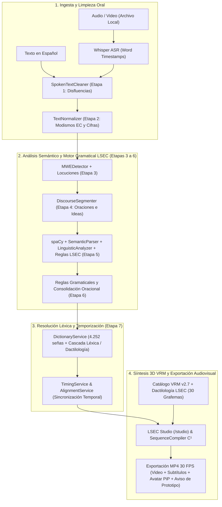

# LSEC Studio — Prototipo Académico de Traducción Asistida y Animación 3D en LSEC

> **Prototipo académico universitario sin fines de lucro (`v1.0-prototipo-academico`)** para la transcripción automática de voz (ASR), traducción heurística de español a glosas de la Lengua de Señas Ecuatoriana (LSEC) y síntesis cinemática 3D en avatar VRM.
>
> Este software se presenta exclusivamente como un **acercamiento tecnológico y apoyo de accesibilidad** para fines educativos en el ámbito universitario; **no sustituye a un intérprete humano de LSEC**.

---

## 📌 Naturaleza y Alcance del Proyecto Académico

1. **Acercamiento Computacional (Primera Versión / Prototipo):** La traducción automática del español hacia una lengua visoespacial natural como la LSEC conlleva desafíos lingüísticos profundos. Este sistema constituye un prototipo académico y primera versión experimental.
2. **Apoyo de Accesibilidad:** El sistema funciona como una herramienta de apoyo a la accesibilidad audiovisual y **no reemplaza la labor de un intérprete humano profesional de LSEC**.
3. **Proyecto Académico Independiente (Sin Fines de Lucro):** Desarrollado con propósitos estrictamente educativos y de investigación universitaria. No cuenta con aval oficial ni patrocinio institucional de FENASEC ni de CONADIS, cuyos materiales lexicográficos públicos se emplean únicamente como fuente académica de referencia (véase [`NOTICE.md`](NOTICE.md)).
4. **Leyenda en Videos Exportados:** Todo video MP4 generado por el módulo de exportación incorpora en la esquina inferior izquierda el aviso en letra pequeña:
   > *«Propuesta computacional pendiente de validación por personas sordas nativas o profesional intérprete de LSEC»*

---

## 🛠️ Arquitectura y Pilares Tecnológicos

| Pilar | Tecnologías Principales | Rol en el Prototipo |
| :--- | :--- | :--- |
| **1. Backend Web & Persistencia** | `Python 3.10+`, `FastAPI`, `Uvicorn`, `Pydantic v2`, `pydantic-settings`, `SQLite3` | Servidor ASGI asíncrono (REST + WebSockets), validación técnica de esquemas de entrada/salida y bitácora local 100 % offline. |
| **2. Reconocimiento de Voz (ASR) & Video** | `Faster-Whisper`, `CTranslate2` (`FP16`/`INT8`), `PyAV (av)` + `libx264` + `AAC` | Transcripción acústica con marcas de tiempo por palabra y codificación determinista de video MP4 a **30.0 FPS constantes** (`/finalize-export-mp4`). |
| **3. Motor PLN Híbrido & Gramática LSEC** | `spaCy` (`es_core_news_sm`), 7 Etapas Lingüísticas, Reglas Gramaticales LSEC, Optimizador Oracional (`DiscourseGroupOptimizer`), Lexicón LSEC (**4.252 señas**) | Limpieza de disfluencias, normalización ecuatoriana, detección de locuciones (MWEs), segmentación proposicional y oracional, lematización y reordenamiento `TIEMPO + TÓPICO + SOV`. |
| **4. Visión 3D & Cinemática (`Diccionario LSEC` v2.7)** | `HaMeR`, `MANO`, `DWPose` / `RTMW3D`, `MediaPipe Face` (52 ARKit Blendshapes), `NumPy`, `SciPy` | Catálogo de animaciones VRM v2.7 estandarizadas con configuración manual (I–IX), unificación de lateralidad diestra (`dominantHand: 'right'`) y despeje torácico analítico. |
| **5. Frontend NLE & Motor 3D WebGL** | `Vanilla HTML5/CSS3/ES6+`, `Three.js`, `@pixiv/three-vrm`, `VRM 1.0 Humanoid` (54 huesos), `HTML5 Canvas 2D`, `Pytest`, `Playwright` | Estación audiovisual *LSEC Studio* (`/studio`), reproductor 3D 1:1 (`/viewer`), calibrador (`/avatarconfig`), compilador de coarticulación $\mathcal{C}^1$ (`SequenceCompiler`) y exportador compuesto con aviso de prototipo. |

---

## 🚀 Guía de Instalación y Ejecución (Clonado desde GitHub)

### 1. Requisitos Previos
- **Sistema Operativo:** Windows 10/11 (64 bits) o Linux/macOS compatible con Python 3.10+.
- **Python:** `3.10`, `3.11`, `3.12` o `3.13`.
- **Navegador Web:** Chrome, Edge o Chromium con soporte WebGL 2.0.

### 2. Instalación Paso a Paso

```powershell
# 1. Clonar el repositorio y entrar en su directorio
git clone https://github.com/BrandonVol3/lsec-translator.git
cd lsec-translator

# 2. Crear y activar el entorno virtual de Python
python -m venv venv
.\venv\Scripts\activate

# 3. Instalar dependencias (incluye FastAPI, Faster-Whisper, spaCy, PyAV y modelo es_core_news_sm)
pip install -r requirements.txt

# 4. (Opcional) Copiar archivo de configuración por defecto
copy .env.example .env

# 5. Iniciar el servidor local (o ejecutar run_studio.bat en Windows)
python -m uvicorn app.main:app --host 127.0.0.1 --port 8000
```

> **Nota sobre recursos multimedia externos (`Avatar/` y `Diccionario LSEC/`):**  
> Por su tamaño (>30 GB), el modelo humanoide `Avatar/LSEC-Interpreter-Female.vrm` y el catálogo de animaciones `Diccionario LSEC/senas_vrm_standardized_v2.7/` no se almacenan dentro de Git. Colócalos en la carpeta superior (`../Avatar/` y `../Diccionario LSEC/`) o configura sus rutas en `.env` según se detalla en [`docs/REPOSITORIO_Y_ASSETS.md`](docs/REPOSITORIO_Y_ASSETS.md).

### 3. Rutas Principales en el Navegador
- **LSEC Studio (Flujo Guiado de 4 Pasos):** <http://127.0.0.1:8000/studio>
- **Visor 3D Interactivo 1:1:** <http://127.0.0.1:8000/viewer>
- **Calibrador del Avatar VRM:** <http://127.0.0.1:8000/avatarconfig>
- **Estado de Salud de la API:** <http://127.0.0.1:8000/api/v1/health>
- **Documentación OpenAPI (Swagger):** <http://127.0.0.1:8000/docs>

---

## 🏗️ Flujo de Procesamiento del Prototipo



---

## 📁 Estructura Modular del Código (`<= 800` líneas por archivo — ISO/IEC 25010)

```
lsec_translator_prototype/
├── app/
│   ├── main.py                              # Aplicación FastAPI, Lifespan, CORS y montajes estáticos
│   ├── config.py                            # Configuración y variables de entorno (pydantic-settings)
│   ├── api/
│   │   ├── endpoints.py                     # REST (/health, /transcribe, /translate, /pipeline)
│   │   ├── animation_direct_endpoints.py    # REST (/animations/*, /finalize-export-mp4)
│   │   ├── dictionary_endpoints.py          # REST (/dictionary/search, /{slug}, /stats)
│   │   └── websocket.py                     # Streaming bidireccional (/ws/pipeline)
│   ├── core/
│   │   ├── schemas.py                       # Contratos de datos Pydantic v2 (GlossOutput, GlossItem...)
│   │   └── audio_reference.py               # Referencias acústicas temporales
│   ├── lsec_grammar/                        # Motor formal de reglas gramaticales LSEC (RuleEngine)
│   ├── services/                            # Pipeline PLN de 7 etapas, optimizador oracional y resolución VRM
│   ├── static/                              # Frontend modular (HTML5/CSS3/ES6+, Three.js, VRM 1.0)
│   │   ├── index.html                       # Estación audiovisual LSEC Studio (/studio)
│   │   ├── viewer.html                      # Visor 3D 1:1 (/viewer)
│   │   ├── avatarconfig.html                # Calibrador VRM (/avatarconfig)
│   │   ├── css/                             # Hojas de estilo modulares
│   │   └── js/
│   │       ├── app.js                       # Coordinador del flujo guiado de 4 ventanas
│   │       ├── state.js                     # Almacén de estado reactivo (AppState)
│   │       ├── avatar/                      # Motor 3D VRM, dactilología LSEC y SequenceCompiler C¹
│   │       └── components/                  # Línea de tiempo, comparador, exportador MP4 y aviso de prototipo
│   └── tests/                               # Suites de pruebas automatizadas (pytest, Playwright y Node.js)
├── data/                                    # Lexicones LSEC y catálogo de referencia
├── run_studio.bat                           # Lanzador rápido para Windows
├── requirements.txt                         # Dependencias de Python
├── LICENSE                                  # Licencia Académica y Educativa No Comercial
├── NOTICE.md                                # Atribuciones de terceros y fuentes lexicográficas
└── README.md
```

---

## 🧪 Ejecución de Pruebas de Calidad de Software

```powershell
# Activar entorno virtual
.\venv\Scripts\activate

# 1. Validación de sintaxis y suites cinemáticas en Node.js (incluye límite de 800 líneas ISO/IEC 25010)
node app/tests/test_m1_natural_rhythm_and_tail.mjs
node app/tests/test_challenger_m1_adversarial.mjs
node app/tests/test_avatar_import_validation.mjs
node app/tests/test_lsec_fingerspelling.mjs

# 2. Suite de pruebas unitarias y de integración en Python (pytest)
python -m pytest app/tests -k "not playwright" -q
```

---

## 📄 Licencia

Este proyecto se distribuye bajo una **Licencia Académica y Educativa No Comercial** para uso exclusivo en el ámbito universitario. Consulta los archivos [`LICENSE`](LICENSE) y [`NOTICE.md`](NOTICE.md) para más detalles.
