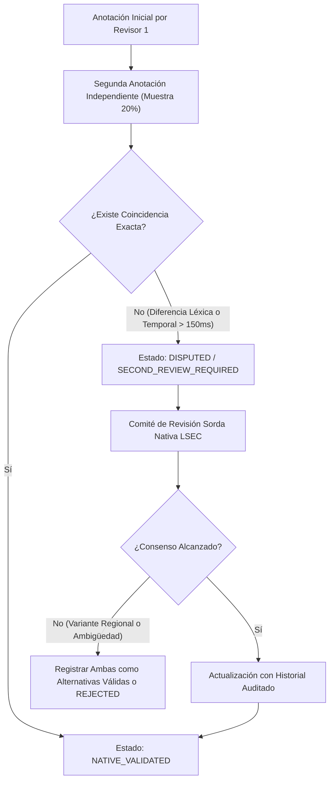

# Guía Oficial de Anotación Lingüística para LSEC (Versión 1.0)
**Comité de Estandarización Lingüística y Traducción Computacional LSEC**

---

> [!IMPORTANT]
> **Principio Rector Comunitario y Lingüístico:**
> La Lengua de Señas Ecuatoriana (LSEC) es una lengua natural, viso-gestual y espacial con gramática propia, independiente del español. Esta guía establece las convenciones de anotación computacional para la construcción del corpus de entrenamiento y evaluación. Ninguna anotación generada automáticamente (`MACHINE_PROPOSED`) puede considerarse referencia lingüística sin la revisión, ajuste y aprobación formal de **personas sordas usuarias competentes o nativas de LSEC**.

---

## 1. Estados del Ciclo de Vida de la Anotación

1. **`UNANNOTATED`**: Ejemplo en bruto (video y texto fuente en español) sin propuesta ni anotación.
2. **`MACHINE_PROPOSED`**: Propuesta preliminar generada por el pipeline computacional. **Prohibido su uso directo para entrenamiento o prueba**.
3. **`HUMAN_CORRECTED`**: Ejemplo corregido por un primer anotador lingüístico o revisor calificado.
4. **`SECOND_REVIEW_REQUIRED`**: Muestra seleccionada para control de calidad cruzado o casos con ambigüedad léxica/espacial.
5. **`NATIVE_VALIDATED`**: Anotación final revisada y aprobada por una persona sorda nativa de LSEC. Único estado apto para `GROUND_TRUTH`.
6. **`REJECTED`**: Ejemplo descartado por baja calidad de video, falta de consentimiento, o inconsistencia insalvable.
7. **`DISPUTED`**: Desacuerdo no resuelto entre anotadores o revisores. Bloqueado para entrenamiento.
8. **`ARCHIVED`**: Versión histórica preservada para trazabilidad y auditoría.

---

## 2. Taxonomía de las 30 Categorías de Anotación LSEC

### Cat 1: Convenciones Generales de Glosas
- **Definición**: Representación simbólica en mayúsculas sostenidas de la unidad léxica o morfológica de LSEC.
- **Forma de anotación**: Letras mayúsculas sin signos de puntuación (ej. `COMER`, `CARRERA`, `UNIVERSIDAD`).
- **Ejemplo positivo**: `MANZANA` para la seña de la fruta.
- **Ejemplo negativo**: `Manzana`, `comer`, `manzán`.
- **Errores frecuentes**: Usar minúsculas o incluir signos de interrogación dentro de la glosa (`¿COMER?`).
- **Criterio de revisión**: Debe coincidir con la entrada del glosario normalizado LSEC.
- **Nivel de confianza**: 1.0 si está en el glosario base; 0.8 si es variante léxica documentada.
- **Condición requires_native_review**: Señas no estandarizadas o neologismos.

### Cat 2: Uso de Mayúsculas y Caracteres Permitidos
- **Definición**: Estandarización tipográfica para glosas, signos compuestos y dactilología.
- **Forma de anotación**: Mayúsculas sostenidas (`A-Z`, `Ñ`, `Á`, `É`, `Í`, `Ó`, `Ú`). Guion `-` reservado para compuestos morfológicos (`SOLAMENTE-NO`) y deletreo (`U-P-E-C`).
- **Ejemplo positivo**: `T-U-L-C-Á-N`, `SOLAMENTE-NO`.
- **Ejemplo negativo**: `TULCAN_DACT`, `U.P.E.C.`.
- **Errores frecuentes**: Usar guion bajo `_` en glosas en lugar de guion `-`.
- **Criterio de revisión**: Rechazo automático si contiene caracteres no permitidos.

### Cat 3: Representación de Pronombres Personales
- **Definición**: Señalamiento deíctico (índice orientado hacia el signante, interlocutor o espacio de referencia).
- **Forma de anotación**: `PRO1` (primera persona singular: yo), `PRO2` (segunda persona: tú), `PRO3` (tercera persona: él/ella), `PRO1-PL` (nosotros), `PRO3-PL` (ellos).
- **Ejemplo positivo**: En "¿Tú comes?", anotar `PRO2` antes o después del objeto.
- **Ejemplo negativo**: Anotar la palabra en español `TÚ` o `YO`.
- **Errores frecuentes**: Confundir `PRO1` con la seña del sustantivo `PERSONA`.
- **Criterio de revisión**: Verificar si existe señalamiento corporal o espacial en el video.

### Cat 4: Deixis vs. Correferencia Espacial
- **Definición**: `DEICTIC` es señalamiento a entidades presentes o al signante/interlocutor. `COREFERENCE` es reidentificación de una entidad previamente asignada a un locus espacial (`A`, `B`, etc.).
- **Forma de anotación**: `PRO3:A` para correferencia al locus A.
- **Ejemplo positivo**: `ESTUDIANTE:A PRO3:A EXPLICAR` (El estudiante en locus A, él explica).
- **Ejemplo negativo**: Anotar `COREFERENCE` sin que el referente haya sido establecido previamente.
- **Errores frecuentes**: Usar `COREFERENCE` para pronombres personales deícticos directos (`PRO1`, `PRO2`).
- **Criterio de revisión**: Todo `COREFERENCE` debe tener `antecedent_id` en el historial discursivo.

### Cat 5: Tratamiento de Sujetos Implícitos (Pro-Drop)
- **Definición**: Cláusulas en español donde el sujeto se infiere por la flexión del verbo ("¿Qué comes?" $\to$ sujeto tácito "tú").
- **Forma de anotación**: En LSEC, no siempre se articula una seña manual para el pronombre si la dirección del verbo o el contexto lo expresan; si se enfatiza, se anota `PRO2`. En el plano semántico se marca `is_implicit=True`.
- **Ejemplo positivo**: Glosas: `['COMER', 'QUÉ']`, Semántica: `Participant(lemma='tú', is_implicit=True)`.
- **Ejemplo negativo**: Forzar la glosa `PRO2` cuando el signante en el video no realiza señalamiento manual.
- **Criterio de revisión**: Coincidencia visual con la articulación del signante.

### Cat 6: Predicados de Acción, Estado y Proceso
- **Definición**: Núcleo relacional o evenencial de la proposición.
- **Forma de anotación**: Lema verbal en infinitivo en mayúsculas (`COMER`, `ESTUDIAR`, `TRABAJAR`, `SER`, `TENER`).
- **Ejemplo positivo**: En "Yo no como carne", predicado = `comer`, glosa manual = `COMER`.
- **Ejemplo negativo**: Predicado = `yo`.
- **Criterio de revisión**: Ningún pronombre, determinante ni sustantivo puede ser clasificado como predicado de acción.

### Cat 7: Roles Semánticos Nucleares
- **Definición**: Función profunda del participante respecto al predicado (`AGENT`, `EXPERIENCER`, `PATIENT`, `THEME`, `GOAL`, `LOCATION`, `TEMPORAL_MODIFIER`, `ADDRESSEE`).
- **Forma de anotación**: Etiqueta canónica en mayúsculas.
- **Ejemplo positivo**: En "María come pan", `maría` $\to$ `AGENT`, `pan` $\to$ `PATIENT`.
- **Ejemplo negativo**: `maría` $\to$ `SUBJECT` (confundir rol sintáctico con semántico).
- **Criterio de revisión**: Oraciones transitivas deben registrar agente y paciente/tema.

### Cat 8: Negación Manual y No Manual
- **Definición**: Expresión de polaridad negativa mediante seña manual (`NO`, `NUNCA`, `NADA`, `SOLAMENTE-NO`) y/o movimiento de cabeza lateral (*headshake*).
- **Forma de anotación**: Glosa manual `NO` + span no manual `expression: FacialExpression.NEGATION`, `head_movement: 'negar'`.
- **Ejemplo positivo**: `['CARNE', 'COMER', 'NO']` con span no manual abarcando `COMER NO`.
- **Ejemplo negativo**: Glosa `NO` sin span no manual de negación asociado.
- **Criterio de revisión**: El span no manual debe sincronizarse con el núcleo predicativo.

### Cat 9: Preguntas Totales (Sí / No)
- **Definición**: Interrogación sobre la veracidad de la proposición. En LSEC, marcada con elevación de cejas, inclinación de cabeza hacia adelante y retención final de la seña.
- **Forma de anotación**: Operador `QUESTION_YN`, span no manual `expression: 'pregunta_sn'`, `eyebrows: 'elevadas'`, `head: 'adelante'`.
- **Ejemplo positivo**: "¿Tú comes manzana?" $\to$ glosas `['PRO2', 'MANZANA', 'COMER']` con cejas elevadas durante toda la frase.
- **Ejemplo negativo**: Usar ceño fruncido para preguntas de sí/no.

### Cat 10: Preguntas Parciales (Qu- / Wh-)
- **Definición**: Interrogación que indaga por un argumento específico (`QUÉ`, `QUIÉN`, `DÓNDE`, `CUÁNDO`, `CÓMO`, `POR-QUÉ`).
- **Forma de anotación**: Operador `QUESTION_WH`, glosa de partícula interrogativa (habitualmente al final o en duplicación), span no manual `expression: 'pregunta_qu'`, `eyebrows: 'fruncidas'`.
- **Ejemplo positivo**: "¿Qué comes?" $\to$ `['COMER', 'QUÉ']` con ceño fruncido en `QUÉ`.
- **Ejemplo negativo**: Insertar glosa `VARIOS` o elevar cejas como en pregunta sí/no.

### Cat 11: Tiempo y Marcadores Temporales
- **Definición**: Línea temporal en el espacio de señas (atrás = pasado, presente = frente al cuerpo, adelante = futuro).
- **Forma de anotación**: Marcadores léxicos temporales al inicio del enunciado discursivo (`AYER`, `HOY`, `MAÑANA`, `FUTURO`, `PASADO`).
- **Ejemplo positivo**: "Ayer comí carne" $\to$ `['AYER', 'PRO1', 'CARNE', 'COMER']`.
- **Ejemplo negativo**: Conjugar la glosa como `COMÍ`. (Las glosas de señas son invariantes morfológicamente en cuanto a tiempo flexivo del español).

### Cat 12: Aspecto Verbal (Durativo, Reiterativo, Completivo)
- **Definición**: Modulación del movimiento de la seña (movimiento circular continuo = durativo, movimiento repetido cortante = reiterativo, seña `YA` o `TERMINAR` = completivo).
- **Forma de anotación**: Sufijo de modulación en glosa: `ESTUDIAR[DURATIVO]`, `COMER[REITERATIVO]`, o glosa `YA`.

### Cat 13: Cantidad, Numerales y Pluralidad
- **Definición**: La pluralidad en LSEC se expresa mediante: numerales explícitos (`TRES MANZANA`), cuantificadores (`MUCHO ESTUDIANTE`), repetición de la seña (`ÁRBOL ÁRBOL ÁRBOL`), o señas de pluralidad (`VARIOS`).
- **Forma de anotación**: `CINCO MANZANA`, `MUCHAS PERSONA`.
- **Ejemplo negativo**: Añadir `VARIOS` a un sustantivo singular ("una manzana" $\to$ `MANZANA VARIOS` es incorrecto).

### Cat 14: Posesión y Relaciones Posesivas
- **Definición**: Expresión de pertenencia mediante señas posesivas (`MÍO`, `TUYO`, `SUYO`) o yuxtaposición deíctica.
- **Forma de anotación**: `CASA MÍO`, `PRO1 COMPUTADORA`.

### Cat 15: Clasificadores (CL)
- **Definición**: Configuraciones manuales que representan clases de objetos, personas, vehículos, formas o manipulación espacial.
- **Forma de anotación**: Prefijo `CL:` seguido de la configuración y descripción de la acción (ej. `CL:1(persona_caminando)`, `CL:V(dos_personas)`, `CL:B(vehículo_avanzando)`).
- **Condición requires_native_review**: Siempre `True`.

### Cat 16: Verbos Direccionales y de Concordancia
- **Definición**: Verbos cuyo movimiento va del punto de origen (sujeto) al punto de destino (objeto) en el espacio señante (ej. `AYUDAR`, `INFORMAR`, `EXPLICAR`, `DAR`, `PREGUNTAR`).
- **Forma de anotación**: `1-AYUDAR-2` (yo te ayudo), `2-AYUDAR-1` (tú me ayudas), `3A-DAR-3B` (él le da a ella).

### Cat 17: Establecimiento de Referentes Espaciales (Loci)
- **Definición**: Asignación de una ubicación tridimensional en el espacio señante a una entidad discursiva.
- **Forma de anotación**: Operación `ESTABLISH(entity_id, locus='LEFT_FRONT'|'RIGHT_FRONT'|'CENTER')`.
- **Ejemplo positivo**: `CAMPUS T-U-L-C-Á-N ESTABLISH:LEFT`.

### Cat 18: Operaciones de Indexación Espacial
- **Definición**: Apuntamiento o modulación hacia un locus previamente establecido (`INDEX:LEFT`, `INDEX:RIGHT`).
- **Criterio de revisión**: El locus debe haber sido establecido una sola vez previamente en el discurso.

### Cat 19: Componentes No Manuales (CNM)
- **Definición**: Movimientos de rostro, ojos, cejas, mejillas, labios, cabeza y torso con valor fonológico, morfológico o sintáctico.
- **Forma de anotación**: Registro de `NonManualSpan` con `start_ms`, `end_ms`, `expression`, `intensity`, `head_movement`.

### Cat 20: Expresiones Faciales Afectivas y Gramaticales
- **Definición**: Distinción entre gestos emocionales y marcadores sintácticos obligatorios (`pregunta_sn`, `pregunta_qu`, `negacion`, `superlativo`, `duda`, `reflexivo`).

### Cat 21: Movimiento e Inclinación de Cabeza
- **Definición**: Inclinación hacia adelante en preguntas sí/no; sacudida lateral en negación; cabeceo asertivo en afirmación enfática.

### Cat 22: Mirada (*Eye Gaze*)
- **Definición**: La dirección de los ojos indica: cambio de rol (mirada al interlocutor ficticio), concordancia con el clasificador (mirada a la mano), oíndice espacial (mirada al locus).

### Cat 23: Orientación del Torso y Cambio de Rol (*Role Shift*)
- **Definición**: Giro sutil del torso para asumir la voz o perspectiva de un personaje o entidad en el discurso narrativo.
- **Forma de anotación**: `ROLE_SHIFT:START(personaje)` ... `ROLE_SHIFT:END`.

### Cat 24: Segmentación y Delimitación Temporal Cuadro a Cuadro
- **Definición**: Marcas temporales milimétricas (`start_ms`, `end_ms`) desde la fase de preparación de la seña hasta el retorno a posición de reposo.
- **Criterio de revisión**: No incluir el tiempo de reposo (*rest position*) como parte de la duración activa de la seña.

### Cat 25: Variantes Regionales (Sierra vs. Costa)
- **Definición**: Reconocimiento y etiquetado de variaciones léxicas legítimas en LSEC (ej. Quito/Pichincha vs. Guayaquil/Guayas).
- **Forma de anotación**: Campo `regional_variant` explícito. Se prohíbe invalidar una seña correcta de otra región si está documentada en la comunidad sorda local.

### Cat 26: Alternativas Léxicas Aceptables
- **Definición**: Señas sinónimas o paráfrasis concurrentes válidas para un mismo concepto en español.
- **Forma de anotación**: Arreglo `acceptable_alternatives = ['GLOSA_ALT_1', 'GLOSA_ALT_2']`.

### Cat 27: Desambiguación de Frases Ambiguas
- **Definición**: Manejo de homonimias o ambigüedades acústicas/semánticas en español (ej. "banco" $\to$ entidad financiera `BANCO` vs. asiento `SILLA`).
- **Forma de anotación**: Registro de contexto y revisión humana obligatoria (`requires_native_review = True`).

### Cat 28: Nombres Propios, Señas de Identidad y Deletreo
- **Definición**: Los nombres propios se expresan mediante dactilología (`M-A-R-Í-A`) o mediante la **Seña de Identidad** otorgada por la comunidad sorda.
- **Forma de anotación**: `D-A-C-T-I-L-O-L-O-G-Í-A` con guiones o nombre de la seña si está asignada (`SEÑA_NOMBRE:JUAN`).

### Cat 29: Préstamos Lingüísticos y Dactilología Parcial
- **Definición**: Uso de iniciales dactilológicas combinadas con movimiento (ej. `LUNES` con configuración en 'L').

### Cat 30: Criterios para Segunda Revisión y Resolución de Desacuerdos
- **Definición**: Todo caso donde dos anotadores difieran en glosa o límite temporal en $> 150\text{ ms}$, o donde se use clasificador complejo, escala a estado `SECOND_REVIEW_REQUIRED` y es resuelto por un comité sordo nativo de consenso.

---

## 3. Protocolo de Resolución de Desacuerdos Inter-Anotadores

