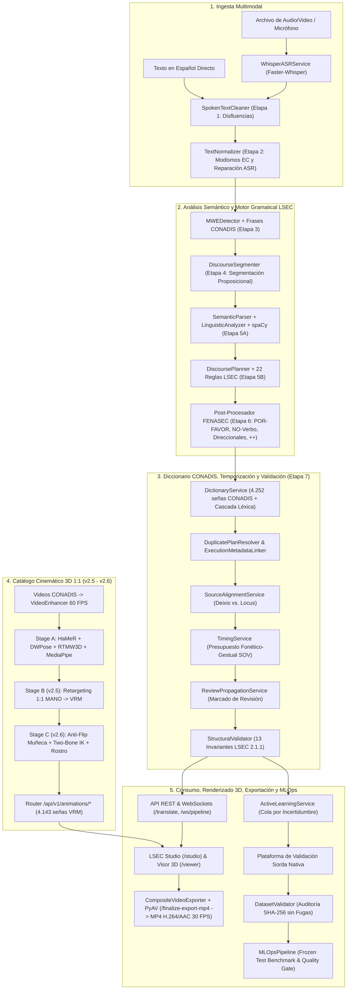

# Documento de Arquitectura, Tecnologías, Funciones y Características del Sistema LSEC Translator

> **Matriz de versiones:** Sistema 2.7.0 / API 2.0.0 / Motor lingüístico 2.1.1 / Esquema 2.1 / LSEC Studio 2.1.1 / VRM v2.7 estandarizado (compatibilidad v2.6 y v2.5)
> **Área:** Tecnologías de la Información y Comunicación (TIC) — Procesamiento de Lenguaje Natural, Visión por Computadora, Animación 3D y Accesibilidad  
> **Fecha:** Octubre 2026  
> **Entorno:** Backend (Python 3.10+, FastAPI, Faster-Whisper/CTranslate2, spaCy, PyAV, SQLite) · Pipeline 3D (PyTorch, HaMeR, MANO, DWPose/RTMW3D, MediaPipe, SciPy/NumPy) · Frontend (Vanilla Web Standards ES6+, Three.js, `@pixiv/three-vrm`, HTML5 Canvas 2D, MediaRecorder)

---

## 1. Resumen Ejecutivo y Visión General del Sistema

El sistema **LSEC Translator** es una plataforma tecnológica integral, modular y **100 % offline** diseñada para la **traducción asistida de español hablado o escrito a Lengua de Señas Ecuatoriana (LSEC), síntesis de animación 3D 1:1 en un avatar humanoide VRM, edición audiovisual bilingüe y entrenamiento continuo (MLOps)**.

A diferencia de aproximaciones tradicionales basadas en mapeos ingenuos palabra por palabra (que resultan agramaticales y carecen de valor comunicativo en lenguas visoespaciales), este sistema implementa una **arquitectura integrada en 5 pilares tecnológicos**:
1. **Backend Web Asíncrono y Persistencia Local:** API REST y WebSockets de baja latencia sobre `FastAPI` y `Uvicorn`, con contratos de datos en `Pydantic v2` y almacenamiento local en `SQLite3`.
2. **Ingesta Acústica y Codificación Multimedia:** Transcripción neuronal con marcas de tiempo por palabra mediante `Faster-Whisper` (`CTranslate2`) y codificación determinista de video MP4 (`H.264 + AAC` a 30.0 FPS constantes) mediante `PyAV` (`FFmpeg`).
3. **Motor Híbrido de PLN y Gramática LSEC de 7 Etapas:** Limpieza del español oral, normalización de modismos ecuatorianos/quichuismos, detección de locuciones multipalabra (MWE), segmentación proposicional, análisis morfosintáctico con `spaCy`, motor de 22 reglas gramaticales formales (`TIEMPO + TÓPICO + SOV`), 4 reglas post-planificación de la **FENASEC**, cascada léxica sobre las **4.252 señas del Diccionario Oficial CONADIS "Gabriel Román"** y auditoría de **13 invariantes estructurales**.
4. **Pipeline de Visión por Computadora y Cinemática 3D (`Diccionario LSEC` v2.7):** Catálogo VRM estandarizado v2.7 como versión predeterminada, con compatibilidad v2.6 corregida y v2.5 directa 1:1. Incluye super-resolución e interpolación temporal 15→60 FPS (`video_enhancer.py`), extracción multimodal en GPU con **HaMeR**, **DWPose / RTMW3D** y **MediaPipe Face Landmarker**, seguido de post-procesamiento biomecánico con IK analítica anti-penetración para **4.143 señas VRM**.
5. **Estación de Trabajo Audiovisual (*LSEC Studio*) y Motor 3D WebGL:** Interfaz de usuario profesional tipo editor no lineal (NLE) y reproductor 3D autónomo (`/viewer`) construidos con **Vanilla ES6+**, **HTML5 Canvas 2D** y **Three.js + `@pixiv/three-vrm`**, acompañados de una plataforma de validación nativa sorda y barrera criptográfica antifugas **SHA-256**.

---

## 2. Pila Tecnológica Exhaustiva (Los 5 Pilares Tecnológicos)

### 2.1 Pilar 1 y 2: Backend, Reconocimiento de Voz (ASR) y Multimedia

| Componente / Librería | Versión | Rol y Justificación Técnica |
| :--- | :--- | :--- |
| **Python** | `>=3.10` (Probado en `3.11`–`3.13`) | Lenguaje principal con tipado estático (`typing`, `from __future__ import annotations`, `dataclasses`) e inyección dinámica de librerías CUDA en Windows. |
| **FastAPI** | `>=0.111.0, <1.0.0` | Framework web ASGI asíncrono de alto rendimiento. Gestiona 5 routers RESTful (`/api/v1/*`, `/api/v1/animations/*`, `/api/v1/dictionary/*`, `/api/v1/dataset/*`), WebSockets (`/ws/pipeline`) y autogeneración de OpenAPI 3.1. |
| **Uvicorn (Standard)** | `>=0.30.0, <1.0.0` | Servidor ASGI multiprotocolo para peticiones HTTP concurrentes, streaming de video con soporte `Accept-Ranges` y WebSockets bidireccionales. |
| **Pydantic v2 & Pydantic-Settings** | `>=2.7.0` / `>=2.3.0` | Validación de esquemas en tiempo de ejecución (`GlossOutput`, `GlossItem`, `LSECDatasetItem`), serialización rápida en Rust y carga declarativa de `.env`. |
| **Faster-Whisper (CTranslate2)** | `>=1.0.0, <2.0.0` | Motor de Reconocimiento Automático del Habla (ASR) hasta $4\times$ más rápido que Whisper original y con una fracción del consumo de VRAM (`float16` en GPU CUDA o `int8` en CPU), generando marcas de tiempo por palabra (`WordTimestamp`). |
| **PyAV (`av` / FFmpeg)** | Incluido con `faster-whisper` | Enlaces Cython hacia `libavcodec`/`libavformat`. Decodifica audio de entrada y ejecuta en `/api/v1/animations/finalize-export-mp4` la codificación determinista a **MP4 (`libx264`, `yuv420p` + `aac` 48 kHz)** a **30.0 FPS constantes**. |
| **SQLite3 (`sqlite3` stdlib)** | Incluido en Python | Persistencia local 100 % offline de logs de traducción y revisiones humanas (`data/lsec_database.sqlite`), con fallback automático a memoria en medios de solo lectura. |
| **Pytest, Pytest-asyncio & HTTPX** | `>=8.2.0` / `>=0.23.0` / `>=0.27.0` | Suite de pruebas automatizadas con **358 pruebas aprobadas** en el backend/estudio y cliente HTTP asíncrono para pruebas de integración. |

### 2.2 Pilar 3: Procesamiento de Lenguaje Natural (PLN) y Motor Gramatical LSEC

| Componente / Módulo | Versión / Alcance | Rol y Justificación Técnica |
| :--- | :--- | :--- |
| **spaCy (`es_core_news_md` / `es_core_news_sm`)** | `>=3.7.0, <4.0.0` (Modelos `3.8.0`) | Núcleo de análisis morfosintáctico en español: tokenización con offsets, Universal POS (`token.pos_`), lematización (`token.lemma_`), árbol de dependencias (`token.dep_`, `head`, `children`) y morfología flexiva (`MorphAnalysis`: persona, número, tiempo y aspecto). |
| **Limpiador Oral y Normalizador Ecuatoriano** | Reglas `R1.1–R1.5` y `R2.1–R2.7` | [`spoken_text_cleaner.py`](file:///c:/Users/brana/Desktop/TIC%20Software/lsec_translator_prototype/app/services/spoken_text_cleaner.py) elimina muletillas y tartamudeos; [`text_normalizer.py`](file:///c:/Users/brana/Desktop/TIC%20Software/lsec_translator_prototype/app/services/text_normalizer.py) normaliza el imperativo andino (`dame + gerundio`), quichuismos (`guagua`, `ñaño`, `achachay`), cifras y errores fonéticos del ASR. |
| **Motor Gramatical Formal LSEC y Reglas FENASEC** | 22 Reglas LSEC + 4 Reglas FENASEC | [`app/lsec_grammar/registry.py`](file:///c:/Users/brana/Desktop/TIC%20Software/lsec_translator_prototype/app/lsec_grammar/registry.py) y [`fenasec_rules.py`](file:///c:/Users/brana/Desktop/TIC%20Software/lsec_translator_prototype/app/services/fenasec_rules.py) aplican el orden `TIEMPO + TÓPICO + SOV`, elisión de cópulas/artículos, transferencia funcional de preposiciones, deixis *pro-drop*, negación incorporada (`NO-SABER`), verbos direccionales (`[1->2]`) e intensidad (`++`). |
| **Servicio de Diccionario Oficial CONADIS** | **4.252 señas** (`catalogo_lsec.json`) | [`dictionary_service.py`](file:///c:/Users/brana/Desktop/TIC%20Software/lsec_translator_prototype/app/services/dictionary_service.py) indexa el Diccionario Oficial "Gabriel Román", detecta frases multipalabra oficiales y clasifica cada glosa en una cascada de verificación (`VERIFICADO_CONADIS`, `LEXICON_LOCAL`, `DACTILOLOGIA`, `NO_VERIFICADO`). |

### 2.3 Pilar 4: Visión por Computadora, Deep Learning y Cinemática 3D (`Diccionario LSEC` v2.7; compatibilidad v2.6/v2.5)

| Componente / Librería | Versión | Rol y Justificación Técnica |
| :--- | :--- | :--- |
| **PyTorch & PyTorch Lightning** | `>=2.4.0, <2.6.0` | Ejecución en GPU CUDA de los modelos de reconstrucción 3D de manos y super-resolución en Stage A (`lsec_hamer_extract.py`). |
| **HaMeR (*Hand Mesh Recovery*) & MANO (`smplx`)** | `smplx==0.1.28`, `timm>=0.9.12`, `einops>=0.7.0` | Extrae matrices de rotación 3D exactas en $\text{SO}(3)$ para la muñeca y las 15 falanges de cada mano a partir del video, evitando la necesidad de cinemática inversa aproximada en los dedos. |
| **DWPose & RTMW3D (`rtmlib` + `onnxruntime-gpu`)** | `rtmlib>=0.1.2`, `onnxruntime-gpu>=1.19.0` | Estimación 2D/3D de 133 keypoints de cuerpo completo (COCO-WholeBody) para posicionar hombros, codos, muñecas y torso con seguimiento temporal de identidad. |
| **MediaPipe Face Landmarker** | `>=0.10.14` | Extracción de 52 coeficientes de expresión facial **ARKit Blendshapes** y orientación cefálica por fotograma. |
| **OpenCV (`headless`), FFmpeg, Real-ESRGAN, CodeFormer & RIFE** | `opencv>=4.8.0` | Motor de mejora de video en 4 niveles ([`video_enhancer.py`](file:///c:/Users/brana/Desktop/TIC%20Software/Diccionario%20LSEC/video_enhancer.py)): super-resolución espacial con realce morfológico *Black Top-Hat* en valles interdigitales, restauración facial e interpolación temporal de 15 a 60 FPS. |
| **NumPy & SciPy (Retargeting 1:1 v2.5 y Stage C v2.6)** | `numpy>=1.26.0`, `scipy>=1.11.0` | Proyección $\text{SO}(3)$ por SVD, conjugación de cambio de base MANO→VRM ([`lsec_retarget_direct.py`](file:///c:/Users/brana/Desktop/TIC%20Software/Diccionario%20LSEC/lsec_retarget_direct.py)), compensación de postura de reposo ([`vrm_rest.py`](file:///c:/Users/brana/Desktop/TIC%20Software/Diccionario%20LSEC/vrm_rest.py)), filtro digital **One-Euro**, **SLERP** de cuaterniones y post-procesador **Stage C v2.6** ([`stage_c_postprocess.py`](file:///c:/Users/brana/Desktop/TIC%20Software/Diccionario%20LSEC/tools/stage_c_postprocess.py)) con reparación de *flips* de muñeca e **IK analítica de 2 huesos** anti-penetración. |

### 2.4 Pilar 5: Frontend (LSEC Studio 2.1.1, Visor 3D y Exportación de Video)

| Tecnología | Tipo | Propósito y Ventajas |
| :--- | :--- | :--- |
| **Vanilla HTML5 Semántico** | Estructura | Cero dependencias de frameworks de UI externos. Optimizado para accesibilidad WCAG 2.1 (regiones ARIA activas, navegación por teclado) en `/studio`, `/viewer` y `/avatarconfig`. |
| **Vanilla CSS3 Moderno** | Estilos | Sistema de diseño de alta densidad (*LSEC Design System*), variables CSS nativas, temas oscuros (*deep dark*), *glassmorphism* (`backdrop-filter`), CSS Grid y Flexbox. |
| **JavaScript Modular (ES6+)** | Lógica | Arquitectura orientada a componentes desacoplados con módulos ES nativos (`import`/`export`) y almacén de estado reactivo Pub/Sub (`state.js`) con pila `Undo/Redo`. |
| **Three.js & `@pixiv/three-vrm`** | Motor 3D WebGL | Renderizado en tiempo real del avatar humanoide **VRM 1.0** (`LSEC-Interpreter-Female.vrm`, 54 huesos) con sombras suaves `PCFSoftShadowMap`, `OrbitControls`, secuenciador de glosas (`sign-sequencer.js`) y reproducción de las **4.143 señas VRM 1:1**. |
| **HTML5 Canvas 2D API** | Gráficos 60 FPS | Renderizado de la regla milimétrica, línea de tiempo multitrack interactiva y lienzo de composición de video con PiP del avatar 3D. |
| **MediaRecorder + Canvas Capture + PyAV** | Exportación de Video | Captura determinista a 30 FPS en el navegador (`captureStream(0)` + `requestFrame()`) combinada con remuxeado/codificación en `/finalize-export-mp4` para producir archivos **MP4 (`H.264 + AAC`)** con tasa de cuadros constante y audio original. |
| **Playwright (Chromium)** | Pruebas E2E | Validación automatizada de extremo a extremo del flujo de interfaz y del renderizado WebGL del avatar VRM. |

---

## 3. Arquitectura Global del Sistema

El siguiente diagrama ilustra el flujo de datos integral desde la ingesta multimodal y el pipeline 3D hasta su renderizado en *LSEC Studio* y el visor VRM:

---

## 4. Funciones y Servicios del Backend (Módulos de Negocio)

### 4.1 Ingesta y Reconocimiento de Voz ([`app/services/asr_service.py`](file:///c:/Users/brana/Desktop/TIC%20Software/lsec_translator_prototype/app/services/asr_service.py))
- **Transcripción Acústica Precisa:** Carga dinámica y perezosa (*lazy loading*) del modelo `Faster-Whisper` con soporte de pesos locales (`data/models/whisper/`) para operación 100 % offline.
- **Alineación a Nivel de Palabra:** Genera marcas de tiempo exactas (`start`, `end`, `probability`) para cada palabra reconocida.
- **Métricas de Confianza:** Asigna valores de certeza acústica que activan automáticamente la bandera `requires_audio_review` si la probabilidad cae por debajo del umbral de calidad (`0.75`).

### 4.2 Limpieza del Español Hablado y Normalización Ecuatoriana ([`spoken_text_cleaner.py`](file:///c:/Users/brana/Desktop/TIC%20Software/lsec_translator_prototype/app/services/spoken_text_cleaner.py), [`text_normalizer.py`](file:///c:/Users/brana/Desktop/TIC%20Software/lsec_translator_prototype/app/services/text_normalizer.py))
- **Filtro de Disfluencias Orales (`SpokenTextCleaner`):** Suprime vacilaciones fonéticas (`eh, em, mm, digamos`), reformuladores (`o sea`) y colapsa tartamudeos de 1 a 3 palabras respetando repeticiones enfáticas.
- **Modismos Ecuatorianos y Quichuismos (`TextNormalizer`):** Convierte el imperativo andino (`dame/deme + gerundio` → `por favor + infinitivo`), traduce quichuismos (`ñaño → hermano`, `guagua → niño`, `achachay → frío`, `arrarray → calor`, `pana → amigo`) y repara errores fonéticos frecuentes del ASR (`Tulkán → Tulcán`, `Callambe → Cayambe`, `campos → campus`).
- **Expansión de Siglas y Cifras:** Convierte siglas institucionales en formas deletreadas normativas (`UPEC` → `U-P-E-C`) y normaliza números, teléfonos y correos electrónicos.

### 4.3 Expresiones Multipalabra y Diccionario Oficial CONADIS ([`mwe_detector.py`](file:///c:/Users/brana/Desktop/TIC%20Software/lsec_translator_prototype/app/services/mwe_detector.py), [`dictionary_service.py`](file:///c:/Users/brana/Desktop/TIC%20Software/lsec_translator_prototype/app/services/dictionary_service.py))
- **Agrupamiento Colocacional (`MWEDetector`):** Reconoce unidades multipalabra complejas con bloqueo de análisis componencial (`"seres humanos" → PERSONA`, `"primer día" → DÍA PRIMERO`, `"haz posible" → REALIDAD HACER`).
- **Catálogo Oficial CONADIS (`DictionaryService`):** Indexa las **4.252 señas** de `catalogo_lsec.json`, detecta frases multipalabra oficiales (`"buenos días" → BUENOS-DÍAS`, `"a diario" → A-DIARIO`) y clasifica cada glosa generada según su estado de verificación (`VERIFICADO_CONADIS`, `DACTILOLOGIA`, `EXENTO_GRAMATICAL`, `LEXICON_LOCAL`, `PARAFRASIS_REVISION`, `NO_VERIFICADO`).

### 4.4 Segmentación Discursiva Proposicional ([`app/services/discourse_segmenter.py`](file:///c:/Users/brana/Desktop/TIC%20Software/lsec_translator_prototype/app/services/discourse_segmenter.py))
- **Segmentación Atómica:** Divide oraciones compuestas en cláusulas independientes y subordinadas analizando puntuación mayor, pares correlativos (`no solo... sino`), conectores adversativos (`pero, sin embargo, aunque`), interrogativas indirectas y cambios de marco temporal.

### 4.5 Extracción Semántica, Análisis Lingüístico y Motor Gramatical LSEC ([`semantic_parser.py`](file:///c:/Users/brana/Desktop/TIC%20Software/lsec_translator_prototype/app/services/semantic_parser.py), [`linguistic_analyzer.py`](file:///c:/Users/brana/Desktop/TIC%20Software/lsec_translator_prototype/app/services/linguistic_analyzer.py), [`discourse_planner.py`](file:///c:/Users/brana/Desktop/TIC%20Software/lsec_translator_prototype/app/services/discourse_planner.py), [`fenasec_rules.py`](file:///c:/Users/brana/Desktop/TIC%20Software/lsec_translator_prototype/app/services/fenasec_rules.py))
- **Identificación de Predicados y Desambiguación de Homógrafos:** Extrae el verbo raíz usando `spaCy` y aplica filtros sintácticos en el árbol de dependencias para no confundir sustantivos homógrafos (`dibujo`, `taller`, `arte`, `música`) con formas verbales conjugadas, reparando además lemas verbales de 1.ª conjugación (`invitamos → INVITAR`).
- **Resolución Tipificada de Sujeto Tácito (*Pro-drop*):** Infiere `PRO1`, `PRO2`, `PRO1-PL` o `PRO2-PL` a partir de `token.morph` y desinencias verbales, bloqueando verbos impersonales/meteorológicos (`llover`, `haber` existencial, `se` impersonal).
- **Transferencia Funcional de Determinantes y Preposiciones:** Elide artículos y preposiciones puramente estructurales (`el, la, de` genitivo, `a` personal), pero transfiere aquellas con valor semántico (`desde → DESDE`, `con → CON`, `para + inf → PROPÓSITO`, `hacia → HACIA`).
- **22 Reglas Formales LSEC y 4 Reglas Oficiales FENASEC:** Ordena la proposición en `TIEMPO + TÓPICO + SUJETO + OBJETO + MODAL + VERBO + ASPECTO + NEG/WH`, aplica cortesía inicial (`POR-FAVOR`), negación incorporada (`NO-SABER`, `NO-PODER`, `NO-QUERER`, `NO-GUSTAR`, `NO-HABER`), verbos direccionales (`AVISAR[1->2]`) e intensidad (`LLOVER++`).

### 4.6 Enlace de Metadatos, Alineación y Temporización ([`metadata_linker.py`](file:///c:/Users/brana/Desktop/TIC%20Software/lsec_translator_prototype/app/services/metadata_linker.py), [`alignment_service.py`](file:///c:/Users/brana/Desktop/TIC%20Software/lsec_translator_prototype/app/services/alignment_service.py), [`timing_service.py`](file:///c:/Users/brana/Desktop/TIC%20Software/lsec_translator_prototype/app/services/timing_service.py))
- **Enlace Relacional Total:** Conecta bidireccionalmente cada `GlossItem` con su proposición semántica, bloque discursivo, locus espacial y marcadores no manuales.
- **Redistribución Temporal SOV:** Reasigna proporcionalmente las marcas de tiempo de las palabras en español (`SVO`) a la secuencia reordenada de glosas (`SOV`) y asigna presupuestos fonético-gestuales (seña estándar `500 ms`, seña corta `400 ms`, dactilología `300 ms/letra`).

### 4.7 Servicio de Animaciones Directas 1:1 y Exportación MP4 ([`app/api/animation_direct_endpoints.py`](file:///c:/Users/brana/Desktop/TIC%20Software/lsec_translator_prototype/app/api/animation_direct_endpoints.py))
- **Resolución y Entrega de 4.143 Señas VRM:** Sirve las animaciones esqueléticas generadas por el pipeline `Diccionario LSEC` (`senas_vrm_direct_v2.6/` con fallback a `senas_vrm_direct/`), resolviendo glosas individuales o por lotes, sirviendo videos originales Ultra HD, ilustraciones oficiales y telemetría QA.
- **Codificación Determinista MP4 (`finalize_export_mp4`):** Recibe el video compuesto desde el navegador y utiliza `PyAV` (`libx264` + `aac`) para entregar un archivo MP4 con tasa de cuadros constante de **30.0 FPS exactos** y audio original sincronizado.

### 4.8 Validador Estructural Formal, Aprendizaje Activo y MLOps ([`validator.py`](file:///c:/Users/brana/Desktop/TIC%20Software/lsec_translator_prototype/app/services/validator.py), [`active_learning_service.py`](file:///c:/Users/brana/Desktop/TIC%20Software/lsec_translator_prototype/app/services/active_learning_service.py), [`dataset_validator.py`](file:///c:/Users/brana/Desktop/TIC%20Software/lsec_translator_prototype/app/services/dataset_validator.py), [`mlops_pipeline.py`](file:///c:/Users/brana/Desktop/TIC%20Software/lsec_translator_prototype/app/services/mlops_pipeline.py))
- Audita matemáticamente las **13 Invariantes Lingüísticas LSEC 2.1.1**, prioriza ejemplos con incertidumbre o señas `NO_VERIFICADO` en la cola de revisión humana, verifica la ausencia de fugas de datos mediante hashes **SHA-256** y ejecuta la compuerta de regresión MLOps (*Exact Match*, *F1*, *Distancia de Edición*).

---

## 5. Funciones y Características del Frontend (LSEC Studio 2.1.1 y Visor 3D)

El frontend ofrece tres interfaces web complementarias servidas localmente sin dependencia de Internet:

### 5.1 Estación de Trabajo Principal: LSEC Studio (`/studio` — [`index.html`](file:///c:/Users/brana/Desktop/TIC%20Software/lsec_translator_prototype/app/static/index.html))
1. **Barra Superior de Control (`#top-navbar`):** Flujo guiado en 3 etapas (**1: Preparar**, **2: Traducir**, **3: Revisar**), pila inmutable Deshacer/Rehacer (`Ctrl+Z` / `Ctrl+Y`), selector de videos de prueba locales, importación/guardado de proyectos JSON y botón maestro de exportación.
2. **Zona Audiovisual y Avatar 3D PiP (`#left-video-zone`):**
   - Reproductor de video HTML5 con avance/retroceso cuadro a cuadro (30 FPS), bucle In/Out y velocidad variable (`0.25x` a `2.0x`).
   - **Intérprete 3D VRM Sincronizado (`studio-avatar-bridge.js`, `avatar-engine.js`):** Visor WebGL integrado que carga el modelo `LSEC-Interpreter-Female.vrm` y ejecuta en tiempo real la secuencia de señas 3D correspondiente a las glosas activas del video.
   - **Capas Superpuestas Sincronizadas:** Subtítulos fieles 1:1 (`subtitle-overlay.js`) y capa de glosas LSEC (`gloss-overlay.js`) con insignias para rasgos no manuales (`? S/N`, `? QU`, `NEG`) y cuadrantes espaciales.
3. **Dock Inferior Bimodal (`#bottom-dock-zone`):**
   - **Editor de Segmentos (`transcript-window.js`, `subtitle-editor-panel.js`):** Tarjetas bilingües con edición in-situ, filtros rápidos y aprobación por segmento.
   - **Línea de Tiempo Multitrack (`timeline.js`):** Lienzo en Canvas a 60 FPS con forma de onda acústica, bloques de glosas arrastrables, pistas de rasgos no manuales, loci espaciales y zoom (`30%` a `250%`).
4. **Inspector Contextual (`sidebar-panels.js`):** Despliega roles semánticos, ficha del Diccionario Oficial CONADIS, expresiones faciales requeridas e invariantes validadas.

### 5.2 Reproductor 3D Autónomo (`/viewer` — [`viewer.html`](file:///c:/Users/brana/Desktop/TIC%20Software/lsec_translator_prototype/app/static/viewer.html)) y Calibrador (`/avatarconfig` — [`avatarconfig.html`](file:///c:/Users/brana/Desktop/TIC%20Software/lsec_translator_prototype/app/static/avatarconfig.html))
- **Explorador 1:1 de 4.143 Señas (`/viewer`):** Permite buscar cualquier seña del Diccionario Oficial CONADIS, reproducir su animación VRM `v2.6`/`v2.5` sincronizada cuadro a cuadro con el video MP4 Ultra HD original, consultar la ilustración oficial y verificar las métricas cinemáticas de calidad (`qa.json`).
- **Calibrador de Avatar (`/avatarconfig`):** Herramienta de diagnóstico para ajustar encuadre de cámara, iluminación WebGL y poses articulares del modelo VRM.

### 5.3 Motor de Exportación Multiformato y Video Determinista (`video-exporter.js`, `modals-and-export.js`)
- **Exportación de Video Compuesto MP4 a 30.0 FPS:** Combina el renderizado cuadro a cuadro en `<canvas>` (video original + avatar 3D PiP + glosas LSEC + subtítulos quemados) con el endpoint backend `/api/v1/animations/finalize-export-mp4` (`PyAV` `H.264 + AAC`).
- **Formatos Estándar y Científicos:** SubRip (`.srt`), WebVTT (`.vtt`), ELAN (`.eaf`), CSV tabular (`.csv`) y Proyecto íntegro (`.json`).

---

## 6. Las 13 Invariantes Lingüísticas de LSEC 2.1.1

El validador estructural ([`StructuralValidator`](file:///c:/Users/brana/Desktop/TIC%20Software/lsec_translator_prototype/app/services/validator.py)) audita automáticamente las siguientes 13 reglas obligatorias:

| N.º | Invariante | Descripción y Criterio de Aceptación | Severidad |
| :---: | :--- | :--- | :--- |
| **1** | **Mayúsculas Canónicas** | Todas las glosas deben expresarse en mayúsculas estrictas (`A-Z`, `Ñ`). Si es deletreo dactilológico, debe separarse por guiones simples (ej. `U-P-E-C`). | `ERROR` / `BLOQUEO` |
| **2** | **Lemas Protegidos** | Los verbos principales deben conservar su forma de lema canónico registrado en el lexicón, impidiendo sufijaciones flexivas del español. | `ERROR` |
| **3** | **No Redundancia Espuria** | Prohíbe la repetición consecutiva de glosas idénticas salvo justificación morfológica de aspecto reiterativo debidamente etiquetada. | `WARNING` |
| **4** | **Concordancia de Negación** | La partícula negativa `NO` (o verbo con negación incorporada `NO-SABER`) debe posicionarse al final de la proposición o posverbal, acompañada del rasgo no manual `negación` (*headshake*). | `ERROR` |
| **5** | **Alineación de Interrogativos** | En preguntas abiertas (*qu-questions*), los pronombres interrogativos (*QUÉ*, *QUIÉN*, etc.) deben ubicarse al final de la proposición con el marcador facial `pregunta_qu` (ceño fruncido). | `ERROR` |
| **6** | **Concordancia Sí/No** | Las proposiciones interrogativas de polaridad sí/no deben portar obligatoriamente la expresión `pregunta_sn` (cejas elevadas) sobre toda la cláusula. | `ERROR` |
| **7** | **Consistencia de Loci Espaciales** | Un referente indexado en un locus (`Locus A`, `Locus B`, etc.) debe mantener su asignación en el discurso y no saltar a otro punto sin una operación explícita de reasignación. | `ERROR` |
| **8** | **Cobertura Proposicional** | Todos los roles semánticos nucleares del texto fuente (*Agent*, *Patient*, *Predicate*) deben tener su correspondiente realización en las glosas (*Concept Recall = 100 %*). | `ERROR` / `BLOQUEO` |
| **9** | **No Cruce de Líneas Temporales** | Los marcadores de tiempo absoluto o relativo (`AYER`, `MAÑANA`, `ANTES`, `FUTURO`) deben situarse al inicio del enunciado discursivo antes de la acción. | `WARNING` |
| **10** | **Alineación Temporal Acústica** | Las marcas de tiempo de las glosas deben circunscribirse dentro del intervalo de habla detectado por el ASR para evitar desfases perceptivos. | `WARNING` |
| **11** | **Validez del Tipo de Seña** | Cada elemento debe clasificarse estrictamente en uno de los tipos válidos del enum `GlossType`: `SEÑA`, `DACTILOLOGÍA`, `CLASIFICADOR` o `EXPRESIÓN`. | `ERROR` |
| **12** | **Presupuesto de Paráfrasis** | La longitud total de la secuencia no debe superar el presupuesto asignado (`compact`, `medium`, `expanded`), impidiendo expansiones hiperbólicas. | `WARNING` |
| **13** | **Sintaxis de Clasificadores** | Todo clasificador debe iniciar con el prefijo normativo `CL:` seguido de la configuración manual y el objeto denotado (ej. `CL:VEHÍCULO-AVANZAR`). | `ERROR` |

---

## 7. Catálogo de Endpoints de la API y Protocolos

### 7.1 Endpoints REST Principales ([`app/api/endpoints.py`](file:///c:/Users/brana/Desktop/TIC%20Software/lsec_translator_prototype/app/api/endpoints.py))
- **`GET /api/v1/health`**: Estado de operatividad de los servicios `asr`, `nlp` y `storage` (SQLite).
- **`POST /api/v1/transcribe`**: Transcripción de audio/video con `Faster-Whisper` y retorno de `WordTimestamp`.
- **`POST /api/v1/translate`**: Traducción Español → `GlossOutput` con modos `detailed`, `legacy` o `debug`.
- **`POST /api/v1/pipeline`**: Ejecución extremo a extremo (Audio/Video → ASR → 7 Etapas PLN → Glosas LSEC).
- **`POST /api/v1/review/validate`** y **`GET /api/v1/review/history`**: Persistencia local de revisiones en SQLite.

### 7.2 Endpoints de Animaciones 3D VRM 1:1 y Exportación MP4 ([`app/api/animation_direct_endpoints.py`](file:///c:/Users/brana/Desktop/TIC%20Software/lsec_translator_prototype/app/api/animation_direct_endpoints.py))
Disponibles bajo `/api/v1/animations` y el alias `/api/animations-direct`:
- **`GET /api/v1/animations/list?q=&limit=`** y **`GET /api/v1/animations/stats`**: Catálogo ordenado y estadísticas de las 4.143 señas VRM v2.7 estandarizadas, con compatibilidad v2.6/v2.5.
- **`GET /api/v1/animations/resolve/{gloss}`** y **`POST /api/v1/animations/resolve`**: Resolución de glosas LSEC a clips de animación 3D.
- **`GET /api/v1/animations/{sign_name}`**, **`/{sign_name}/qa`**, **`/{sign_name}/info`**, **`/{sign_name}/video`**, **`/{sign_name}/illustration`**: Entrega del `animation.json`, métricas QA, ficha lingüística, video MP4 Ultra HD e ilustración oficial.
- **`POST /api/v1/animations/finalize-export-mp4`**: Codificación determinista a MP4 (`H.264 + AAC` a 30.0 FPS constantes) mediante `PyAV`.

### 7.3 Endpoints del Diccionario Oficial CONADIS ([`app/api/dictionary_endpoints.py`](file:///c:/Users/brana/Desktop/TIC%20Software/lsec_translator_prototype/app/api/dictionary_endpoints.py))
- **`GET /api/v1/dictionary/search`**, **`GET /api/v1/dictionary/{slug}`** y **`GET /api/v1/dictionary/stats`**: Búsqueda y consulta sobre las 4.252 fichas oficiales de CONADIS.

### 7.4 Endpoints de Anotación y MLOps ([`app/api/annotation_endpoints.py`](file:///c:/Users/brana/Desktop/TIC%20Software/lsec_translator_prototype/app/api/annotation_endpoints.py))
- **`GET /api/v1/dataset/manifest`**, **`POST /api/v1/dataset/validate-item`**, **`GET /api/v1/dataset/export`**: Estado del corpus particionado y auditoría SHA-256.
- **`POST /api/v1/annotations/submit`** y **`GET /api/v1/annotations/queue?top_k=20`**: Registro inmutable de revisiones nativas y cola de aprendizaje activo.
- **`POST /api/v1/mlops/benchmark`**: Evaluación automatizada sobre el *Frozen Test Set* (`PASS` / `FAIL`).

### 7.5 Canal de Comunicación en Tiempo Real ([`app/api/websocket.py`](file:///c:/Users/brana/Desktop/TIC%20Software/lsec_translator_prototype/app/api/websocket.py))
- **`WS /ws/pipeline`**: Transmisión bidireccional de audio/texto con respuesta incremental de `transcription`, `gloss_result` y `avatar_payload`.

---

## 8. Arquitectura de Datos y Principios Éticos de No-Contaminación

El esquema de datos formal ([`app/core/dataset_schemas.py`](file:///c:/Users/brana/Desktop/TIC%20Software/lsec_translator_prototype/app/core/dataset_schemas.py)) implementa salvaguardas éticas estrictas:
1. **Protección de Datos Nativos:** Toda propuesta automática se etiqueta con `MACHINE_PROPOSED`.
2. **Barrera contra Contaminación (*Data Leak Barrier*):** Ningún ejemplo `MACHINE_PROPOSED` o sin consentimiento (`NO_CONSENT`) puede ingresar a las particiones `TRAIN`, `TEST` o `FROZEN_TEST`. Solo se admiten ejemplos validados por personas sordas nativas (`HUMAN_VERIFIED`).
3. **Auditoría Criptográfica SHA-256:** Cada par texto-glosa se verifica criptográficamente para impedir fugas entre entrenamiento y evaluación.

---

## 9. Matriz Resumen de Capacidades del Sistema

| Dominio | Característica Técnica | Beneficio Operativo |
| :--- | :--- | :--- |
| **Voz (ASR)** | `Faster-Whisper` con `CTranslate2` (`FP16`/`INT8`) | Transcripción local confidencial, ultrarrápida y con marcas de tiempo por palabra sin APIs en la nube. |
| **PLN y Gramática LSEC** | `spaCy` + 7 Etapas + 22 Reglas LSEC + 4 Reglas FENASEC | Conversión morfosintáctica fiel a la estructura visoespacial de la LSEC (`TIEMPO + TÓPICO + SOV`). |
| **Lexicón Oficial** | Diccionario CONADIS (4.252 señas) + Cascada Léxica | Trazabilidad oficial con detección de frases multipalabra y alerta de términos no verificados. |
| **Control de Calidad** | `StructuralValidator` (13 Invariantes) | Blindaje algorítmico contra agramaticalidades antes de su reproducción o exportación. |
| **Captura y Cinemática 3D** | `HaMeR` (`MANO`) + `DWPose`/`RTMW3D` + `MediaPipe` + `Stage C v2.6` | **4.143 señas VRM 1:1** con manos exactas en $\text{SO}(3)$, filtro One-Euro, IK analítica anti-colisión y expresiones faciales ARKit. |
| **Edición y Visor 3D** | *LSEC Studio* (`/studio`) + Visor (`/viewer`) con `Three.js` / `three-vrm` | Estación NLE bilingüe a 60 FPS y reproductor 3D interactivo sincronizados con el avatar `LSEC-Interpreter-Female.vrm`. |
| **Exportación de Video** | `Canvas 2D` (30 FPS) + `MediaRecorder` + `PyAV` (`libx264` + `aac`) | Exportación determinista a MP4 con avatar 3D PiP, glosas LSEC, subtítulos quemados y audio original sincronizado. |
| **MLOps y Ética** | Active Learning + Auditoría SHA-256 | Mejora continua priorizada por incertidumbre garantizando la soberanía lingüística de la comunidad sorda. |
