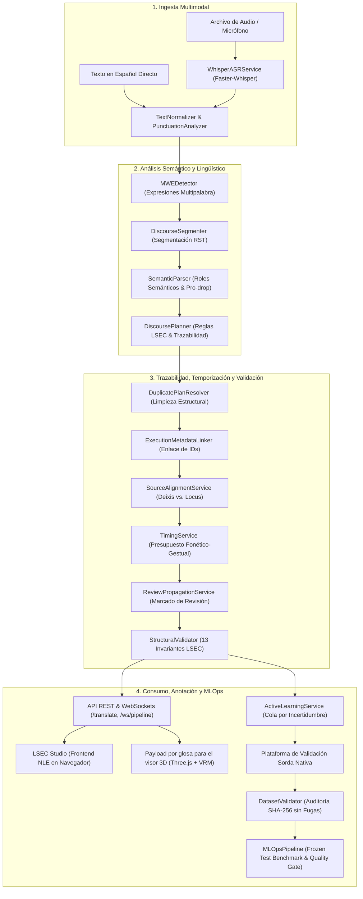

# Documento de Arquitectura, Tecnologías, Funciones y Características del Sistema LSEC Translator

> **Versión del Sistema:** LSEC Translator Architecture 2.2 / LSEC Studio 2.1.1  
> **Área:** Tecnologías de la Información y Comunicación (TIC) — Procesamiento de Lenguaje Natural y Accesibilidad  
> **Fecha:** Septiembre 2026  
> **Entorno:** Backend (Python 3.10+, FastAPI, CTranslate2) & Frontend (Vanilla Web Standards ES6+, HTML5 Canvas, MediaRecorder)

---

## 1. Resumen Ejecutivo y Visión General del Sistema

El sistema **LSEC Translator** es una plataforma tecnológica integral y modular diseñada para la **traducción asistida, representación semántica, generación de glosas, edición audiovisual bilingüe y entrenamiento continuo en la Lengua de Señas Ecuatoriana (LSEC)**.

A diferencia de aproximaciones tradicionales basadas en mapeos ingenuos palabra por palabra (que resultan agramaticales y carecen de valor comunicativo en lenguas visoespaciales), este sistema implementa una **arquitectura híbrida de 4 capas**:
1. **Ingesta Acústica y Normalización:** Transcripción de voz en español con marcas de tiempo a nivel de palabra mediante modelos neuronales ASR optimizados para ejecución en GPU/CPU local.
2. **Comprensión Semántica y Planificación Discursiva:** Extracción de proposiciones, roles temáticos nucleares (*Agent*, *Patient*, *Theme*), resolución de sujeto implícito (*pro-drop*) y ordenamiento sintáctico conforme a la gramática LSEC (Tópico-Comentario, SOV/OSV, negación final, preguntas abiertas y sí/no).
3. **Validación Estructural Rigurosa:** Auditoría algorítmica obligatoria de **13 invariantes lingüísticas formales** para certificar la integridad de las glosas y componentes no manuales.
4. **Estación de Trabajo Audiovisual y MLOps:** Interfaz de usuario profesional tipo editor no lineal (NLE) que permite la revisión humana por personas sordas nativas, exportación multiformato (incluyendo renderizado de video en cliente) y un pipeline de aprendizaje activo sin contaminación de datos.

---

## 2. Pila Tecnológica Exhaustiva (Technology Stack)

### 2.1 Backend y Motor de Inteligencia Artificial

| Componente / Librería | Versión | Rol y Justificación Técnica |
| :--- | :--- | :--- |
| **Python** | `>=3.10` | Lenguaje de programación principal con soporte estricto de tipado (`typing`, `__future__.annotations`, Dataclasses). |
| **FastAPI** | `>=0.111.0` | Framework web ASGI asíncrono de alto rendimiento. Gestiona endpoints RESTful y WebSockets bidireccionales con autogeneración de OpenAPI 3.1. |
| **Uvicorn (Standard)** | `>=0.30.0` | Servidor ASGI con soporte para bucle de eventos `uvloop` y parser HTTP ultra rápido `httptools`. |
| **Pydantic v2 & Pydantic-Settings** | `>=2.7.0` | Validación de tipos en tiempo de ejecución, serialización/deserialización de alto rendimiento y carga declarativa de variables de entorno `.env`. |
| **Faster-Whisper (CTranslate2)** | `>=1.0.0` | Motor de Reconocimiento Automático del Habla (ASR) 4 veces más rápido que Whisper original con un tercio del consumo de VRAM (cuantización `int8`/`float16` y timestamps de palabras milimétricos). |
| **spaCy** | `>=3.7.0` | Procesamiento morfosintáctico en español con modelos `es_core_news_md` / `es_core_news_sm`. Proporciona etiquetado de partes de la oración (POS), análisis de dependencias sintácticas y lematización. |
| **OpenCV (headless)** | `>=4.10.0` | Manipulación de fotogramas, cálculo de matrices espaciales y operaciones matriciales en video. |
| **NumPy** | `>=1.26.0` | Computación numérica para vectores espaciales, distancias euclidianas y transformaciones de coordenadas 3D. |
| **SQLite (stdlib)** | incluido en Python | Persistencia local 100% offline de logs de traducción y revisiones (`data/lsec_database.sqlite`), sin dependencias ni servicios en la nube. |
| **Pytest & Pytest-asyncio** | `>=8.2.0` | Suite de pruebas unitarias y de integración asíncronas con 358 casos de prueba automatizados (100% de éxito, sin contar las pruebas E2E de navegador). |
| **HTTPX** | `>=0.27.0` | Cliente HTTP asíncrono para pruebas de integración de la API. |

### 2.2 Frontend (LSEC Studio 2.1.1)

| Tecnología | Tipo | Propósito y Ventajas |
| :--- | :--- | :--- |
| **Vanilla HTML5 Semántico** | Estructura | Cero dependencias de librerías externas. Estructura optimizada para accesibilidad WCAG 2.1 (regiones ARIA activas, navegación por teclado). |
| **Vanilla CSS3 Moderno** | Estilos | Sistema de diseño de alta densidad (*LSEC Design System*), variables CSS nativas, temas oscuros (*deep dark*), efecto translúcido (*glassmorphism* con `backdrop-filter`), CSS Grid y Flexbox. |
| **JavaScript Modular (ES6+)** | Lógica | Arquitectura orientada a componentes desacoplados mediante módulos ES nativos (`import`/`export`), sin necesidad de empaquetadores como Webpack o Vite en tiempo de ejecución. |
| **HTML5 Canvas 2D API** | Gráficos | Renderizado de alta frecuencia (60 FPS) para la regla milimétrica, la línea de tiempo multitrack interactiva y el cabezal de reproducción. |
| **MediaRecorder & Canvas Capture** | Video | Motor de composición y renderizado de video en el cliente que une fotogramas, subtítulos y glosas LSEC directamente en el navegador sin consumir cómputo en el servidor. |
| **WebSockets API** | Conectividad | Transmisión bidireccional continua de fragmentos de audio y recepción reactiva de glosas en tiempo real. |
| **LocalStorage API** | Persistencia | Almacenamiento local de preferencias de usuario, estados de sesión y caché de proyectos. |

---

## 3. Arquitectura Global del Sistema

El siguiente diagrama ilustra el flujo de datos integral desde la entrada de audio o texto hasta su renderizado audiovisual o entrega a motores 3D:

---

## 4. Funciones y Servicios del Backend (Módulos de Negocio)

### 4.1 Ingesta y Reconocimiento de Voz (`app/services/asr_service.py`)
- **Transcripción Acústica Precisa:** Carga dinámica y perezosa (*lazy loading*) del modelo Faster-Whisper para preservar memoria VRAM.
- **Alineación a Nivel de Palabra:** Genera marcas de tiempo exactas (`start`, `end`, `probability`) para cada palabra reconocida.
- **Métricas de Confianza:** Asigna valores de certeza acústica que activan de forma automática la bandera `requires_audio_review` si la probabilidad cae por debajo del umbral de calidad (0.75).

### 4.2 Normalización de Texto y Puntuación (`app/services/text_normalizer.py`)
- **Limpieza Trazable:** Normaliza caracteres manteniendo un mapa de correspondencia con los índices del texto original.
- **Expansión de Siglas y Acrónimos:** Convierte siglas institucionales en formas deletreadas normativas (ej. `UPEC` → `U-P-E-C`).
- **Normalización Numérica:** Convierte números arábigos a formas léxicas reconocibles en el lexicón.
- **Detección de Palabras Dudosas:** Alerta sobre términos desconocidos, dialectismos no registrados o posibles fallos ortográficos.

### 4.3 Detección de Expresiones Multipalabra (`app/services/mwe_detector.py`)
- **Agrupamiento Colocacional:** Reconoce unidades multipalabra complejas (ej. *por favor*, *de repente*, *gracias a*) para tratarlas como un único concepto semántico en lugar de traducirlas de manera atomizada.

### 4.4 Segmentación Discursiva Proposicional (`app/services/discourse_segmenter.py`)
- **Teoría de Estructura Retórica (RST):** Divide oraciones compuestas en cláusulas independientes y subordinadas analizando los árboles de dependencia sintáctica de spaCy.
- **Preservación del Contexto:** Asigna identificadores únicos a cada unidad discursiva (`DiscourseUnit`), permitiendo estructurar relaciones de causa, condición y temporalidad.

### 4.5 Extracción Semántica y Roles Temáticos (`app/services/semantic_parser.py`)
- **Identificación de Predicados Nucleares:** Extrae el verbo raíz, polaridad (positiva/negativa), aspecto (perfectivo/imperfectivo/continuo) y modalidad oracional (declarativa, imperativa, interrogativa).
- **Asignación de Roles Temáticos:** Identifica argumentos nucleares:
  - `AGENT`: Quien ejecuta la acción.
  - `PATIENT` / `THEME`: Quien recibe el impacto o sobre quien recae la acción.
  - `BENEFICIARY`: Destinatario de la acción.
  - `LOCATION`: Espacio físico de referencia.
- **Resolución de Sujeto Implícito (*Pro-drop*):** Infiere el pronombre omitido en español a partir de la desinencia verbal, generando los índices pronominales LSEC adecuados (`PRO1` = yo/nosotros, `PRO2` = tú/ustedes, `PRO3` = él/ella/ellos).
- **Clasificación Tipológica Verbal:** Discrimina entre verbos planos, verbos espaciales y verbos direccionales con concordancia morfológica.

### 4.6 Planificación Discursiva LSEC (`app/services/discourse_planner.py`)
- **Reordenamiento Sintáctico:** Aplica las estructuras naturales de la LSEC:
  - **Tópico-Comentario:** El elemento informativo primario se traslada al inicio de la cláusula.
  - **SOV / OSV:** Configuración canónica para verbos transitivos.
  - **Negación Posverbal Obligatoria:** Ubica la partícula `NO` inmediatamente después del predicado o al final de la proposición, vinculando el movimiento de cabeza (*headshake*).
  - **Interrogativos al Final:** Coloca pronombres interrogativos (*QUÉ*, *QUIÉN*, *DÓNDE*, *CUÁNDO*) en posición final de la proposición.
- **Trazabilidad Conceptual (*ConceptTraceability*):** Registra cada concepto del texto fuente y calcula la tasa de cobertura conceptual (*concept recall*) asegurando que no existan omisiones en la traducción.

### 4.7 Enlace de Metadatos y Alineación Fuente (`app/services/metadata_linker.py`, `alignment_service.py`)
- **Enlace Relacional Total:** Conecta bidireccionalmente cada `GlossItem` con su proposición semántica, bloque discursivo, locus espacial y marcadores no manuales.
- **Deixis vs. Locus Abstracto:** Discrimina rigurosamente entre señalamiento deíctico (a interlocutores presentes) y señalamiento a un punto espacial arbitrario (*locus*) para correferencia anafórica de entidades ausentes.

### 4.8 Temporización y Presupuesto Fonético-Gestual (`app/services/timing_service.py`)
- **Métricas Temporales de la LSEC:** Asigna duraciones reales basadas en la velocidad natural de señación:
  - Seña estándar: `500 ms`.
  - Seña corta: `400 ms`.
  - Dactilología (deletreo): `300 ms` por letra.
  - Pausa interproposicional: `200–300 ms`.
- **Cálculo de Pausas de Video:** Determina el tiempo exacto que un video original en español debe detenerse para permitir la finalización de una secuencia de señas sin aceleraciones forzadas.

### 4.9 Validador Estructural Formal (`app/services/validator.py`)
Audita matemáticamente las **13 Invariantes Lingüísticas LSEC 2.1.1** (descritas en detalle en la Sección 6), catalogando las infracciones en advertencias o bloqueos críticos (`BLOCKED`).

### 4.10 Aprendizaje Activo y Control MLOps (`app/services/active_learning_service.py`, `dataset_validator.py`, `mlops_pipeline.py`)
- **Muestreo por Incertidumbre:** Calcula un vector de confianza multidimensional; oraciones con baja confianza o múltiples correcciones automáticas son enviadas prioritariamente a la cola de revisión humana (`GET /api/v1/annotations/queue`).
- **Auditoría Antifugas SHA-256:** Genera hashes criptográficos de cada texto y glosa para garantizar matemáticamente que ningún ejemplo de entrenamiento contamine los conjuntos de prueba congelados (*Frozen Test Set*).
- **Compuerta MLOps Automatizada:** Ejecuta pruebas de regresión cuantitativas evaluando métricas estrictas: Exact Match (EM), F1 sintáctico, distancia de edición de Levenshtein y dictamina `PASS` o `FAIL`.

---

## 5. Funciones y Características del Frontend (LSEC Studio 2.1.1)

El frontend es una **estación de trabajo audiovisual profesional integrada en una sola página (SPA)** construida bajo el paradigma de alto rendimiento sin frameworks pesados.

### 5.1 Arquitectura del Layout y Zonas Ergonómicas
1. **Barra Superior de Control (`#top-navbar`):**
   - Selector de flujo de trabajo en 3 etapas: **Etapa 1: Preparar** (Audio y transcripción), **Etapa 2: Traducir** (Glosado y sintaxis), **Etapa 3: Revisar** (Auditoría e incidencias).
   - Botones de Deshacer (`Ctrl+Z`) y Rehacer (`Ctrl+Y`) gestionados por una pila inmutable de historial.
   - Acceso rápido a carga de archivos de video, carga del video institucional UPEC de prueba, importación/guardado de proyectos y exportación final.
   - Indicador reactivo de guardado automático (*"Guardado"* / *"Guardando..."*).
2. **Zona Audiovisual (`#left-video-zone`):**
   - Reproductor de video HTML5 con soporte de aceleración por hardware y renderizador de reserva en Canvas.
   - Controles avanzados de precisión: avance/retroceso por fotograma individual (*frame-by-frame* a 30 fps), saltos de ±5 segundos, código de tiempo exacto (`MM:SS.mmm`), bucle In/Out para repetición continua y velocidad variable (0.25x a 2.0x).
3. **Capas Superpuestas Sincronizadas (Overlays):**
   - **Capa de Subtítulos Fiel 1:1 (`subtitle-overlay.js`):** Muestra el subtítulo en español activo garantizando confinamiento en área segura, partición de líneas equilibrada y ausencia de efectos distractores tipo karaoke.
   - **Capa de Glosas LSEC (`gloss-overlay.js`):** Despliega las glosas en tipografía monoespaciada de alto contraste, incorporando insignias cromáticas para marcadores no manuales (`? S/N`, `? QU`, `NEG`) y cuadrantes espaciales de señación.
4. **Dock Inferior Bimodal (`#bottom-dock-zone`):**
   - **Pestaña 1: Editor de Segmentos (`transcript-window.js`, `subtitle-editor-panel.js`):** Tarjetas bilingües cronológicas con edición in-situ de palabras y glosas, botones de aprobación rápida y filtrado dinámico (*Todos*, *Revisar*, *Audio dudoso*, *Sintaxis LSEC*, *Corregidos*).
   - **Pestaña 2: Línea de Tiempo Multitrack (`timeline.js`):** Lienzo interactivo en Canvas con regla en milisegundos, visualización de forma de onda acústica, bloques de glosas arrastrables, pistas de expresiones no manuales, loci espaciales y zoom interactivo (30% a 250%).
5. **Inspector Contextual y Transcripción (`#contextual-inspector-zone`, `sidebar-panels.js`):**
   - Muestra de forma inmediata los roles semánticos del segmento seleccionado, la correspondencia de cada seña con el lexicón oficial, las expresiones faciales gramaticales requeridas y las reglas de validación activas.

### 5.2 Motor de Exportación y Composición en Cliente (`video-exporter.js`, `modals-and-export.js`)
- **Compositor de Video Nativo en Navegador:** Utiliza `CanvasRenderingContext2D` y la API `MediaRecorder` para procesar el video fotograma a fotograma en el cliente, quemando los subtítulos estilizados, franjas de glosas y marcas institucionales sin enviar archivos pesados al servidor.
- **Exportación Multiformato:**
  - **Subtítulos Estándar:** SubRip (`.srt`) y WebVTT (`.vtt`).
  - **Anotación Científica:** Archivos de intercambio ELAN (`.eaf`) para lingüistas e investigadores de lenguas de señas.
  - **Tabular:** Archivos `.csv` estructurados por marcas de tiempo.
  - **Proyecto Completo:** Archivos `.json` con el estado íntegro de la sesión, historial de validaciones y metadatos LSEC.

---

## 6. Las 13 Invariantes Lingüísticas de LSEC 2.1.1

El validador estructural (`StructuralValidator`) audita automáticamente las siguientes 13 reglas obligatorias:

| N.º | Invariante | Descripción y Criterio de Aceptación | Severidad |
| :---: | :--- | :--- | :--- |
| **1** | **Mayúsculas Canónicas** | Todas las glosas deben expresarse en mayúsculas estrictas (`A-Z`, `Ñ`). Si es deletreo dactilológico, debe separarse por guiones simples (ej. `U-P-E-C`). | `ERROR` / `BLOQUEO` |
| **2** | **Lemas Protegidos** | Los verbos principales deben conservar su forma de lema canónico registrado en el lexicón, impidiendo sufijaciones flexivas del español. | `ERROR` |
| **3** | **No Redundancia Espuria** | Prohíbe la repetición consecutiva de glosas idénticas salvo justificación morfológica de aspecto reiterativo debidamente etiquetada. | `WARNING` |
| **4** | **Concordancia de Negación** | La partícula negativa `NO` debe posicionarse al final de la proposición o posverbal, acompañada del rasgo no manual `negación` (*headshake*). | `ERROR` |
| **5** | **Alineación de Interrogativos** | En preguntas abiertas (*qu-questions*), los pronombres interrogativos (*QUÉ*, *QUIÉN*, etc.) deben ubicarse al final de la proposición con el marcador facial `pregunta_qu` (ceño fruncido). | `ERROR` |
| **6** | **Concordancia Sí/No** | Las proposiciones interrogativas de polaridad sí/no deben portar obligatoriamente la expresión `pregunta_sn` (cejas elevadas) sobre toda la cláusula. | `ERROR` |
| **7** | **Consistencia de Loci Espaciales** | Un referente indexado en un locus (`Locus A`, `Locus B`, etc.) debe mantener su asignación en el discurso y no saltar a otro punto sin una operación explícita de reasignación. | `ERROR` |
| **8** | **Cobertura Proposicional** | Todos los roles semánticos nucleares del texto fuente (*Agent*, *Patient*, *Predicate*) deben tener su correspondiente realización en las glosas (*Concept Recall = 100%*). | `ERROR` / `BLOQUEO` |
| **9** | **No Cruce de Líneas Temporales** | Los marcadores de tiempo absoluto o relativo (`AYER`, `MAÑANA`, `FUTURO`) deben situarse al inicio del enunciado discursivo antes de la acción. | `WARNING` |
| **10** | **Alineación Temporal Acústica** | Las marcas de tiempo de las glosas deben circunscribirse dentro del intervalo de habla detectado por el ASR para evitar desfases perceptivos. | `WARNING` |
| **11** | **Validez del Tipo de Seña** | Cada elemento debe clasificarse estrictamente en uno de los tipos válidos del enum `GlossType`: `SEÑA`, `DACTILOLOGÍA`, `CLASIFICADOR` o `EXPRESIÓN`. | `ERROR` |
| **12** | **Presupuesto de Paráfrasis** | La longitud total de la secuencia no debe superar el presupuesto asignado (`compact`, `medium`, `expanded`), impidiendo expansiones hiperbólicas. | `WARNING` |
| **13** | **Sintaxis de Clasificadores** | Todo clasificador debe iniciar con el prefijo normativo `CL:` seguido de la configuración manual y el objeto denotado (ej. `CL:VEHÍCULO-AVANZAR`). | `ERROR` |

---

## 7. Catálogo de Endpoints de la API y Protocolos

### 7.1 Endpoints REST Principales (`app/api/endpoints.py`)

- **`GET /api/v1/health`**
  - Verifica el estado de operatividad de los motores de ASR, NLP y almacenamiento local.
  - **Respuesta:** estado de cada servicio (`asr`, `nlp`, `storage`) y versión de la API.

- **`POST /api/v1/transcribe`**
  - **Entrada:** Archivo de audio multipart (`.wav`, `.mp3`, `.m4a`, etc.).
  - **Función:** Ejecuta Faster-Whisper, aplica beam search y calcula probabilidades acústicas por palabra.
  - **Salida:** Texto transcripto y arreglo de `WordTimestamp` (`word`, `start`, `end`, `probability`).

- **`POST /api/v1/translate`**
  - **Entrada:** JSON `{ "text": "¿Tú estudias en la universidad?", "mode": "detailed", "budget": "medium" }`.
  - **Función:** Ejecuta la cadena semántico-discursiva, planifica glosas LSEC, vincula expresiones no manuales y evalúa las 13 invariantes.
  - **Salida:** Objeto `GlossOutput` con glosas, roles semánticos, temporización, confianza multidimensional y estado de ejecución (`READY`, `REVIEW_REQUIRED` o `BLOCKED`).

- **`POST /api/v1/pipeline`**
  - **Entrada:** Archivo de audio binario directo.
  - **Función:** Ejecución completa extremo a extremo (Audio → ASR → Normalización → Semántica → LSEC → Temporización).

### 7.2 Endpoints de Anotación y MLOps (`app/api/annotation_endpoints.py`)

- **`GET /api/v1/dataset/manifest`**
  - Entrega el desglose estadístico del corpus LSEC particionado (*Train*, *Validation*, *Test*, *Frozen Test*), variantes dialectales (Sierra vs. Costa) y reporte de auditoría SHA-256 de control de fugas.

- **`POST /api/v1/annotations/submit`**
  - Registra las revisiones de glosas y componentes no manuales realizadas por personas sordas o lingüistas. Almacena en un registro de solo adición (*append-only*) sin sobrescritura destructiva para trazabilidad ética.

- **`GET /api/v1/annotations/queue?top_k=20`**
  - Retorna los casos con mayor incertidumbre sintáctica o baja confianza para su priorización inmediata en la cola de validación humana.

- **`POST /api/v1/mlops/benchmark`**
  - Ejecuta la batería de pruebas de regresión contra el conjunto de datos congelado (*Frozen Test Set*). Evalúa exactitud estricta, similitud semántica y emite el dictamen de paso a producción (`PASS` o `FAIL`).

### 7.3 Canal de Comunicación en Tiempo Real (`app/api/websocket.py`)

- **`WS /ws/pipeline`**
  - Permite la interacción continua y reactiva con el sistema.
  - **Mensajes entrantes:** Chunks de audio binarios, fragmentos de texto o comandos de sincronización.
  - **Mensajes salientes:**
    - `transcription`: Actualizaciones parciales de la voz transcripta.
    - `gloss_result`: Secuencia incremental de glosas LSEC a medida que se completan las cláusulas.
    - `avatar_payload`: una glosa individual con sus marcadores no manuales y metadatos de secuencia (`sequence_index`, texto original, latencia), lista para que el visor 3D reproduzca el clip correspondiente. No incluye puntos clave de visión artificial.

---

## 8. Arquitectura de Datos y Principios Éticos de No-Contaminación

El sistema cuenta con un esquema de datos formal (`app/core/dataset_schemas.py`) que implementa salvaguardas éticas fundamentales para el tratamiento de lenguas minoritarias:

1. **Protección de Datos Nativos:** Toda propuesta generada automáticamente por algoritmos se marca de forma indeleble con el estado `MACHINE_PROPOSED`.
2. **Barrera contra Contaminación (*Data Leak Barrier*):** Ningún ejemplo generado por máquina o sin consentimiento explícito (`NO_CONSENT`) puede ingresar a los conjuntos de entrenamiento (*Train*) o de prueba (*Ground Truth*). Solo ejemplos en estado `HUMAN_VERIFIED` por usuarios nativos competentes de LSEC son admitidos.
3. **Auditoría Criptográfica SHA-256:** Cada texto y su respectiva secuencia de glosas se auditan criptográficamente para evitar solapamientos accidentales entre las particiones de entrenamiento y evaluación.

---

## 9. Matriz Resumen de Capacidades del Sistema

| Dominio | Característica Técnica | Beneficio Operativo |
| :--- | :--- | :--- |
| **Voz** | Faster-Whisper con CTranslate2 | Transcripción local confidencial, ultrarrápida y con marcas de tiempo a nivel de palabra sin dependencia de APIs en la nube. |
| **PLN** | spaCy + Roles Temáticos + Pro-Drop | Análisis profundo de la oración en español y resolución precisa de pronombres implícitos. |
| **Gramática LSEC** | DiscoursePlanner | Generación de oraciones naturales en LSEC (Tópico-Comentario, SOV, negación final y marcadores no manuales de interrogación). |
| **Control de Calidad** | StructuralValidator (13 Invariantes) | Blindaje algorítmico contra agramaticalidades antes de que el contenido llegue al usuario o al avatar. |
| **Edición Frontend** | LSEC Studio (Vanilla Web + Canvas) | Interfaz no lineal bilingüe de 60 FPS, accesible, con edición in-situ y navegación precisa por fotogramas. |
| **Composición Video** | MediaRecorder en Navegador | Exportación de videos con subtítulos y glosas quemadas directamente en el cliente, reduciendo a cero el coste de render en servidor. |
| **Visor 3D** | Three.js + VRM 1.0 | Reproduce clips JSON de animación generados por un proyecto externo; este sistema no genera señas. |
| **MLOps y Ética** | Active Learning + Auditoría SHA-256 | Entrenamiento continuo priorizado por incertidumbre garantizando la soberanía lingüística de la comunidad sorda. |

---

## 10. Conclusión

El sistema **LSEC Translator** representa una arquitectura de vanguardia que aúna el rigor de la lingüística computacional aplicada a la Lengua de Señas Ecuatoriana con la eficiencia de los estándares web modernos y el aprendizaje automático ético. Al desacoplar la ingesta, el análisis semántico, la validación formal y la estación de trabajo audiovisual, la plataforma garantiza tanto la fidelidad gramatical requerida por la comunidad sorda como la versatilidad técnica necesaria para integraciones en entornos web, educativos, institucionales y motores de renderizado 3D en tiempo real.
