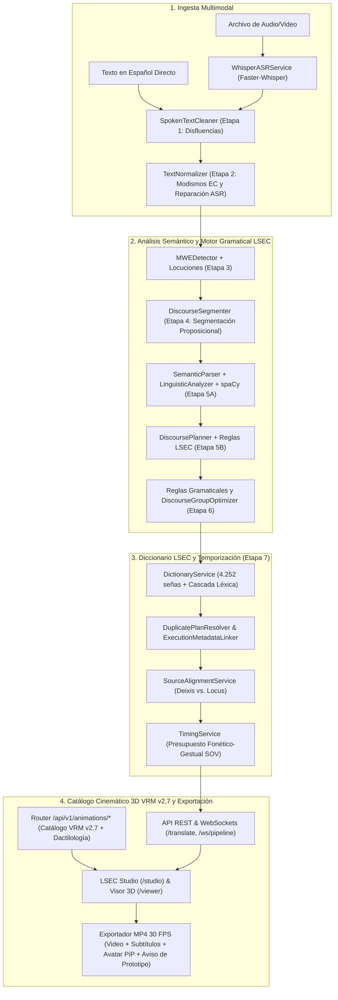

# Documento de Arquitectura, Tecnologías, Funciones y Características del Prototipo LSEC Studio (`v1.0-prototipo-academico`)

> **Versión:** `v1.0-prototipo-academico` (Catálogo VRM v2.7 estandarizado con compatibilidad v2.6 y v2.5)  
> **Área:** Tecnologías de la Información y Comunicación (TIC) — Procesamiento de Lenguaje Natural, Visión por Computadora, Animación 3D y Accesibilidad  
> **Naturaleza:** Prototipo académico universitario sin fines de lucro. Herramienta tecnológica de apoyo a la accesibilidad que **no sustituye a un intérprete humano profesional de LSEC**.  
> **Entorno:** Backend (`Python 3.10+`, `FastAPI`, `Faster-Whisper/CTranslate2`, `spaCy`, `PyAV`, `SQLite`) · Pipeline 3D (`PyTorch`, `HaMeR`, `MANO`, `DWPose/RTMW3D`, `MediaPipe`, `SciPy/NumPy`) · Frontend (`Vanilla Web Standards ES6+`, `Three.js`, `@pixiv/three-vrm`, `HTML5 Canvas 2D`, `MediaRecorder`)

---

## 1. Resumen Ejecutivo y Visión General del Prototipo

El sistema **LSEC Studio** es un prototipo académico modular y **100 % offline** diseñado como primera aproximación computacional para la **traducción asistida de español hablado o escrito a glosas de la Lengua de Señas Ecuatoriana (LSEC), síntesis de animación 3D 1:1 en un avatar humanoide VRM y edición audiovisual bilingüe**.

A diferencia de aproximaciones tradicionales basadas en mapeos ingenuos palabra por palabra (que resultan agramaticales en lenguas visoespaciales), este prototipo implementa una **arquitectura integrada en 5 pilares tecnológicos**:
1. **Backend Web Asíncrono y Persistencia Local:** API REST y WebSockets de baja latencia sobre `FastAPI` y `Uvicorn`, con contratos de datos en `Pydantic v2` y bitácora local en `SQLite3`.
2. **Ingesta Acústica y Codificación Multimedia:** Transcripción neuronal con marcas de tiempo por palabra mediante `Faster-Whisper` (`CTranslate2`) y codificación determinista de video MP4 (`H.264 + AAC` a 30.0 FPS constantes) mediante `PyAV` (`FFmpeg`) y `video_export_service.py`.
3. **Motor Híbrido de PLN y Gramática LSEC de 7 Etapas:** Limpieza del español oral, normalización de modismos ecuatorianos/quichuismos, detección de locuciones multipalabra (MWE), segmentación proposicional y optimización de grupos oracionales (`DiscourseGroupOptimizer`), análisis morfosintáctico con `spaCy`, motor de reglas gramaticales formales (`TIEMPO + TÓPICO + SOV`), reglas de cortesía/negación/direccionalidad/intensidad y cascada léxica sobre las **4.252 señas del lexicón de referencia LSEC**.
4. **Pipeline de Visión por Computadora y Cinemática 3D (`Diccionario LSEC` v2.7):** Catálogo VRM estandarizado v2.7 como versión predeterminada, con unificación de lateralidad diestra (`dominantHand: 'right'`), despeje torácico analítico, configuración manual y expresiones faciales ARKit.
5. **Estación de Trabajo Audiovisual (*LSEC Studio*) y Motor 3D WebGL:** Interfaz de usuario con flujo guiado de 4 ventanas (`/studio`), reproductor 3D autónomo (`/viewer`) y calibrador (`/avatarconfig`) construidos con **Vanilla ES6+**, **HTML5 Canvas 2D** y **Three.js + `@pixiv/three-vrm`**, incorporando en todo video exportado la leyenda permanente:
   > *«Propuesta computacional pendiente de validación por personas sordas nativas o profesional intérprete de LSEC»*

---

## 2. Pila Tecnológica Exhaustiva (Los 5 Pilares Tecnológicos)

### 2.1 Pilar 1 y 2: Backend, Reconocimiento de Voz (ASR) y Multimedia

| Componente / Librería | Versión | Rol y Justificación Técnica |
| :--- | :--- | :--- |
| **Python** | `>=3.10` (Probado en `3.11`–`3.13`) | Lenguaje principal con tipado estático (`typing`, `from __future__ import annotations`, `dataclasses`) e inyección dinámica de librerías CUDA en Windows. |
| **FastAPI** | `>=0.111.0, <1.0.0` | Framework web ASGI asíncrono de alto rendimiento. Gestiona los routers RESTful (`/api/v1/*`, `/api/v1/animations/*`, `/api/v1/dictionary/*`), WebSockets (`/ws/pipeline`) y autogeneración de OpenAPI 3.1. |
| **Uvicorn (Standard)** | `>=0.30.0, <1.0.0` | Servidor ASGI multiprotocolo para peticiones HTTP concurrentes, streaming de video con soporte `Accept-Ranges` y WebSockets bidireccionales. |
| **Pydantic v2 & Pydantic-Settings** | `>=2.7.0` / `>=2.3.0` | Validación de esquemas en tiempo de ejecución (`GlossOutput`, `GlossItem`), serialización rápida en Rust y carga declarativa de `.env`. |
| **Faster-Whisper (CTranslate2)** | `>=1.0.0, <2.0.0` | Motor de Reconocimiento Automático del Habla (ASR) con bajo consumo de VRAM (`float16` en GPU CUDA o `int8` en CPU), generando marcas de tiempo por palabra (`WordTimestamp`). |
| **PyAV (`av` / FFmpeg)** | Incluido con `faster-whisper` | Enlaces Cython hacia `libavcodec`/`libavformat`. Decodifica audio de entrada y ejecuta en `/api/v1/animations/finalize-export-mp4` la codificación determinista a **MP4 (`libx264`, `yuv420p` + `aac` 48 kHz)** a **30.0 FPS constantes**. |
| **SQLite3 (`sqlite3` stdlib)** | Incluido en Python | Persistencia local 100 % offline de bitácoras de traducción (`data/lsec_database.sqlite`), con fallback automático a memoria en medios de solo lectura. |
| **Pytest, Pytest-asyncio, Node.js & Playwright** | `>=8.2.0` / `>=0.23.0` / `>=1.40.0` | Suites de pruebas automatizadas unitarias, de integración, cinemáticas en Node.js y E2E en navegador real. |

### 2.2 Pilar 3: Procesamiento de Lenguaje Natural (PLN) y Motor Gramatical LSEC

| Componente / Módulo | Versión / Alcance | Rol y Justificación Técnica |
| :--- | :--- | :--- |
| **spaCy (`es_core_news_md` / `es_core_news_sm`)** | `>=3.7.0, <4.0.0` (Modelos `3.8.0`) | Núcleo de análisis morfosintáctico en español: tokenización con offsets, Universal POS (`token.pos_`), lematización (`token.lemma_`), árbol de dependencias (`token.dep_`, `head`, `children`) y morfología flexiva (`MorphAnalysis`). |
| **Limpiador Oral y Normalizador Ecuatoriano** | Reglas `R1.1–R1.5` y `R2.1–R2.7` | [`spoken_text_cleaner.py`](../app/services/spoken_text_cleaner.py) elimina muletillas y tartamudeos; [`text_normalizer.py`](../app/services/text_normalizer.py) normaliza el imperativo andino (`dame + gerundio`), quichuismos (`guagua`, `ñaño`, `achachay`), cifras y errores fonéticos del ASR. |
| **Motor Gramatical Formal LSEC y Optimizador Oracional** | Reglas LSEC + Optimizador | [`app/lsec_grammar/registry.py`](../app/lsec_grammar/registry.py), [`fenasec_rules.py`](../app/services/fenasec_rules.py) y [`discourse_group_optimizer.py`](../app/services/discourse_group_optimizer.py) aplican el orden `TIEMPO + TÓPICO + SOV`, elisión de cópulas/artículos, transferencia funcional de preposiciones, deixis *pro-drop*, negación incorporada (`NO-SABER`), verbos direccionales (`[1->2]`) e intensidad (`++`). |
| **Servicio de Diccionario de Referencia LSEC** | **4.252 señas** (`catalogo_lsec.json`) | [`dictionary_service.py`](../app/services/dictionary_service.py) indexa el catálogo lexicográfico de referencia, detecta frases multipalabra y clasifica cada glosa en una cascada de verificación (`EN_DICCIONARIO`, `LEXICON_LOCAL`, `DACTILOLOGIA`, `FUERA_DE_DICCIONARIO`). |

### 2.3 Pilar 4: Visión por Computadora, Deep Learning y Cinemática 3D (`Diccionario LSEC` v2.7)

| Componente / Librería | Versión | Rol y Justificación Técnica |
| :--- | :--- | :--- |
| **PyTorch & HaMeR (`MANO` / `smplx`)** | `>=2.4.0` / `smplx==0.1.28` | Extrae matrices de rotación 3D exactas en $\text{SO}(3)$ para la muñeca y las 15 falanges de cada mano a partir del video de referencia. |
| **DWPose & RTMW3D (`rtmlib` + `onnxruntime-gpu`)** | `rtmlib>=0.1.2` | Estimación 2D/3D de 133 keypoints de cuerpo completo (COCO-WholeBody) para posicionar hombros, codos, muñecas y torso. |
| **MediaPipe Face Landmarker** | `>=0.10.14` | Extracción de 52 coeficientes de expresión facial **ARKit Blendshapes** y orientación cefálica por fotograma. |
| **NumPy & SciPy (Cinemática VRM v2.7)** | `numpy>=1.26.0`, `scipy>=1.11.0` | Proyección $\text{SO}(3)$ por SVD, cambio de base MANO→VRM, compensación de postura de reposo, filtro digital **One-Euro**, **SLERP** de cuaterniones, unificación de lateralidad diestra (`dominantHand: 'right'`) e **IK analítica de 2 huesos** anti-penetración. |

### 2.4 Pilar 5: Frontend (LSEC Studio, Visor 3D y Exportación de Video)

| Tecnología | Tipo | Propósito y Ventajas |
| :--- | :--- | :--- |
| **Vanilla HTML5 Semántico** | Estructura | Cero dependencias de frameworks de UI externos. Optimizado para accesibilidad WCAG 2.1 en `/studio`, `/viewer` y `/avatarconfig`. |
| **Vanilla CSS3 Moderno** | Estilos | Sistema de diseño modular (`app/static/css/*.css`), variables CSS nativas, temas oscuros, CSS Grid y Flexbox. |
| **JavaScript Modular (ES6+)** | Lógica | Arquitectura orientada a componentes desacoplados con módulos ES nativos (`import`/`export`) y almacén de estado reactivo Pub/Sub ([`state.js`](../app/static/js/state.js)) con pila `Undo/Redo`. |
| **Three.js & `@pixiv/three-vrm`** | Motor 3D WebGL | Renderizado en tiempo real del avatar humanoide **VRM 1.0** (`LSEC-Interpreter-Female.vrm`, 54 huesos) con sombras suaves `PCFSoftShadowMap`, `OrbitControls`, compilador de coarticulación $\mathcal{C}^1$ ([`sequence-compiler.js`](../app/static/js/avatar/sequence-compiler.js)) y reproducción del catálogo VRM v2.7. |
| **HTML5 Canvas 2D API** | Gráficos 60 FPS | Renderizado de la línea de tiempo interactiva y lienzo de composición de video con PiP del avatar 3D y aviso permanente de prototipo ([`export-disclaimer.js`](../app/static/js/components/export-disclaimer.js)). |
| **MediaRecorder + Canvas Capture + PyAV** | Exportación de Video | Captura determinista a 30 FPS en el navegador combinada con codificación en `/finalize-export-mp4` ([`video_export_service.py`](../app/services/video_export_service.py)) para producir archivos **MP4 (`H.264 + AAC`)** con tasa de cuadros constante y audio original. |

---

## 3. Arquitectura Global del Prototipo

---

## 4. Funciones y Servicios del Backend (`app/services/`)

### 4.1 Ingesta y Reconocimiento de Voz ([`app/services/asr_service.py`](../app/services/asr_service.py))
- **Transcripción Acústica Precisa:** Carga dinámica (*lazy loading*) del modelo `Faster-Whisper` con soporte de pesos locales (`data/models/whisper/`) para operación 100 % offline.
- **Alineación a Nivel de Palabra:** Genera marcas de tiempo exactas (`start`, `end`, `probability`) para cada palabra reconocida.

### 4.2 Limpieza del Español Hablado y Normalización Ecuatoriana ([`spoken_text_cleaner.py`](../app/services/spoken_text_cleaner.py), [`text_normalizer.py`](../app/services/text_normalizer.py))
- **Filtro de Disfluencias Orales (`SpokenTextCleaner`):** Suprime vacilaciones fonéticas (`eh, em, mm, digamos`), reformuladores (`o sea`) y colapsa tartamudeos de 1 a 3 palabras respetando repeticiones enfáticas.
- **Modismos Ecuatorianos y Quichuismos (`TextNormalizer`):** Convierte el imperativo andino (`dame/deme + gerundio` → `por favor + infinitivo`), traduce quichuismos (`ñaño → hermano`, `guagua → niño`, `achachay → frío`, `arrarray → calor`, `pana → amigo`) y repara errores fonéticos frecuentes del ASR.
- **Expansión de Siglas y Cifras:** Convierte siglas institucionales en formas deletreadas normativas (`UPEC` → `U-P-E-C`) y normaliza números, teléfonos y correos electrónicos.

### 4.3 Expresiones Multipalabra y Diccionario de Referencia ([`mwe_detector.py`](../app/services/mwe_detector.py), [`dictionary_service.py`](../app/services/dictionary_service.py))
- **Agrupamiento Colocacional (`MWEDetector`):** Reconoce unidades multipalabra complejas con bloqueo de análisis componencial (`"seres humanos" → PERSONA`, `"primer día" → DÍA PRIMERO`).
- **Catálogo de Referencia LSEC (`DictionaryService`):** Indexa las **4.252 señas** de `catalogo_lsec.json`, detecta frases multipalabra y clasifica cada glosa generada según su estado de resolución (`EN_DICCIONARIO`, `DACTILOLOGIA`, `EXENTO_GRAMATICAL`, `LEXICON_LOCAL`, `PARAFRASIS_REVISION`, `FUERA_DE_DICCIONARIO`).

### 4.4 Segmentación Discursiva y Optimización Oracional ([`discourse_segmenter.py`](../app/services/discourse_segmenter.py), [`discourse_group_optimizer.py`](../app/services/discourse_group_optimizer.py))
- **Segmentación Atómica (`DiscourseSegmenter`):** Divide oraciones compuestas en cláusulas independientes y subordinadas analizando puntuación mayor, pares correlativos, conectores adversativos y cambios de marco temporal.
- **Optimizador de Unidades Oracionales (`DiscourseGroupOptimizer`):** Consolida proposiciones en grupos discursivos coherentes con orden global `TIEMPO + TÓPICO + SOV` y elimina duplicados léxicos adyacentes.

### 4.5 Extracción Semántica, Análisis Lingüístico y Motor Gramatical LSEC Modular (`<= 800` líneas)
- **Analizador Semántico ([`semantic_parser.py`](../app/services/semantic_parser.py)):** Orquesta [`semantic_constants.py`](../app/services/semantic_constants.py), [`semantic_verb_morphology.py`](../app/services/semantic_verb_morphology.py), [`semantic_role_extractor.py`](../app/services/semantic_role_extractor.py) y [`semantic_domain_templates.py`](../app/services/semantic_domain_templates.py).
- **Planificador Discursivo ([`discourse_planner.py`](../app/services/discourse_planner.py)):** Orquesta [`discourse_lexicon.py`](../app/services/discourse_lexicon.py), [`discourse_morphosyntax.py`](../app/services/discourse_morphosyntax.py), [`discourse_spacy_reorder.py`](../app/services/discourse_spacy_reorder.py), [`discourse_gloss_emitter.py`](../app/services/discourse_gloss_emitter.py) y [`discourse_plan_builder.py`](../app/services/discourse_plan_builder.py).
- **Reglas Gramaticales LSEC ([`registry.py`](../app/lsec_grammar/registry.py), [`fenasec_rules.py`](../app/services/fenasec_rules.py)):** Aplica cortesía inicial (`POR-FAVOR`), negación incorporada (`NO-SABER`, `NO-PODER`, `NO-QUERER`, `NO-GUSTAR`, `NO-HABER`), verbos direccionales (`AVISAR[1->2]`) e intensidad (`LLOVER++`).

### 4.6 Servicios Modulares de Animaciones VRM y Exportación MP4
- **Controlador HTTP Delgado ([`animation_direct_endpoints.py`](../app/api/animation_direct_endpoints.py)):** Expone las rutas REST bajo `/api/v1/animations` y `/api/animations-direct`.
- **Servicio de Catálogo VRM ([`animation_catalog_service.py`](../app/services/animation_catalog_service.py)):** Gestiona la resolución de rutas de catálogo (`v2.7` estandarizada preferida, con fallback a `v2.6` y `v2.5`), caché en memoria normalizada en NFC y post-procesamiento cinemático en vivo.
- **Resolvedor Léxico y Homónimos ([`animation_lexical_resolver.py`](../app/services/animation_lexical_resolver.py), [`lexical_homonym_rules.py`](../app/services/lexical_homonym_rules.py)):** Resuelve glosas individuales o por lotes aplicando desambiguación contextual de homónimos y fallback universal a dactilología para palabras fuera de vocabulario (OOV).
- **Streaming Multimedia y Exportación MP4 ([`animation_media_service.py`](../app/services/animation_media_service.py), [`video_export_service.py`](../app/services/video_export_service.py)):** Sirve videos de referencia con soporte HTTP Range y codifica la exportación final a **MP4 (`libx264` + `aac` a 30.0 FPS constantes)**.

---

## 5. Funciones y Características del Frontend (`app/static/`)

1. **Estación de Trabajo Principal: LSEC Studio (`/studio` — [`index.html`](../app/static/index.html)):**
   - Flujo guiado de 4 ventanas (**1. Cargar Video/Texto**, **2. Subtítulos en Español**, **3. Glosas LSEC y Línea de Tiempo**, **4. Avatar 3D y Exportación MP4**).
   - **Intérprete 3D VRM Sincronizado ([`studio-avatar-bridge.js`](../app/static/js/avatar/studio-avatar-bridge.js), [`avatar-sync-controller.js`](../app/static/js/avatar/avatar-sync-controller.js)):** Visor WebGL que carga `LSEC-Interpreter-Female.vrm` y ejecuta la secuencia compilada con ritmo natural `1.0x`, coarticulación $\mathcal{C}^1$ y unificación de lateralidad diestra.
   - **Exportador Compuesto con Aviso Académico ([`video-exporter.js`](../app/static/js/components/video-exporter.js), [`export-disclaimer.js`](../app/static/js/components/export-disclaimer.js)):** Renderiza a 30 FPS el video original, subtítulos en español, glosas LSEC, avatar 3D PiP y el aviso permanente de prototipo en la esquina inferior izquierda.
2. **Reproductor 3D Autónomo (`/viewer` — [`viewer.html`](../app/static/viewer.html)) y Calibrador (`/avatarconfig` — [`avatarconfig.html`](../app/static/avatarconfig.html)):**
   - Permite explorar 1:1 cualquier seña del catálogo VRM v2.7 sincronizada cuadro a cuadro con su video de referencia y calibrar cámara, iluminación y poses articulares del modelo VRM.

---

## 6. Catálogo de Endpoints de la API

- **`GET /api/v1/health`**: Estado de salud de los servicios (`asr`, `nlp`, `storage`).
- **`POST /api/v1/transcribe`**: Transcripción de audio/video con `Faster-Whisper` y retorno de `WordTimestamp`.
- **`POST /api/v1/translate`**: Traducción Español → `GlossOutput` con modos `detailed`, `legacy` o `debug`.
- **`POST /api/v1/pipeline`**: Ejecución extremo a extremo (Audio/Video → ASR → 7 Etapas PLN → Glosas LSEC).
- **`GET /api/v1/animations/list`**, **`/stats`**, **`/resolve/{gloss}`**, **`/{sign_name}`** y **`POST /api/v1/animations/finalize-export-mp4`**: Catálogo VRM v2.7, resolución léxica/contextual y exportación determinista a MP4.
- **`GET /api/v1/dictionary/search`**, **`/{slug}`** y **`/stats`**: Consulta sobre las 4.252 fichas lexicográficas de referencia.
- **`WS /ws/pipeline`**: Canal WebSocket bidireccional de traducción y sincronización.
