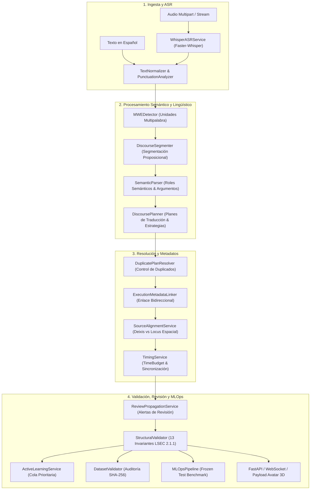
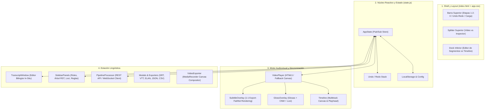

# Arquitectura Integral del Sistema LSEC Translator Prototype (v2.1.1 / 2.2)
## Documentación Técnica Detallada: Backend y Frontend

Este documento presenta el desglose técnico exhaustivo de los dos subsistemas que componen la plataforma **LSEC Translator**: el **Backend** (motor lingüístico, servicios de IA, validación estructural, ASR y API REST/WebSocket) y el **Frontend** (estación de trabajo interactiva audiovisual *LSEC Studio*, reproductor sincronizado, línea de tiempo multitrack y compositor de video).

---

# PARTE 1: ARQUITECTURA DEL BACKEND

El backend está diseñado bajo una arquitectura modular y desacoplada en Python 3.10+, estructurada según los estándares de Clean Architecture y Domain-Driven Design (DDD). Su función principal es procesar texto o audio en español, ejecutar un análisis morfosintáctico y semántico profundo, generar una representación intermedia proposicional, proyectar la estructura visoespacial de la Lengua de Señas Ecuatoriana (LSEC), validar 13 invariantes estructurales obligatorias y emitir cargas útiles para la API, WebSocket y motores de animación 3D (Unreal Engine / MetaHuman).

---

## 1.1 Tecnologías y Librerías del Backend

| Tecnología / Librería | Versión | Propósito Arquitectónico |
| :--- | :--- | :--- |
| **Python** | `>=3.10` | Lenguaje base con tipado estático (`typing`, `__future__.annotations`). |
| **FastAPI** | `>=0.111.0` | Framework web ASGI de alto rendimiento para APIs REST y WebSockets con generación automática de OpenAPI 3.1. |
| **Uvicorn (Standard)** | `>=0.30.0` | Servidor ASGI con soporte uvloop y httptools para concurrencia asíncrona. |
| **Pydantic v2 & Pydantic-Settings** | `>=2.7.0` | Modelado de esquemas de datos, validación estricta en tiempo de ejecución y parseo declarativo de `.env`. |
| **spaCy** | `>=3.7.0` | Motor industrial de PLN en español (`es_core_news_md` / `es_core_news_sm`) para POS-tagging, lemmatización y análisis de dependencias. |
| **Faster-Whisper** | `>=1.0.0` | Motor de reconocimiento automático del habla (ASR) con cuantización CTranslate2 (int8/float16) y cálculo de marcas de tiempo a nivel de palabra. |
| **MediaPipe** | `>=0.10.14` | Framework de visión artificial para captura y tracking de Pose, Manos (21 landmarks por mano) y Face Mesh (468 landmarks faciales + blendshapes). |
| **Firebase Admin SDK** | `>=6.5.0` | Conexión con Google Cloud Firestore para auditoría y persistencia de proyectos (con fallback tolerante a fallos in-memory). |
| **Pytest & Pytest-asyncio** | `>=8.2.0` | Suite integral de pruebas automatizadas y asíncronas con 172 tests unitarios y de integración (100% de aprobación). |
| **HTTPX** | `>=0.27.0` | Cliente HTTP asíncrono para pruebas de integración y llamadas a servicios externos. |

---

## 1.2 Configuración y Ciclo de Vida (`app/config.py`, `app/main.py`)

### `app/config.py` — `Settings`
Utiliza `pydantic_settings.BaseSettings` para cargar variables de entorno con validación de tipos:
- **LLM Local / OpenAI:** `openai_api_key`, `openai_model` (`qwen2.5:3b`), `openai_base_url` (`http://localhost:11434/v1`).
- **Protección de GPU (VRAM 4GB):** `llm_max_tokens` (800), `llm_request_timeout` (300s), límites de concurrencia Ollama.
- **Whisper ASR:** `whisper_model_size` (`small` / `base`), `whisper_device` (`cuda` / `cpu`), `whisper_compute_type` (`float16` / `int8`).
- **Servidor y CORS:** `app_host` (`0.0.0.0`), `app_port` (8000), `cors_origins`, `app_debug`.

### `app/main.py` — Punto de Entrada y Lifespan
- **Inyección de DLLs CUDA:** En sistemas Windows, detecta dinámicamente el directorio de `nvidia` en el entorno virtual e inyecta las rutas al `PATH` y a `os.add_dll_directory` para garantizar aceleración por GPU.
- **`lifespan(app: FastAPI)`:**
  - Inicializa los servicios pesados de forma controlada (`WhisperASRService`, `LSECTranslatorService`, `FirebaseService`).
  - Aplica carga lazy en Whisper para minimizar la ocupación inicial de VRAM.
  - Inyecta las instancias de los servicios en los enrutadores REST y WebSockets.
  - En el shutdown, libera los recursos de visión y conexiones de base de datos.
- **Montaje de Estáticos y Medios:** Monta la carpeta `/static` para la aplicación web y monta `/media` (en modo debug) para servir los videos de prueba locales.

---

## 1.3 Contratos y Modelos de Datos (`app/core/schemas.py`, `app/core/dataset_schemas.py`)

Los esquemas de datos modelan formalmente la transición desde el audio hasta la ejecución motora:
- **`WordTimestamp`:** Marca de tiempo individual para cada palabra reconocida por el ASR (`word`, `start`, `end`, `probability`).
- **`SemanticProposition`:** Unidad proposicional con identificador unívoco (`p1`, `p2`), predicado nuclear (`SemanticPredicate`), participantes (`SemanticParticipant`), tiempo gramatical, aspecto, modalidad (declarativa, interrogativa_qu, interrogativa_sn, imperativa) y polaridad (positiva/negativa).
- **`TranslationPlan`:** Estrategia discursiva seleccionada (`TOPIC_COMMENT`, `SVO`, `SOV`, `TEMPORAL_TOPIC`, `CONTRAST`), conceptos fuentes requeridos (`SourceConceptItem`), conceptos realizados (`RealizedConceptItem`) y cálculo de cobertura conceptual (*concept recall*).
- **`GlossItem`:** Representación individual de una seña en la secuencia LSEC:
  - `gloss`: Etiqueta en mayúsculas canónicas (`U-P-E-C`, `PRO1`, `COMER`, `NO`).
  - `gloss_type`: `SEÑA`, `DACTILOLOGÍA`, `CLASIFICADOR`, `EXPRESIÓN`.
  - `source_start_seconds` / `source_end_seconds`: Sincronización con el audio fuente.
  - `non_manual`: Expresión facial asociada (`FacialExpression`), movimiento cefálico y dirección de mirada (*eye gaze*).
  - `spatial_ref`: Referencia espacial (Locus A, Locus B, Locus C, neutro).
  - `duration_ms`, `pause_before_ms`, `pause_after_ms`: Parámetros temporales milimétricos.
- **`DiscourseBlock`:** Agrupación superior de proposiciones interconectadas por relaciones discursivas (RST) con expresión base y pausas estructurales.
- **`SpatialReferent` & `SpatialOperation`:** Modelado del espacio de señación; asigna loci específicos (`LEFT_NEAR`, `RIGHT_NEAR`, `CENTER`, etc.) a entidades y registra operaciones de indexación o movimiento direccional.
- **`NonManualSpan`:** Rango temporal o de glosas donde se despliega un marcador no manual concurrente (ej. cejas elevadas durante una pregunta sí/no).
- **`TimingPlan`:** Plan global de temporización: duración acumulada, pausas del video extendido (`extended_video_pauses_duration_ms`), tasa de señación (*signing rate* en señas/segundo) y marcadores de sincronización.
- **`MultidimensionalConfidence` & `ValidationMetadata`:** Vector de confianza que pondera ASR (0.98), normalización (0.95), alineación (0.90), segmentación (0.95), semántica (0.92), cobertura (0.95), léxico (0.90) y reglas sintácticas, clasificando la ejecución en:
  - `READY` (`AUTO_VERIFIED`): Lista para reproducción directa.
  - `REVIEW_REQUIRED`: Requiere verificación por personas sordas usuarias nativas.
  - `BLOCKED`: Bloqueada por violación crítica de invariantes.
- **`LSECDatasetItem` (`dataset_schemas.py`):** Estructura canónica del corpus que enforcea reglas éticas de no-contaminación: prohíbe que ejemplos en estado `MACHINE_PROPOSED` o con `NO_CONSENT` ingresen a particiones `TRAIN`, `TEST` o `FROZEN_TEST`.

---

## 1.4 Servicios y Lógica del Pipeline Lingüístico (`app/services/`)

### 1. `TextNormalizer` & `PunctuationAnalyzer` (`text_normalizer.py`)
- Limpieza y desinfección de texto preservando la correspondencia con los índices del texto original.
- Expansión de acrónimos institucionales (ej. *UPEC* → *U-P-E-C*).
- Corrección de errores ortográficos comunes y variaciones fonéticas.
- Conversión de números arábigos a formas verbales/léxicas normalizadas.
- Identificación de palabras dudosas (`check_dubious_words`) para emitir advertencias de revisión temprana.

### 2. `MWEDetector` (`mwe_detector.py`)
- Detección de expresiones multipalabra (*Multi-Word Expressions*, MWE) y colocaciones léxicas (ej. *por favor*, *gracias a*, *de vez en cuando*).
- Carga dinámica desde el lexicón LSEC para agrupar secuencias que deben traducirse a una única seña o compuesto léxico unificado.

### 3. `DiscourseSegmenter` (`discourse_segmenter.py`)
- Segmentación proposicional avanzada que divide oraciones complejas en unidades discursivas mínimas.
- Utiliza análisis de dependencias sintácticas de spaCy y marcadores discursivos para delimitar cláusulas independientes y subordinadas.

### 4. `SemanticParser` (`semantic_parser.py`)
- Módulo central de extracción de la representación semántica intermedia.
- Identifica el lema del verbo, voz, polaridad, tiempo y modo.
- Aplica el lexicón verbal en español (`SpanishVerbLexicon`) para mapear roles temáticos (`AGENT`, `PATIENT`, `THEME`, `BENEFICIARY`, `LOCATION`).
- Resuelve el fenómeno de *pro-drop* (sujeto implícito en español), infiriendo el pronombre o referente correspondiente (`PRO1`, `PRO2`, `PRO3`).

### 5. `DiscoursePlanner` (`discourse_planner.py`)
- Aplica las reglas de estructuración sintáctica de la LSEC:
  - **Tópico-Comentario:** Coloca el objeto/tema antes del verbo cuando es el foco discursivo.
  - **Estructura SOV/OSV según tipo de verbo:** Verbos con concordancia espacial vs. verbos simples.
  - **Negación Posverbal y Gestual:** Ubica la partícula negativa (`NO`) al final de la cláusula o después del verbo, asociando el marcador no manual de movimiento de cabeza (*headshake*).
  - **Preguntas Interrogativas:** Ubica los pronombres interrogativos (*QUÉ*, *QUIÉN*, *DÓNDE*) al final de la proposición, adjuntando la expresión facial `pregunta_qu` (ceño fruncido) o `pregunta_sn` (cejas levantadas).
- Realiza el seguimiento conceptual (*ConceptTraceability*), validando que ningún concepto nuclear de la fuente sea omitido en las glosas.

### 6. `DuplicatePlanResolver` (`duplicate_resolver.py`)
- Inspecciona planes de traducción concurrentes generados por cláusulas coordinadas o ambiguas.
- Elimina duplicaciones espurias de glosas o predicados y corrige fugas morfológicas.

### 7. `ExecutionMetadataLinker` (`metadata_linker.py`)
- Vincula bidireccionalmente cada elemento de la secuencia: enlaza cada `GlossItem` con su `proposition_id`, `discourse_block_id`, `spatial_operation_ids` y `non_manual_span_ids`.
- Garantiza que cualquier modificación en la interfaz repercuta coherentemente en todas las capas del modelo.

### 8. `SourceAlignmentService` (`alignment_service.py`)
- Mapea cada glosa generada con los tokens y caracteres del texto original en español.
- Enlaza las marcas de tiempo acústicas de las palabras (`WordTimestamp`) con las glosas correspondientes.
- Discrimina rigurosamente entre deixis pura (señalamiento pronominal a la persona presente) y correferencia anafórica a un locus espacial abstracto.

### 9. `TimingService` (`timing_service.py`)
- Asigna presupuestos temporales basados en la métrica fonético-gestual de la LSEC:
  - Seña base estándar: 500 ms.
  - Seña corta: 400 ms.
  - Dactilología: 300 ms por letra.
  - Pausa interclausal / interbloque: 200–300 ms.
- Calcula los puntos donde el video o avatar debe pausar para respetar el ritmo natural de la lengua sin aceleraciones artificiales (*time stretching*).

### 10. `ReviewPropagationService` (`review_service.py`)
- Evalúa de forma unificada si una proposición, glosa o bloque requiere revisión humana.
- Diferencia entre `requires_audio_review` (baja confianza del Whisper) y `requires_native_review` (complejidad sintáctica, paráfrasis o palabras fuera de vocabulario).

### 11. `StructuralValidator` (`validator.py`) — Las 13 Invariantes LSEC
Aplica el motor formal de validación que audita las **13 Invariantes de la LSEC 2.1.1**:
1. **Mayúsculas Canónicas:** Todas las glosas deben estar en mayúsculas estrictas; deletreos separados por guiones (`U-P-E-C`).
2. **Lemas Protegidos:** Verbos nucleares deben mantener su lema léxico reconocido.
3. **No Redundancia Espuria:** Prohíbe repeticiones idénticas consecutivas de glosas no justificadas morfológicamente.
4. **Concordancia de Negación:** La glosa `NO` debe ubicarse en posición final o posverbal con la expresión no manual `negación`.
5. **Alineación de Interrogativos:** Preguntas abiertas deben llevar el pronombre al final y la expresión `pregunta_qu`.
6. **Concordancia de Preguntas Sí/No:** Requieren el marcador `pregunta_sn` en toda la cláusula.
7. **Consistencia de Loci Espaciales:** Un referente no puede reasignarse a un locus distinto sin una operación explícita de desambiguación.
8. **Cobertura Proposicional:** Todos los conceptos nucleares (`AGENT`, `PREDICATE`, `PATIENT`) deben estar realizados en el plan.
9. **No Cruce de Líneas Temporales:** Los marcadores temporales (`AYER`, `MAÑANA`, `FUTURO`) deben anteceder a la acción.
10. **Alineación Temporal Acústica:** Los límites de la glosa deben mantenerse dentro del horizonte temporal del enunciado.
11. **Validez del Tipo de Seña:** Cada glosa debe corresponder a un tipo válido del enum `GlossType`.
12. **Presupuesto de Paráfrasis:** No exceder la longitud máxima de paráfrasis según el presupuesto asignado (`compact`, `medium`, `expanded`).
13. **Clasificadores Válidos:** Los clasificadores deben incluir el prefijo normativo `CL:`.

### 12. `ActiveLearningService`, `DatasetValidator` y `MLOpsPipeline`
- **Active Learning (`active_learning_service.py`):** Prioriza los ejemplos con menor confianza multidimensional y mayor cantidad de reparaciones automáticas en la cola de revisión humana (`GET /api/v1/annotations/queue`).
- **Control de Fugas (`dataset_validator.py`):** Calcula hashes SHA-256 sobre el texto y las glosas para certificar que ningún ejemplo del conjunto de entrenamiento aparezca en validación o prueba.
- **Compuerta MLOps (`mlops_pipeline.py`):** Ejecuta benchmarks sobre el *Frozen Test Set*, evaluando Exact Match, F1 sintáctico y distancia de edición de Levenshtein, otorgando el dictamen `PASS` / `FAIL`.

---

## 1.5 Endpoints y Rutas del Backend (`app/api/`)

### Endpoints Principales (`app/api/endpoints.py`)
- `GET /api/v1/health`: Diagnóstico de disponibilidad de servicios (ASR, NLP, Firebase) y versión del motor.
- `POST /api/v1/transcribe`: Ingesta de archivos de audio (`.wav`, `.mp3`, `.m4a`), ejecución de Whisper y retorno de texto con `word_timestamps`.
- `POST /api/v1/translate`: Traducción de texto a glosas con modos `detailed`, `legacy` o `debug` y control de presupuesto de paráfrasis.
- `POST /api/v1/pipeline`: Flujo combinado extremo a extremo: audio → transcripción ASR → normalización → glosas LSEC → plan de temporización.

### Endpoints de Anotación y MLOps (`app/api/annotation_endpoints.py`)
- `GET /api/v1/dataset/manifest`: Distribución estadística del corpus, divisiones de datos (*splits*) y reporte de fugas.
- `POST /api/v1/annotations/submit`: Registro inmutable de revisiones humanas con auditoría de usuario y tiempo dedicado.
- `GET /api/v1/annotations/queue`: Obtención de los `top_k` ejemplos con mayor incertidumbre lingüística.
- `POST /api/v1/mlops/benchmark`: Disparo de la evaluación formal automatizada del modelo.

### WebSocket Bidireccional (`app/api/websocket.py`)
- `WS /ws/pipeline`: Protocolo de streaming en tiempo real.
  - **Entrada:** Chunks de audio binarios (`audio_chunk`), texto directo (`text_input`) o señales de control (`control`).
  - **Salida:** Transcripción parcial continua (`transcription`), actualización de glosas (`gloss_result`) y fotogramas tridimensionales de animación para MetaHuman (`avatar_payload`).

---

# PARTE 2: ARQUITECTURA DEL FRONTEND

El frontend de la plataforma es **LSEC Studio 2.1.1**, una estación de trabajo audiovisual profesional tipo NLE (Non-Linear Editor) e IDE lingüístico integrada en una sola página. Está desarrollada con estándares web puros (Vanilla HTML5, CSS3 y JavaScript ES6+ modular), prescindiendo de frameworks pesados para garantizar máximo rendimiento a 60 fps, latencia nula en la sincronización audiovisual y control milimétrico sobre los eventos de reproducción y renderizado.

---

## 2.1 Tecnologías y Principios de Diseño del Frontend

| Tecnología | Rol en la Aplicación | Beneficios Técnicos |
| :--- | :--- | :--- |
| **Vanilla HTML5 Semántico** | Estructura jerárquica y accesible. | Accesibilidad WCAG 2.1 (ARIA live regions, landmark roles, navegación por tabulación). |
| **Vanilla CSS3 Moderno** | Sistema de diseño de alta densidad de información (*LSEC Design System*). | Variables CSS nativas, temas oscuros (*deep dark*), efecto cristal (*glassmorphism* con `backdrop-filter`), CSS Grid y Flexbox sin sobrecarga de frameworks externos. |
| **JavaScript Modular (ES6+)** | Lógica de negocio y controladores desacoplados. | Modularidad sin empaquetadores complejos, ejecución nativa inmediata en el navegador y alta velocidad de procesamiento. |
| **HTML5 Canvas 2D API** | Renderizado gráfico de alto rendimiento. | Regla de tiempo milimétrica, oscilograma de audio y motor de fallback del reproductor de video. |
| **MediaRecorder & Canvas Capture** | Exportador de video en cliente. | Composición y renderizado de video en tiempo real con subtítulos y glosas quemadas directamente en el navegador del usuario. |
| **WebSockets API** | Comunicación dúplex en tiempo real. | Streaming de audio y recepción continua de glosas para visualización interactiva instantánea. |

---

## 2.2 Estructura del Layout y Áreas de Trabajo (`index.html`, `css/app.css`)

La interfaz está dividida ergonómicamente en 4 macro-zonas:

### 1. Barra Superior Compacta (`#top-navbar`)
- **Marca e Indicadores:** Glifo de LSEC Studio, nombre del video cargado e indicador reactivo de autoguardado (*"Guardado"* / *"Guardando..."*).
- **Flujo de 3 Etapas:**
  - **Etapa 1 (Preparar - Tecla 1):** Ingesta audiovisual, verificación de transcripción ASR y segmentación.
  - **Etapa 2 (Traducir - Tecla 2):** Generación de glosas LSEC, ajuste de loci y componentes no manuales.
  - **Etapa 3 (Revisar - Tecla 3):** Auditoría de incidencias, validación por usuarios sordos y exportación.
- **Acciones Rápidas:** Botones de Deshacer (`Ctrl+Z`) y Rehacer (`Ctrl+Y`), carga de video local, carga directa del video institucional de prueba de la UPEC, importación/guardado de proyectos JSON y botón maestro de exportación.

### 2. Zona Superior Izquierda: Reproductor Audiovisual (`#left-video-zone`)
- Contenedor con relación de aspecto adaptable para `<video>` HTML5 y `<canvas>` de respaldo.
- **Overlays Flotantes:**
  - Contenedor de Glosas LSEC (`#gloss-overlay-container`).
  - Contenedor de Subtítulos sincronizados (`#subtitle-overlay-container`).
- **Panel de Control de Reproducción:**
  - Barra de progreso con cabezal y marcadores visuales de inicio de bloque.
  - Botones de salto (±5 segundos), avance/retroceso por fotograma individual (*frame-by-frame* a 30 fps), Play/Pause.
  - Visualizador de código de tiempo (*timecode* en formato `MM:SS.mmm`).
  - Delimitadores de bucle In/Out para repetición continua de segmentos en revisión.
  - Selectores de velocidad (0.25x a 2.0x), mute y volumen deslizable.

### 3. Zona Superior Derecha: Panel Lateral e Inspector Contextual (`#contextual-inspector-zone`)
- Redimensionable mediante divisor vertical arrastrable (`#vertical-splitter`).
- **Pestaña Transcripción:** Lista secuencial completa de la transcripción en español con marcas de tiempo en minutos, buscador en vivo y botón para copiar el texto completo al portapapeles.
- **Pestaña Inspector Contextual:** Muestra dinámicamente las propiedades morfosintácticas del elemento seleccionado: roles semánticos, correspondencia con el lexicón, expresiones faciales obligatorias y estado de validación.

### 4. Zona Inferior: Dock de Trabajo Dual (`#bottom-dock-zone`)
- Redimensionable mediante divisor horizontal arrastrable (`#horizontal-splitter`).
- **Pestaña 1 — Editor de Segmentos (`#segment-hub-view`):**
  - Tarjetas unificadas bilingües (Español vs Glosas LSEC) ordenadas cronológicamente.
  - Permite edición in-situ de palabras, adición/eliminación de glosas y ajuste de tiempos.
  - Filtros rápidos por chips: *Todos*, *Revisar*, *Audio dudoso*, *Sintaxis LSEC*, *Corregidos*.
  - Función de Auto-Scroll inteligente que mantiene el segmento activo visible durante la reproducción.
- **Pestaña 2 — Línea de Tiempo Multitrack (`#timeline-view-wrap`):**
  - Regla milimétrica en Canvas interactiva.
  - **Pistas Base:** Pista 1 (Forma de onda / Audio), Pista 2 (Glosas LSEC), Pista 3 (Revisiones).
  - **Pistas Avanzadas:** Subtítulos CC, Discurso (RST), Rasgos No Manuales, Loci Espaciales, Incidencias.
  - Cabezal de reproducción sincronizado y slider de zoom horizontal (30% a 250%).

---

## 2.3 Componentes y Módulos de JavaScript (`app/static/js/`)

### 1. `state.js` — Núcleo de Estado Reactivo
- Implementa el patrón Observer mediante la clase singleton `AppState`.
- Administra el estado completo de la sesión:
  - Archivo multimedia actual, duración, posición temporal (`currentTime`), estado de reproducción y volumen.
  - Lista de segmentos, transcripciones, glosas validadas, proposiciones semánticas y bloques discursivos.
  - Historial de cambios con pila de `undoStack` y `redoStack` para reversión de ediciones sin pérdida.
  - Filtros de visualización, etapa activa y preferencias persistidas en `localStorage`.
- Métodos clave: `subscribe(event, callback)`, `setState(updates)`, `pushHistory(description)`, `undo()`, `redo()`.

### 2. `pipeline-processor.js` — Procesamiento y Conexión con el Backend
- Encargado de la comunicación HTTP REST y WebSocket con el servidor FastAPI.
- `translateText(text, options)`: Envía peticiones a `/api/v1/translate` y normaliza la respuesta.
- `transcribeAudio(file)`: Gestiona la subida de audio multipart a `/api/v1/transcribe`.
- `connectWebSocket()`: Establece el streaming bidireccional, despachando eventos de transcripción y glosado en tiempo real.
- Transforma las estructuras del backend en entidades consumibles por la UI (`transformApiResponse`).

### 3. `video-player.js` — Controlador Audiovisual
- Gestiona los eventos nativos del elemento `<video>` (`play`, `pause`, `timeupdate`, `seeking`, `ratechange`).
- Implementa soporte de fotogramas discretos (asumiendo 30 fps, calcula saltos exactos de 1/30 s).
- Gestiona el bucle temporal In/Out: si el cabezal sobrepasa el punto *Out*, retorna automáticamente al punto *In*.
- Ofrece el renderizador de respaldo en `<canvas>` si el navegador tiene limitaciones con codecs específicos.

### 4. `subtitle-overlay.js` — Capa de Subtítulos Sincronizada
- Muestra el texto subtitulado en español correspondiente al segundo actual con formato idéntico 1:1 a la exportación final de video.
- **Renderizado Fiel Unificado (Sin Karaoke):** Presenta el texto particionado en líneas completas según los cálculos métricos de `SubtitleEngine`, respetando tipografía, márgenes, sombra, contorno y confinamiento en área segura de forma idéntica a los subtítulos quemados en la exportación audiovisual.
- Permite activar o desactivar la capa mediante botón o con el atajo de teclado `C`.

### 5. `gloss-overlay.js` — Capa Textual de Glosas LSEC
- Renderiza las glosas LSEC sobre el video con tipografía de alta visibilidad.
- Agrega insignias visuales para componentes no manuales:
  - Cejas levantadas para preguntas sí/no (`? S/N`).
  - Ceño fruncido para preguntas abiertas (`? QU`).
  - Negación gestual (`NEG`).
- Indica el locus espacial de ejecución (Izquierda, Centro, Derecha).
- Permite conmutar su visibilidad con la tecla `G`.

### 6. `timeline.js` — Línea de Tiempo Multitrack
- Dibuja en Canvas una regla de tiempos con subdivisiones en segundos y décimas de segundo.
- Renderiza bloques interactivos correspondientes a cada glosa y segmento.
- Permite el arrastre interactivo (*scrubbing*) del cabezal de reproducción.
- Aplica zoom temporal dinámico redimensionando la escala de píxeles por segundo.

### 7. `transcript-window.js` — Editor de Segmentos y Transcripción
- Mantiene la coherencia visual entre el audio y la lista de segmentos.
- Permite modificar el texto de las glosas directamente desde la tarjeta de edición.
- Ofrece botones de acción rápida para aprobar, rechazar o marcar para revisión sorda un segmento específico.
- Sincroniza la selección del segmento con el inspector lateral.

### 8. `sidebar-panels.js` — Inspector Contextual
- Despliega metadatos profundos de la seña o proposición activa:
  - Estructura argumental (Agente, Paciente, Predicado).
  - Tiempos de inicio y fin milimétricos.
  - Expresión facial y postura corporal requerida.
  - Reglas de validación aplicadas y posibles advertencias lingüísticas.

### 9. `video-exporter.js` — Compositor de Video en Navegador
- Utiliza la API de `CanvasRenderingContext2D` y `MediaRecorder` para procesar el video en el cliente.
- Dibuja cuadro a cuadro el video fuente y sobreimprime:
  - Subtítulos estilizados en la zona inferior.
  - Franja superior o badge de glosas LSEC.
  - Marcas de tiempo institucionales.
- Exporta un archivo de video final listo para distribución sin requerir renderizado en servidores externos.

### 10. `modals-and-export.js` — Exportador de Datos y Diálogos
- Implementa diálogos modales accesibles para:
  - **Exportación de Subtítulos:** Formatos WebVTT (`.vtt`) y SubRip (`.srt`).
  - **Exportación Lingüística:** Archivo ELAN (`.eaf`) para anotación científica en corpus de lengua de señas.
  - **Exportación Tabular:** CSV estructurado con marcas de tiempo, texto original y glosas.
  - **Exportación de Proyecto:** Archivo JSON completo con el estado y metadatos LSEC 2.1.1.
  - **Atajos de Teclado:** Guía interactiva de controles rápidos de edición y navegación.

### 11. `demo-data.js` — Conjunto de Datos Demostrativo
- Almacena transcripciones y glosas precalculadas del video institucional de la Universidad Politécnica Estatal del Carchi (UPEC).
- Permite la evaluación inmediata de todas las funcionalidades del estudio sin requerir la ejecución de Whisper en máquinas sin GPU dedicada.

### 12. `app.js` — Coordinador Principal del Sistema
- Inicializa los componentes en el orden correcto tras el evento `DOMContentLoaded`.
- Configura los atajos de teclado globales (Espacio, J/K/L, C, G, I/O, 1/2/3, Ctrl+S, Ctrl+Z, Ctrl+Y).
- Gestiona el arrastre y suelta (*drag & drop*) de archivos de video y proyectos en la ventana.

---

# PARTE 3: MATRIZ DE INTEGRACIÓN Y COMUNICACIÓN

| Flujo de Datos | Origen | Destino | Formato / Protocolo | Responsabilidad |
| :--- | :--- | :--- | :--- | :--- |
| **Ingesta de Audio** | Frontend (`video-player` / archivo) | Backend (`/api/v1/transcribe`) | `multipart/form-data` | Conversión de voz a texto con timestamps de palabras vía Whisper. |
| **Traducción Directa** | Frontend (`pipeline-processor`) | Backend (`/api/v1/translate`) | JSON (HTTP POST) | Generación de la representación intermedia, glosas LSEC y validación de invariantes. |
| **Streaming en Tiempo Real** | Frontend (Micrófono / Canvas) | Backend (`/ws/pipeline`) | WebSocket (JSON / Binario) | Transcripción incremental y streaming de glosas cuadro a cuadro. |
| **Animación 3D Avatar** | Backend (`websocket.py`) | Motor Externo (Unreal / MetaHuman) | JSON (`AvatarPayload`) | Posición de landmarks, blendshapes faciales y duración de cada seña. |
| **Auditoría de Anotaciones** | Frontend (`sidebar-panels`) | Backend (`/api/v1/annotations/submit`) | JSON (HTTP POST) | Registro inmutable append-only de correcciones humanas y validaciones sordas. |
| **Composición Audiovisual** | Frontend (`video-exporter`) | Disco Local del Usuario | Blob binario (`.webm` / `.mp4`) | Fusión en cliente de video con capas de subtítulos y glosas quemadas. |

---

# PARTE 4: CONCLUSIONES Y ESTADO DEL SISTEMA

La arquitectura del sistema **LSEC Translator** combina el rigor del procesamiento lingüístico computacional de la Lengua de Señas Ecuatoriana en el **Backend** con una estación de trabajo ergonómica, accesible y de alto rendimiento en el **Frontend**. 

El desacoplamiento entre el motor de reglas semánticas y la interfaz de usuario asegura que las validaciones lingüísticas se ejecuten con estricta adherencia a las 13 invariantes formales, al tiempo que proporciona a lingüistas, anotadores y personas sordas una herramienta completa para la edición, verificación y exportación de contenidos bilingües accesibles.
