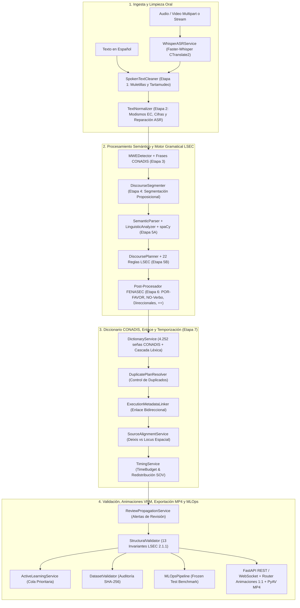
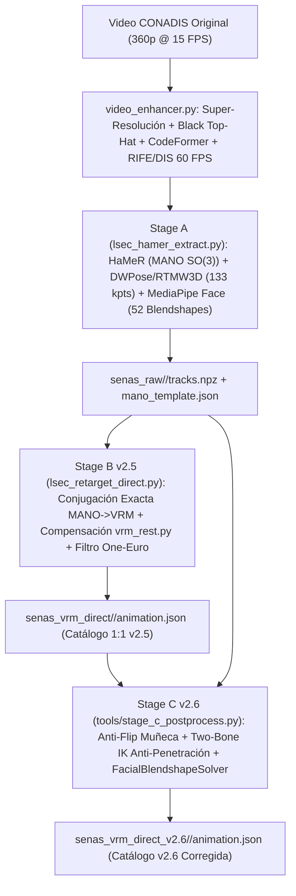
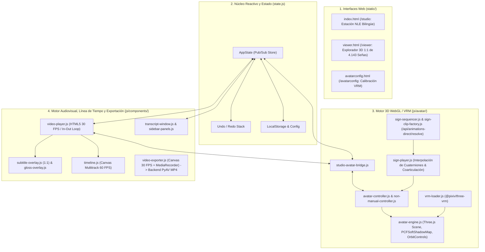

# Arquitectura Integral del Sistema LSEC Translator Prototype 2.7.0
## Documentación Técnica Detallada: Backend, Pipeline Cinemático 3D y Frontend

Este documento presenta el desglose técnico exhaustivo de los tres subsistemas que conforman el ecosistema **LSEC Translator** hasta su última versión (octubre de 2026):
1. **El Backend** (motor lingüístico de 7 etapas, ASR con Faster-Whisper, reglas formales LSEC/FENASEC, Diccionario Oficial CONADIS, servidor de animaciones VRM 1:1, codificador determinista MP4 con PyAV, validación de 13 invariantes y MLOps).
2. **El Pipeline de Visión por Computadora y Cinemática 3D (`Diccionario LSEC` v2.7; compatibilidad v2.6/v2.5)** (mejora de video Ultra HD a 60 FPS, captura multimodal con HaMeR + DWPose + RTMW3D + MediaPipe, retargeting matemático 1:1 MANO→VRM y post-procesamiento biomecánico Stage C con IK analítica de 2 huesos para 4.143 señas).
3. **El Frontend** (estación de trabajo audiovisual *LSEC Studio*, motor 3D WebGL con Three.js + `@pixiv/three-vrm`, reproductor autónomo `/viewer`, línea de tiempo multitrack en Canvas y compositor de video).

---

# PARTE 1: ARQUITECTURA DEL BACKEND

El backend está diseñado bajo una arquitectura modular y desacoplada en **Python 3.10+**, estructurada según los principios de *Clean Architecture* y *Domain-Driven Design (DDD)*. Su función es procesar audio o texto en español, ejecutar el pipeline morfosintáctico y semántico de 7 etapas, proyectar la estructura visoespacial de la Lengua de Señas Ecuatoriana (LSEC), auditar 13 invariantes formales, servir las **4.143 animaciones VRM 1:1** y remuxear exportaciones de video MP4 a 30.0 FPS constantes.

---

## 1.1 Tecnologías y Librerías del Backend

| Tecnología / Librería | Versión | Propósito Arquitectónico |
| :--- | :--- | :--- |
| **Python** | `>=3.10` | Lenguaje base con tipado estricto (`typing`, `from __future__ import annotations`, `dataclasses`). |
| **FastAPI** | `>=0.111.0, <1.0.0` | Framework web ASGI de alto rendimiento para APIs REST y WebSockets con generación automática de OpenAPI 3.1. |
| **Uvicorn (Standard)** | `>=0.30.0, <1.0.0` | Servidor ASGI multiprotocolo con soporte de streaming por rangos HTTP y WebSockets. |
| **Pydantic v2 & Pydantic-Settings** | `>=2.7.0` / `>=2.3.0` | Modelado de esquemas de datos, validación estricta en tiempo de ejecución y parseo declarativo de `.env`. |
| **spaCy** | `>=3.7.0, <4.0.0` | Motor industrial de PLN en español (`es_core_news_md` / `es_core_news_sm` `3.8.0`) para POS-tagging, lematización, dependencias y análisis morfológico (`MorphAnalysis`). |
| **Faster-Whisper (CTranslate2)** | `>=1.0.0, <2.0.0` | Motor de reconocimiento automático del habla (ASR) con cuantización `float16`/`int8` y marcas de tiempo por palabra (`WordTimestamp`). |
| **PyAV (`av` / FFmpeg)** | Incluido con `faster-whisper` | Decodificación de audio y codificación determinista de video MP4 (`libx264` + `aac` a 30.0 FPS constantes) en `/finalize-export-mp4`. |
| **NumPy** | `>=1.26.0, <3.0.0` | Operaciones matriciales para audio, cuaterniones y post-procesamiento cinemático. |
| **SQLite3 (`sqlite3` stdlib)** | Incluido en Python | Persistencia local 100 % offline de logs de traducción y revisiones (`data/lsec_database.sqlite`). |
| **Pytest, Pytest-asyncio & HTTPX** | `>=8.2.0` / `>=0.23.0` / `>=0.27.0` | Suite integral de pruebas automatizadas con **358 tests aprobados (0 fallos)** en el backend/estudio. |

---

## 1.2 Configuración y Ciclo de Vida ([`app/config.py`](file:///c:/Users/brana/Desktop/TIC%20Software/lsec_translator_prototype/app/config.py), [`app/main.py`](file:///c:/Users/brana/Desktop/TIC%20Software/lsec_translator_prototype/app/main.py))

### `app/config.py` — `Settings`
Utiliza `pydantic_settings.BaseSettings` para cargar variables de entorno con validación automática:
- **Whisper ASR:** `whisper_model_size` (`small` / `base`), `whisper_device` (`cuda` / `cpu`), `whisper_compute_type` (`float16` / `int8`), `whisper_model_path` (`data/models/whisper`).
- **Persistencia y Diccionario CONADIS:** `lsec_database_path` (`data/lsec_database.sqlite`), `lsec_dictionary_catalog_path`, `lsec_dictionary_enabled`, `lsec_dictionary_flag_unverified`, `lsec_dictionary_phrase_matching`.
- **Servidor y CORS:** `app_host` (`0.0.0.0`), `app_port` (`8000`), `cors_origins`, `app_debug`. Los orígenes se declaran explícitamente; no se permite `*` con credenciales. Las cargas de audio/video aceptan formatos conocidos y tienen un límite configurable mediante `MAX_UPLOAD_SIZE_MB` (100 MB por defecto).

### `app/main.py` — Punto de Entrada y Lifespan
- **Inyección de DLLs CUDA:** En Windows, detecta dinámicamente los directorios `Lib/site-packages/nvidia/*/bin` del entorno virtual y los añade al `PATH` y a `os.add_dll_directory` para habilitar la aceleración por GPU sin configuraciones manuales del sistema.
- **`lifespan(app: FastAPI)`:** Inicializa `WhisperASRService` (carga lazy), `LSECTranslatorService` y `LocalStorageService` (SQLite), inyectándolos en los routers REST y WebSocket. Las llamadas bloqueantes de Whisper se delegan a workers mediante `asyncio.to_thread` para no bloquear el event loop.
- **Montaje de Estáticos y Routers:**
  - Monta `/static` (`app/static`), `/avatar` (`../Avatar/` con el modelo `.vrm`) y `/media` (videos de prueba en modo debug).
  - Registra `api_router`, `annotation_router`, `dictionary_router`, `animation_router` (`/api/v1/animations`), `animation_direct_alias_router` (`/api/animations-direct`) y `ws_router`.
  - Expone las rutas de interfaz web `/studio`, `/viewer` (alias `/reproductor`) y `/avatarconfig` (alias `/avatar-config`).

---

## 1.3 Contratos y Modelos de Datos ([`app/core/schemas.py`](file:///c:/Users/brana/Desktop/TIC%20Software/lsec_translator_prototype/app/core/schemas.py), [`app/core/dataset_schemas.py`](file:///c:/Users/brana/Desktop/TIC%20Software/lsec_translator_prototype/app/core/dataset_schemas.py))

- **`WordTimestamp`:** Marca de tiempo individual por palabra reconocida por Whisper (`word`, `start`, `end`, `probability`).
- **`SemanticProposition`:** Unidad proposicional (`p1`, `p2`) con predicado nuclear (`SemanticPredicate`), participantes (`SemanticParticipant`), tiempo gramatical, aspecto, modalidad (`DECLARATIVE`, `INTERROGATIVE_YN`, `INTERROGATIVE_WH`, `IMPERATIVE`) y polaridad.
- **`TranslationPlan`:** Estrategia discursiva seleccionada (`TOPIC_COMMENT`, `SOV`, `TEMPORAL_TOPIC`, `CONTRAST`), conceptos fuente (`SourceConceptItem`), conceptos realizados (`RealizedConceptItem`) y tasa de cobertura conceptual (*concept recall*).
- **`GlossItem`:** Representación individual de una seña en la secuencia LSEC:
  - `gloss`: Etiqueta en mayúsculas canónicas (`U-P-E-C`, `PRO1`, `INVITAR`, `NO-SABER`).
  - `gloss_type`: `SEÑA`, `DACTILOLOGÍA`, `CLASIFICADOR`, `EXPRESIÓN`.
  - `dictionary_metadata` (`DictionarySignMetadata`): Estado de verificación en el Diccionario Oficial CONADIS (`VERIFICADO_CONADIS`, `LEXICON_LOCAL`, `DACTILOLOGIA`, `EXENTO_GRAMATICAL`, `PARAFRASIS_REVISION`, `NO_VERIFICADO`), URL de video/ilustración, configuración manual y sugerencias léxicas cercanas.
  - `source_start_seconds` / `source_end_seconds`, `duration_ms`, `pause_before_ms`, `pause_after_ms`.
  - `non_manual` (`FacialExpression`, movimiento cefálico, mirada) y `spatial_ref` (Locus A, B, C, neutro).
- **`MultidimensionalConfidence` & `ValidationMetadata`:** Vector de confianza que pondera ASR, normalización, alineación, segmentación, semántica, cobertura, léxico y reglas sintácticas, clasificando la salida en `READY` (`AUTO_VERIFIED`), `REVIEW_REQUIRED` o `BLOCKED`.
- **`LSECDatasetItem` (`dataset_schemas.py`):** Esquema del corpus con barrera ética contra contaminación: impide que ejemplos `MACHINE_PROPOSED` o `NO_CONSENT` ingresen a particiones `TRAIN`, `TEST` o `FROZEN_TEST`.

---

## 1.4 Servicios del Pipeline Lingüístico de 7 Etapas (`app/services/`)

1. **`SpokenTextCleaner` ([`spoken_text_cleaner.py`](file:///c:/Users/brana/Desktop/TIC%20Software/lsec_translator_prototype/app/services/spoken_text_cleaner.py)) — Etapa 1:** Limpia muletillas fonéticas (`eh, em, mm, digamos`), reformuladores (`o sea`), demostrativos de vacilación y tartamudeos de 1 a 3 palabras.
2. **`TextNormalizer` & `PunctuationAnalyzer` ([`text_normalizer.py`](file:///c:/Users/brana/Desktop/TIC%20Software/lsec_translator_prototype/app/services/text_normalizer.py)) — Etapa 2:** Convierte el imperativo andino (`dame/deme + gerundio` → `por favor + infinitivo`), traduce quichuismos y modismos ecuatorianos (`ñaño`, `guagua`, `achachay`, `arrarray`, `pana`), repara errores fonéticos del ASR (`Tulkán → Tulcán`, `Callambe → Cayambe`), expande siglas (`UPEC → U-P-E-C`) y normaliza números y teléfonos.
3. **`MWEDetector` ([`mwe_detector.py`](file:///c:/Users/brana/Desktop/TIC%20Software/lsec_translator_prototype/app/services/mwe_detector.py)) — Etapa 3:** Detecta locuciones multipalabra con bloqueo de análisis componencial (`prevent_component_parsing=True`, p. ej. `"seres humanos" → PERSONA`) y coordina el emparejamiento de frases de 2 a 4 palabras del catálogo CONADIS.
4. **`DiscourseSegmenter` ([`discourse_segmenter.py`](file:///c:/Users/brana/Desktop/TIC%20Software/lsec_translator_prototype/app/services/discourse_segmenter.py)) — Etapa 4:** Divide oraciones complejas en proposiciones atómicas mediante puntuación, pares correlativos (`no solo... sino`), conectores adversativos (`pero, sin embargo`), interrogativas indirectas y cambios de marco temporal.
5. **`SemanticParser`, `EnhancedLinguisticAnalyzer`, `DiscoursePlanner` y `RuleEngine` — Etapa 5:**
   - [`semantic_parser.py`](file:///c:/Users/brana/Desktop/TIC%20Software/lsec_translator_prototype/app/services/semantic_parser.py) identifica el predicado verbal y roles temáticos (`AGENT`, `PATIENT`, `THEME`, `BENEFICIARY`, `LOCATION`), descartando falsos verbos cuando un sustantivo homógrafo (`dibujo`, `taller`, `arte`, `música`) tiene modificadores nominales en el árbol de `spaCy`.
   - [`linguistic_analyzer.py`](file:///c:/Users/brana/Desktop/TIC%20Software/lsec_translator_prototype/app/services/linguistic_analyzer.py) ejecuta 6 algoritmos sobre `spaCy`: resolución tipificada de *pro-drop* (`PRO1`, `PRO2`, `PRO1-PL`), alcance sintáctico de la negación, extracción separada de tiempo (`ANTES`/`FUTURO`) y aspecto (`AHORA`/`YA`), transferencia funcional de determinantes/preposiciones (`DESDE`, `CON`, `PROPÓSITO`, `HACIA` vs. omisión `Ø`), detección de pluralidad nominal (`VARIOS`) y modalidad interrogativa.
   - [`discourse_planner.py`](file:///c:/Users/brana/Desktop/TIC%20Software/lsec_translator_prototype/app/services/discourse_planner.py) y [`app/lsec_grammar/registry.py`](file:///c:/Users/brana/Desktop/TIC%20Software/lsec_translator_prototype/app/lsec_grammar/registry.py) aplican las **22 reglas gramaticales formales** para proyectar la plantilla `[POR-FAVOR] + [TIEMPO] + [TÓPICO] + [SUJETO] + [OBJETO/LOC] + [MODAL] + [VERBO] + [ASPECTO] + [NEG/WH]`.
6. **`FenasecRules` ([`fenasec_rules.py`](file:///c:/Users/brana/Desktop/TIC%20Software/lsec_translator_prototype/app/services/fenasec_rules.py)) — Etapa 6:** Aplica las 4 reglas oficiales post-planificación de la FENASEC: cortesía inicial (`POR-FAVOR`), negación incorporada (`NO-SABER`, `NO-QUERER`, `NO-PODER`, `NO-GUSTAR`, `NO-HABER`), verbos direccionales (`AVISAR[1->2]`) e intensidad por duplicación (`LLOVER++`).
7. **`DictionaryService`, `DuplicatePlanResolver`, `ExecutionMetadataLinker`, `SourceAlignmentService`, `TimingService`, `ReviewPropagationService` y `StructuralValidator` — Etapa 7:** Validan cada glosa contra las **4.252 señas del Diccionario Oficial CONADIS**, redistribuyen proporcionalmente las marcas de tiempo al orden SOV y auditan las **13 Invariantes LSEC 2.1.1**.

---

# PARTE 2: PIPELINE DE VISIÓN 3D Y CINEMÁTICA VRM (`Diccionario LSEC` v2.7; compatibilidad v2.6/v2.5)

El subsistema ubicado en [`Diccionario LSEC/`](file:///c:/Users/brana/Desktop/TIC%20Software/Diccionario%20LSEC/) convierte los videos del Diccionario Oficial CONADIS en el catálogo de **4.143 animaciones 3D VRM 1:1** consumidas por el backend y el visor WebGL.

## 2.1 Módulos Clave del Pipeline 3D

1. **`video_enhancer.py` ([`Diccionario LSEC/video_enhancer.py`](file:///c:/Users/brana/Desktop/TIC%20Software/Diccionario%20LSEC/video_enhancer.py)):**
   - Implementa una estrategia de 4 niveles (`PYTORCH_CUDA` → `NCNN_VULKAN` → `PYTORCH_CPU` → `ALGORITHMIC`) protegida por [`gpu_guard.py`](file:///c:/Users/brana/Desktop/TIC%20Software/Diccionario%20LSEC/gpu_guard.py).
   - Aplica super-resolución (`Real-ESRGAN` / `Lanczos-4`) con morfología **Black Top-Hat** para profundizar el contraste en los valles interdigitales, restauración facial (`CodeFormer` / ROI $512\times512$ con suavizado EMA) e interpolación temporal de 15 a 60 FPS (`RIFE` / flujo óptico `OpenCV DIS`).
2. **Stage A — `lsec_hamer_extract.py` ([`Diccionario LSEC/lsec_hamer_extract.py`](file:///c:/Users/brana/Desktop/TIC%20Software/Diccionario%20LSEC/lsec_hamer_extract.py)):**
   - Ejecuta **HaMeR** (*Hand Mesh Recovery* en PyTorch) para extraer matrices de rotación 3D exactas en $\text{SO}(3)$ de la muñeca y las 15 articulaciones de los dedos del modelo paramétrico **MANO (`smplx`)**.
   - Ejecuta **DWPose** y **RTMW3D** (`rtmlib` + `onnxruntime-gpu`) para extraer 133 puntos clave 2D/3D (COCO-WholeBody) con seguimiento temporal de identidad del intérprete.
   - Ejecuta **MediaPipe Face Landmarker** para obtener los 52 coeficientes **ARKit Blendshapes** y la pose cefálica, guardando todo de forma atómica en `tracks.npz`.
3. **Stage B (v2.5) — `lsec_retarget_direct.py` ([`Diccionario LSEC/lsec_retarget_direct.py`](file:///c:/Users/brana/Desktop/TIC%20Software/Diccionario%20LSEC/lsec_retarget_direct.py)) y `vrm_rest.py` ([`Diccionario LSEC/vrm_rest.py`](file:///c:/Users/brana/Desktop/TIC%20Software/Diccionario%20LSEC/vrm_rest.py)):**
   - Transfiere 1:1 cada articulación MANO a su hueso correspondiente en el estándar **VRM 1.0 Humanoid** mediante un cambio de base ortogonal constante ($D_{\text{mano}} = P \cdot R_{\text{global}}' \cdot C^\top$, $L_{\text{dedo}} = C \cdot R_{\text{articulación}}' \cdot C^\top$) calculado desde `mano_template.json` y compensado con la postura de reposo real de `LSEC-Interpreter-Female.vrm`.
   - Proyecta los vectores 3D de brazos (`upperArm`, `lowerArm`) y aplica un filtro **One-Euro** suave ($f_c=1.0\text{ Hz}, \beta=0.005$) con interpolación esférica **SLERP**.
4. **Stage C (v2.6 Corregida) — `tools/stage_c_postprocess.py` ([`Diccionario LSEC/tools/stage_c_postprocess.py`](file:///c:/Users/brana/Desktop/TIC%20Software/Diccionario%20LSEC/tools/stage_c_postprocess.py)):**
   - **Prioridad 1 (`repair_wrist_bursts`):** Elimina saltos angulares bruscos de muñeca ($\ge 55^\circ$, como giros espurios de $180^\circ$ en HaMeR).
   - **Prioridad 2 (Resolución de Penetraciones con IK de 2 Huesos):** Evalúa la cinemática directa (`AvatarFKExtractor`) frente a los volúmenes de colisión del tórax, cráneo y ambas manos (`body_proxy.py`). Si detecta penetración más allá de la tolerancia de contacto legítimo ($\sim 1\text{ cm}$), desplaza suavemente el objetivo de la muñeca hacia el exterior y recalcula hombro y codo mediante **`two_bone_ik`** (`kinematics_solver.py`) respetando el presupuesto de fidelidad ($\le 8^\circ$ promedio óseo, $\le 2\text{ cm}$ promedio muñeca).
   - **Prioridad 3 (`FacialBlendshapeSolver`):** Recupera las expresiones faciales ARKit/VRM y las rotaciones de cabeza/cuello desde `tracks.npz`, generando el catálogo final en `senas_vrm_direct_v2.6/`.

---

# PARTE 3: ARQUITECTURA DEL FRONTEND

El frontend comprende la estación de trabajo **LSEC Studio 2.1.1** (`/studio`), el **Reproductor 3D Autónomo** (`/viewer`) y el **Calibrador de Avatar** (`/avatarconfig`), desarrollados con estándares web nativos (**Vanilla HTML5, CSS3, ES6+ Modules, HTML5 Canvas 2D y WebGL / Three.js / `@pixiv/three-vrm`**).

---

## 3.1 Módulos del Motor 3D del Avatar (`app/static/js/avatar/`)

1. **`avatar-engine.js` ([`js/avatar/avatar-engine.js`](file:///c:/Users/brana/Desktop/TIC%20Software/lsec_translator_prototype/app/static/js/avatar/avatar-engine.js)):** Inicializa la escena de `Three.js`, el `WebGLRenderer` con `preserveDrawingBuffer: true`, `THREE.SRGBColorSpace` y sombras suaves `THREE.PCFSoftShadowMap`, un esquema de iluminación de 4 luces (ambiental, clave frontal con sombras, relleno y contraluz de silueta), controles de cámara `OrbitControls` con límites polares y manejo automático de pérdida de contexto WebGL.
2. **`vrm-loader.js` ([`js/avatar/vrm-loader.js`](file:///c:/Users/brana/Desktop/TIC%20Software/lsec_translator_prototype/app/static/js/avatar/vrm-loader.js)):** Utiliza `GLTFLoader` y `VRMLoaderPlugin` de `@pixiv/three-vrm` para cargar el modelo `LSEC-Interpreter-Female.vrm` desde `/avatar/`, mapear sus 54 huesos humanoides y habilitar la proyección de sombras en manos y dedos.
3. **`sign-sequencer.js`, `sign-clip-factory.js`, `sign-player.js` y `animation-cache.js`:** Consultan `/api/animations-direct/resolve` para mapear cada glosa LSEC a su archivo `animation.json` (`v2.6`/`v2.5`), almacenan los clips en caché LRU, construyen las curvas de animación con transiciones suaves (*blend-in* / *blend-out*) entre señas consecutivas y reproducen los cuaterniones y blendshapes a 60 FPS (o en modo determinista cuadro a cuadro durante la exportación).
4. **`avatar-controller.js`, `non-manual-controller.js`, `spatial-locus-controller.js` y `studio-avatar-bridge.js`:** Sincronizan el estado de reproducción de *LSEC Studio* (`AppState`) con el intérprete 3D, aplicando los rasgos no manuales (`pregunta_sn`, `pregunta_qu`, `negación`) y la orientación espacial hacia los loci asignados.

---

## 3.2 Componentes de la Estación Audiovisual (`app/static/js/components/`)

- **`state.js` y `app.js`:** Almacén reactivo Pub/Sub con pila `Undo/Redo`, autoguardado en `localStorage` y coordinador global de atajos de teclado (`Espacio`, `J/K/L`, `C`, `G`, `I/O`, `1/2/3`, `Ctrl+Z`, `Ctrl+Y`).
- **`pipeline-processor.js`:** Cliente REST y WebSocket que conecta la interfaz con `/api/v1/transcribe`, `/api/v1/translate`, `/api/v1/pipeline` y `/ws/pipeline`.
- **`video-player.js`, `subtitle-overlay.js` y `gloss-overlay.js`:** Reproductor HTML5 con navegación por fotograma (1/30 s), subtítulos fieles 1:1 sin efectos distractores y superposición de glosas con insignias de rasgos no manuales.
- **`timeline.js`, `transcript-window.js` y `sidebar-panels.js`:** Línea de tiempo multipista en Canvas a 60 FPS, editor bilingüe de segmentos con filtros de revisión e inspector morfosintáctico y léxico (con ficha CONADIS integrada).
- **`video-exporter.js` y `modals-and-export.js`:** Compositor de video determinista a 30.0 FPS (que une el video fuente, el avatar 3D VRM en PiP, las glosas LSEC y los subtítulos quemados en un `<canvas>` y lo remuxea a **MP4 `H.264 + AAC`** mediante `/api/v1/animations/finalize-export-mp4`), además de exportadores a `.srt`, `.vtt`, `.eaf` (ELAN), `.csv` y `.json`.

---

# PARTE 4: MATRIZ DE INTEGRACIÓN Y COMUNICACIÓN

| Flujo de Datos | Origen | Destino | Formato / Protocolo | Responsabilidad |
| :--- | :--- | :--- | :--- | :--- |
| **Ingesta de Audio / Video** | Frontend (`video-player` / archivo) | Backend (`/api/v1/transcribe`, `/api/v1/pipeline`) | `multipart/form-data` | Conversión de voz a texto con timestamps por palabra vía `Faster-Whisper`. |
| **Traducción Español → LSEC** | Frontend (`pipeline-processor`) | Backend (`/api/v1/translate`) | JSON (`HTTP POST`) | Ejecución del pipeline de 7 etapas (`spaCy` + 22 reglas LSEC + FENASEC + CONADIS + 13 invariantes). |
| **Resolución y Carga de Animaciones 3D 1:1** | Frontend (`sign-sequencer.js`, `/viewer`) | Backend (`/api/v1/animations/*`, `/api/animations-direct/*`) | JSON / MP4 Stream (`HTTP GET/POST`) | Entrega de los 4.143 clips `animation.json` (`v2.6`/`v2.5`), videos Ultra HD, ilustraciones e informes QA. |
| **Streaming en Tiempo Real** | Frontend (Micrófono) | Backend (`/ws/pipeline`) | WebSocket (JSON / Binario) | Transcripción incremental y emisión de `gloss_result` + `avatar_payload`. |
| **Exportación Determinista de Video MP4** | Frontend (`video-exporter.js`) | Backend (`/api/v1/animations/finalize-export-mp4`) | `multipart/form-data` → `video/mp4` | Remuxeado y codificación con `PyAV` (`libx264` + `aac`) a 30.0 FPS constantes con audio original sincronizado. |
| **Auditoría de Anotaciones y MLOps** | Frontend (`sidebar-panels`) | Backend (`/api/v1/annotations/*`, `/api/v1/mlops/benchmark`) | JSON (`HTTP POST/GET`) | Registro inmutable *append-only* de validaciones sordas, cola de aprendizaje activo y control antifugas SHA-256. |
