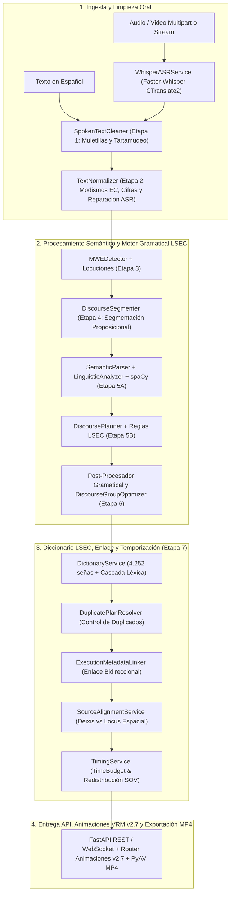
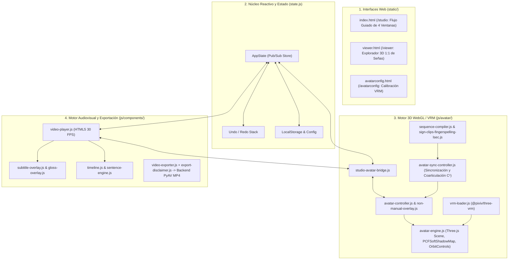

# Arquitectura Integral del Prototipo LSEC Studio (`v1.0-prototipo-academico`)
## Documentación Técnica Detallada: Backend, Pipeline Cinemático 3D y Frontend

> **Aviso de Alcance Académico:** Este documento describe la arquitectura técnica del prototipo universitario sin fines de lucro **LSEC Studio (`v1.0-prototipo-academico`)**. El software constituye una primera aproximación computacional de apoyo a la accesibilidad y **no sustituye la labor de un intérprete humano profesional de Lengua de Señas Ecuatoriana (LSEC)**.

Este documento presenta el desglose técnico de los tres subsistemas que conforman el prototipo:
1. **El Backend** (motor lingüístico de 7 etapas, optimizador de grupos oracionales, ASR con `Faster-Whisper`, reglas gramaticales LSEC, servicio de diccionario de referencia, servidor de animaciones VRM v2.7 y codificador determinista MP4 con `PyAV`).
2. **El Pipeline de Visión por Computadora y Cinemática 3D (`Diccionario LSEC` v2.7; compatibilidad v2.6/v2.5)** (captura multimodal con `HaMeR + DWPose + RTMW3D + MediaPipe`, retargeting matemático 1:1 `MANO→VRM`, unificación de lateralidad diestra y despeje biomecánico con IK analítica de 2 huesos).
3. **El Frontend** (estación de trabajo audiovisual *LSEC Studio* de 4 ventanas, motor 3D WebGL con `Three.js + @pixiv/three-vrm`, compilador de coarticulación $\mathcal{C}^1$, reproductor autónomo `/viewer`, calibrador `/avatarconfig` y compositor de video con aviso permanente de prototipo).

---

# PARTE 1: ARQUITECTURA DEL BACKEND

El backend está diseñado bajo una arquitectura modular y desacoplada en **Python 3.10+** (`<= 800` líneas por archivo según principios de mantenibilidad ISO/IEC 25010). Su función es procesar audio o texto en español, ejecutar el pipeline morfosintáctico y semántico de 7 etapas, proyectar la estructura visoespacial de la LSEC, servir el catálogo de animaciones VRM v2.7 y codificar exportaciones de video MP4 a 30.0 FPS constantes.

---

## 1.1 Tecnologías y Librerías del Backend

| Tecnología / Librería | Versión | Propósito Arquitectónico |
| :--- | :--- | :--- |
| **Python** | `>=3.10` | Lenguaje base con tipado estricto (`typing`, `from __future__ import annotations`, `dataclasses`). |
| **FastAPI** | `>=0.111.0, <1.0.0` | Framework web ASGI de alto rendimiento para APIs REST y WebSockets con generación automática de OpenAPI 3.1. |
| **Uvicorn (Standard)** | `>=0.30.0, <1.0.0` | Servidor ASGI multiprotocolo con soporte de streaming por rangos HTTP y WebSockets. |
| **Pydantic v2 & Pydantic-Settings** | `>=2.7.0` / `>=2.3.0` | Modelado de esquemas de datos, validación estricta en tiempo de ejecución y parseo declarativo de `.env`. |
| **spaCy** | `>=3.7.0, <4.0.0` | Motor de PLN en español (`es_core_news_md` / `es_core_news_sm` `3.8.0`) para POS-tagging, lematización, dependencias y análisis morfológico (`MorphAnalysis`). |
| **Faster-Whisper (CTranslate2)** | `>=1.0.0, <2.0.0` | Motor de reconocimiento automático del habla (ASR) con cuantización `float16`/`int8` y marcas de tiempo por palabra (`WordTimestamp`). |
| **PyAV (`av` / FFmpeg)** | Incluido con `faster-whisper` | Decodificación de audio y codificación determinista de video MP4 (`libx264` + `aac` a 30.0 FPS constantes) en `/finalize-export-mp4`. |
| **NumPy** | `>=1.26.0, <3.0.0` | Operaciones matriciales para audio, cuaterniones y post-procesamiento cinemático. |
| **SQLite3 (`sqlite3` stdlib)** | Incluido en Python | Persistencia local 100 % offline de bitácoras de traducción (`data/lsec_database.sqlite`). |
| **Pytest, Pytest-asyncio, Node.js & Playwright** | `>=8.2.0` / `>=0.23.0` / `>=1.40.0` | Suites automatizadas de pruebas unitarias, integración, cinemáticas en Node.js y E2E en navegador. |

---

## 1.2 Configuración y Ciclo de Vida ([`app/config.py`](../app/config.py), [`app/main.py`](../app/main.py))

### `app/config.py` — `Settings`
Utiliza `pydantic_settings.BaseSettings` para cargar variables de entorno con validación automática:
- **Whisper ASR:** `whisper_model_size` (`small` / `base`), `whisper_device` (`cuda` / `cpu`), `whisper_compute_type` (`float16` / `int8`), `whisper_model_path` (`data/models/whisper`).
- **Persistencia y Diccionario LSEC:** `lsec_database_path` (`data/lsec_database.sqlite`), `lsec_dictionary_catalog_path`, `lsec_dictionary_enabled`, `lsec_dictionary_flag_unverified`, `lsec_dictionary_phrase_matching`.
- **Catálogo VRM:** `GET /api/v1/animations/catalog` expone el contrato de versiones v2.7/v2.6/v2.5, disponibilidad de assets, conteos y orden de fallback.
- **Servidor y CORS:** `app_host` (`0.0.0.0`), `app_port` (`8000`), `cors_origins`, `app_debug`. Las cargas de audio/video aceptan formatos conocidos y tienen un límite configurable mediante `MAX_UPLOAD_SIZE_MB` (100 MB por defecto).

### `app/main.py` — Punto de Entrada y Lifespan
- **Inyección de DLLs CUDA:** En Windows, detecta dinámicamente los directorios `Lib/site-packages/nvidia/*/bin` del entorno virtual y los añade al `PATH` y a `os.add_dll_directory`.
- **`lifespan(app: FastAPI)`:** Inicializa `WhisperASRService` (carga lazy), `LSECTranslatorService` y `LocalStorageService` (SQLite), inyectándolos en los routers REST y WebSocket.
- **Montaje de Estáticos y Routers:**
  - Monta `/static` (`app/static`), `/avatar` (`../Avatar/` con el modelo `.vrm`) y `/media` (videos de prueba).
  - Registra `api_router`, `dictionary_router`, `animation_router` (`/api/v1/animations`), `animation_direct_alias_router` (`/api/animations-direct`) y `ws_router`.
  - Expone las rutas de interfaz web `/studio`, `/viewer` (alias `/reproductor`) y `/avatarconfig` (alias `/avatar-config`).

---

## 1.3 Contratos y Modelos de Datos ([`app/core/schemas.py`](../app/core/schemas.py))

- **`WordTimestamp`:** Marca de tiempo individual por palabra reconocida por Whisper (`word`, `start`, `end`, `probability`).
- **`SemanticProposition`:** Unidad proposicional (`p1`, `p2`) con predicado nuclear (`SemanticPredicate`), participantes (`SemanticParticipant`), tiempo gramatical, aspecto, modalidad (`DECLARATIVE`, `INTERROGATIVE_YN`, `INTERROGATIVE_WH`, `IMPERATIVE`) y polaridad.
- **`TranslationPlan`:** Estrategia discursiva seleccionada (`TOPIC_COMMENT`, `SOV`, `TEMPORAL_TOPIC`, `CONTRAST`), conceptos fuente (`SourceConceptItem`), conceptos realizados (`RealizedConceptItem`) y tasa de cobertura conceptual.
- **`GlossItem`:** Representación individual de una seña en la secuencia LSEC:
  - `gloss`: Etiqueta en mayúsculas canónicas (`U-P-E-C`, `PRO1`, `INVITAR`, `NO-SABER`).
  - `gloss_type`: `SEÑA`, `DACTILOLOGÍA`, `CLASIFICADOR`, `EXPRESIÓN`.
  - `dictionary_metadata` (`DictionarySignMetadata`): Estado de resolución en el catálogo de referencia (`EN_DICCIONARIO`, `LEXICON_LOCAL`, `DACTILOLOGIA`, `EXENTO_GRAMATICAL`, `PARAFRASIS_REVISION`, `FUERA_DE_DICCIONARIO`), configuración manual y sugerencias léxicas cercanas.
  - `source_start_seconds` / `source_end_seconds`, `duration_ms`, `pause_before_ms`, `pause_after_ms`.
  - `non_manual` (`FacialExpression`, movimiento cefálico, mirada) y `spatial_ref` (Locus A, B, C, neutro).

---

## 1.4 Servicios del Pipeline Lingüístico de 7 Etapas (`app/services/`)

1. **`SpokenTextCleaner` ([`spoken_text_cleaner.py`](../app/services/spoken_text_cleaner.py)) — Etapa 1:** Limpia muletillas fonéticas (`eh, em, mm, digamos`), reformuladores (`o sea`), demostrativos de vacilación y tartamudeos de 1 a 3 palabras.
2. **`TextNormalizer` & `PunctuationAnalyzer` ([`text_normalizer.py`](../app/services/text_normalizer.py)) — Etapa 2:** Convierte el imperativo andino (`dame/deme + gerundio` → `por favor + infinitivo`), traduce quichuismos y modismos ecuatorianos (`ñaño`, `guagua`, `achachay`, `arrarray`, `pana`), repara errores fonéticos del ASR, expande siglas (`UPEC → U-P-E-C`) y normaliza números y teléfonos.
3. **`MWEDetector` ([`mwe_detector.py`](../app/services/mwe_detector.py)) — Etapa 3:** Detecta locuciones multipalabra con bloqueo de análisis componencial (`prevent_component_parsing=True`) y coordina el emparejamiento de frases de 2 a 4 palabras del catálogo lexicográfico.
4. **`DiscourseSegmenter` ([`discourse_segmenter.py`](../app/services/discourse_segmenter.py)) — Etapa 4:** Divide oraciones complejas en proposiciones atómicas mediante puntuación, pares correlativos, conectores adversativos y cambios de marco temporal.
5. **`SemanticParser`, `EnhancedLinguisticAnalyzer`, `DiscoursePlanner` y `RuleEngine` — Etapa 5 (Arquitectura Modular `<= 800` líneas):**
   - **Analizador Semántico ([`semantic_parser.py`](../app/services/semantic_parser.py)):** Orquesta [`semantic_constants.py`](../app/services/semantic_constants.py), [`semantic_verb_morphology.py`](../app/services/semantic_verb_morphology.py), [`semantic_role_extractor.py`](../app/services/semantic_role_extractor.py) y [`semantic_domain_templates.py`](../app/services/semantic_domain_templates.py).
   - **Analizador Lingüístico ([`linguistic_analyzer.py`](../app/services/linguistic_analyzer.py)):** Ejecuta sobre `spaCy` la resolución tipificada de *pro-drop* (`PRO1`, `PRO2`, `PRO1-PL`), alcance sintáctico de la negación, extracción separada de tiempo (`ANTES`/`FUTURO`) y aspecto (`AHORA`/`YA`), transferencia funcional de preposiciones y modalidad interrogativa.
   - **Planificador Discursivo ([`discourse_planner.py`](../app/services/discourse_planner.py)) y [`app/lsec_grammar/registry.py`](../app/lsec_grammar/registry.py):** Orquesta [`discourse_lexicon.py`](../app/services/discourse_lexicon.py), [`discourse_morphosyntax.py`](../app/services/discourse_morphosyntax.py), [`discourse_spacy_reorder.py`](../app/services/discourse_spacy_reorder.py), [`discourse_gloss_emitter.py`](../app/services/discourse_gloss_emitter.py) y [`discourse_plan_builder.py`](../app/services/discourse_plan_builder.py) para proyectar la plantilla `[POR-FAVOR] + [TIEMPO] + [TÓPICO] + [SUJETO] + [OBJETO/LOC] + [MODAL] + [VERBO] + [ASPECTO] + [NEG/WH]`.
6. **`FenasecRules` ([`fenasec_rules.py`](../app/services/fenasec_rules.py)) y `DiscourseGroupOptimizer` ([`discourse_group_optimizer.py`](../app/services/discourse_group_optimizer.py)) — Etapa 6:** Aplica cortesía inicial (`POR-FAVOR`), negación incorporada (`NO-SABER`, `NO-QUERER`, `NO-PODER`, `NO-GUSTAR`, `NO-HABER`), verbos direccionales (`AVISAR[1->2]`), intensidad por duplicación (`LLOVER++`) y consolidación de grupos oracionales.
7. **`DictionaryService`, `DuplicatePlanResolver`, `ExecutionMetadataLinker`, `SourceAlignmentService` y `TimingService` — Etapa 7:** Validan cada glosa contra las **4.252 señas del lexicón LSEC** y redistribuyen proporcionalmente las marcas de tiempo al orden SOV.

---

## 1.5 Servicios Modulares de Animación 3D y Exportación Multimedia (`app/api/` y `app/services/`)

1. **`animation_direct_endpoints.py` ([`app/api/animation_direct_endpoints.py`](../app/api/animation_direct_endpoints.py)):** Controlador HTTP delgado para `animation_router` (`/api/v1/animations`) y `animation_direct_alias_router` (`/api/animations-direct`).
2. **`animation_catalog_service.py` ([`app/services/animation_catalog_service.py`](../app/services/animation_catalog_service.py)):** Resolución de rutas de catálogos (`v2.7` estandarizada preferida, con fallback a `v2.6` y `v2.5`), caché en memoria normalizada en NFC y post-procesamiento cinemático en vivo.
3. **`animation_lexical_resolver.py` ([`app/services/animation_lexical_resolver.py`](../app/services/animation_lexical_resolver.py)) y `lexical_homonym_rules.py` ([`app/services/lexical_homonym_rules.py`](../app/services/lexical_homonym_rules.py)):** Construcción del índice léxico unificado, desambiguación contextual de homónimos, mapa de alias LSEC y resolución de glosas (`resolve_gloss_to_sign`).
4. **`animation_media_service.py` ([`app/services/animation_media_service.py`](../app/services/animation_media_service.py)) y `video_export_service.py` ([`app/services/video_export_service.py`](../app/services/video_export_service.py)):** Streaming HTTP Range de videos de referencia y codificación determinista MP4 (`H.264 + AAC` a **30.0 FPS**) mediante `PyAV`.

---

# PARTE 2: PIPELINE DE VISIÓN 3D Y CINEMÁTICA VRM (`Diccionario LSEC` v2.7)

El catálogo externo ubicado en `../Diccionario LSEC/senas_vrm_standardized_v2.7` proporciona las animaciones 3D VRM consumidas por el backend y el visor WebGL:
1. **Extracción Multimodal (Stage A):** Reconstrucción 3D de manos en $\text{SO}(3)$ mediante **HaMeR (`MANO`)**, puntos clave corporales 2D/3D con **DWPose / RTMW3D** y 52 **ARKit Blendshapes** faciales con **MediaPipe Face Landmarker**.
2. **Retargeting 1:1 MANO→VRM (Stage B):** Cambio de base ortogonal constante hacia los 54 huesos del estándar **VRM 1.0 Humanoid**, compensado con la postura de reposo de `LSEC-Interpreter-Female.vrm` y suavizado mediante filtro **One-Euro** y **SLERP**.
3. **Estandarización Biomecánica v2.7 (Stage C):** Reparación de giros espurios de muñeca, unificación de lateralidad diestra (`dominantHand: 'right'`) para señas unimanuales y resolución analítica anti-penetración con **IK de 2 huesos** (`upperArm`, `lowerArm`).

---

# PARTE 3: ARQUITECTURA DEL FRONTEND

El frontend comprende la estación de trabajo **LSEC Studio** (`/studio`), el **Reproductor 3D Autónomo** (`/viewer`) y el **Calibrador de Avatar** (`/avatarconfig`), desarrollados con estándares web nativos (**Vanilla HTML5, CSS3, ES6+ Modules, HTML5 Canvas 2D y WebGL / Three.js / `@pixiv/three-vrm`**).

---

## 3.1 Módulos Principales del Frontend (`app/static/js/` — SRP `<= 800` líneas)

- **Motor 3D del Avatar (`app/static/js/avatar/`):**
  - [`avatar-engine.js`](../app/static/js/avatar/avatar-engine.js) y [`vrm-loader.js`](../app/static/js/avatar/vrm-loader.js): Escena `Three.js`, sombras `PCFSoftShadowMap` y carga del modelo `LSEC-Interpreter-Female.vrm` (54 huesos).
  - [`sequence-compiler.js`](../app/static/js/avatar/sequence-compiler.js), [`sequence-coarticulation-math.js`](../app/static/js/avatar/sequence-coarticulation-math.js) y [`sequence-run-scheduler.js`](../app/static/js/avatar/sequence-run-scheduler.js): Compilación determinista de secuencias a ritmo `1.0x`, cola congelada (*frozen-tail*), interpolación SLERP con suavizado $\mathcal{C}^1$ y planificación de pistas.
  - [`sign-clips-fingerspelling-lsec.js`](../app/static/js/avatar/sign-clips-fingerspelling-lsec.js) y [`sign-clips-fingerspelling-primitives.js`](../app/static/js/avatar/sign-clips-fingerspelling-primitives.js): Alfabeto dactilológico oficial LSEC (30 grafemas, incluyendo `Ñ`, `CH`, `LL`, `RR`).
  - [`avatar-sync-controller.js`](../app/static/js/avatar/avatar-sync-controller.js) y [`studio-avatar-bridge.js`](../app/static/js/avatar/studio-avatar-bridge.js): Sincronización cuadro a cuadro con el reproductor de video y la línea de tiempo.
- **Almacén de Estado Reactivo (`app/static/js/state.js` y `js/state/`):**
  - [`state-project-hydration.js`](../app/static/js/state/state-project-hydration.js), [`state-gloss-mutations.js`](../app/static/js/state/state-gloss-mutations.js) y [`state-persistence-styles.js`](../app/static/js/state/state-persistence-styles.js).
- **Componentes de Interfaz y Exportación (`app/static/js/components/`):**
  - [`pipeline-processor.js`](../app/static/js/components/pipeline-processor.js), [`transcript-window.js`](../app/static/js/components/transcript-window.js), [`sentence-engine.js`](../app/static/js/components/sentence-engine.js), [`linguistic-comparison-view.js`](../app/static/js/components/linguistic-comparison-view.js), [`video-exporter.js`](../app/static/js/components/video-exporter.js) y [`export-disclaimer.js`](../app/static/js/components/export-disclaimer.js).
